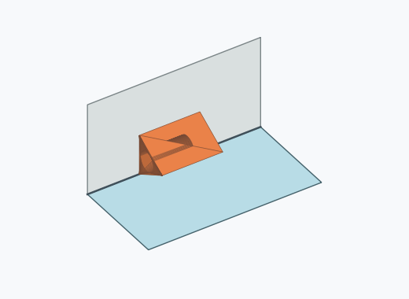
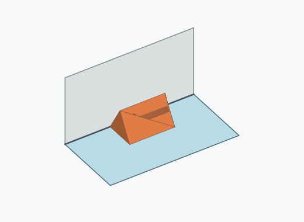
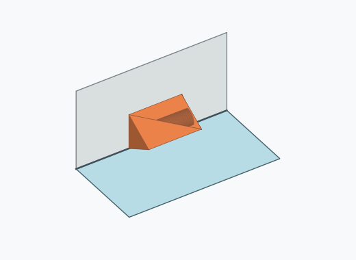
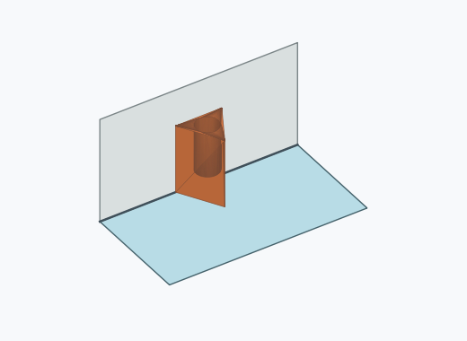
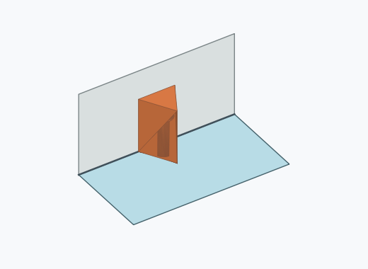
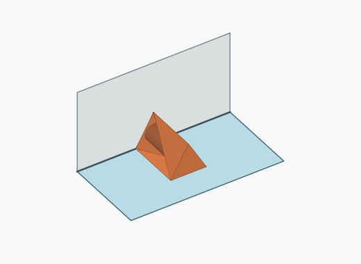
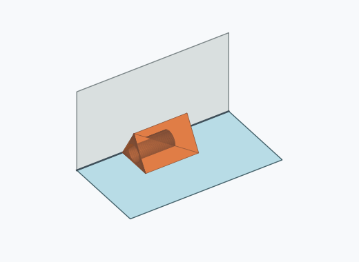
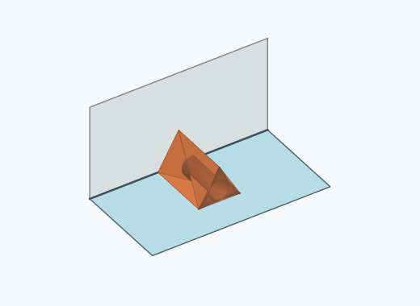

# Dk1i

[Workpiece index](../README.md#workpieces)

## Catalogue rebuilt from 10,000 drops

Rebuilt on 16 November 2026 from the completed [20261107_10000 moving-belt study](simulations/20261107_10000/100mm_s/README.md). No new simulation trials were run. The archived reference settings are used (belt/wall friction 0.10/0.05 and first-second weight impulses); the older 1,000-trial catalogue used an earlier protocol.

Pose classes retain the recorded symmetry, 5° tolerance and 1° ambiguity margin. Historical IDs are reused only for unique unambiguous anchor matches; all historical registry anchors remain reserved. Groups use the unchanged published simulator rules, ordered by combined incidence. Rare groups remain visible. Review rows remain separate. No disturbance stability representatives were inferred.

[JSON](poses.json) · [YAML](poses.yaml) · [Memberships](group_memberships.csv) · [Trials](trials.csv) · [Configuration](config.json) · [Validation](validation.json)

## Moving-belt transport poses

9,950 settled observations from 10,000 drops. Incidence uses all drops.

| Pose | Saved ID | Group | Image | Count | Incidence | 95% interval |
| --- | --- | --- | --- | ---: | ---: | ---: |
| 0 | Dk1i_0003 | Group 0 |  | 1700 | 17.00% | 16.28–17.75% |
| 1 | Dk1i_0005 | Group 0 |  | 1634 | 16.34% | 15.63–17.08% |
| 2 | Dk1i_0002 | Group 1 |  | 1630 | 16.30% | 15.59–17.04% |
| 3 | Dk1i_0004 | Group 1 |  | 1607 | 16.07% | 15.36–16.80% |
| 4 | Dk1i_0007 | Group 2 |  | 1174 | 11.74% | 11.12–12.39% |
| 5 | Dk1i_0006 | Group 3 |  | 1089 | 10.89% | 10.29–11.52% |
| 6 | Dk1i_0001 | Group 4 |  | 602 | 6.02% | 5.57–6.50% |
| 7 | Dk1i_0008 | Group 5 |  | 514 | 5.14% | 4.72–5.59% |

[Post-braking JSON](poses_after_stop.json) · [Post-braking YAML](poses_after_stop.yaml) · [Post-braking trials](trials_after_stop.csv)

## Resting poses after belt stop

10,000 settled observations from 10,000 drops. Incidence uses all drops.

| Pose | Saved ID | Group | Image | Count | Incidence | 95% interval |
| --- | --- | --- | --- | ---: | ---: | ---: |
| 0 | Dk1i_stop_0002 | Group 0 |  | 1700 | 17.00% | 16.28–17.75% |
| 1 | Dk1i_stop_0005 | Group 0 |  | 1634 | 16.34% | 15.63–17.08% |
| 2 | Dk1i_stop_0003 | Group 1 |  | 1630 | 16.30% | 15.59–17.04% |
| 3 | Dk1i_stop_0004 | Group 1 |  | 1607 | 16.07% | 15.36–16.80% |
| 4 | Dk1i_stop_0007 | Group 2 |  | 1176 | 11.76% | 11.14–12.41% |
| 5 | Dk1i_stop_0006 | Group 3 |  | 1094 | 10.94% | 10.34–11.57% |
| 6 | Dk1i_stop_0001 | Group 4 |  | 602 | 6.02% | 5.57–6.50% |
| 7 | Dk1i_stop_0008 | Group 5 |  | 557 | 5.57% | 5.14–6.04% |

## Preserved history and source data

The original 10,000-drop simulation archives and all earlier grouping/validation studies are unchanged. The prior 1,000-trial catalogue's top-level files and images are preserved in the history snapshot.

[Previous catalogue snapshot](history/catalogue_before_10000_20261116.tar.xz) · [Snapshot checksums](history/catalogue_before_10000_20261116.contents.json) · [Derivation provenance](catalogue/20261116_10000/provenance.json) · [Transport grouping evidence](catalogue/20261116_10000/transport_grouping.json.gz) · [Post-braking grouping evidence](catalogue/20261116_10000/after_stop_grouping.json.gz)

[Stationary and moving source runs](simulations/20261107_10000/README.md). The existing simulation_results.zip, when present, is the preserved historical 1,000-trial run.

Checksums refer to committed Git bytes; Windows checkout line endings may differ.
