# Kf2a

[Workpiece index](../README.md#workpieces)

## Catalogue rebuilt from 10,000 drops

Rebuilt on 16 November 2026 from the completed [20261110_10000 moving-belt study](simulations/20261110_10000/100mm_s/README.md). No new simulation trials were run. The archived reference settings are used (belt/wall friction 0.10/0.05 and first-second weight impulses); the older 1,000-trial catalogue used an earlier protocol.

Pose classes retain the recorded symmetry, 5° tolerance and 1° ambiguity margin. Historical IDs are reused only for unique unambiguous anchor matches; all historical registry anchors remain reserved. Groups use the unchanged published simulator rules, ordered by combined incidence. Rare groups remain visible. Review rows remain separate. No disturbance stability representatives were inferred.

[JSON](poses.json) · [YAML](poses.yaml) · [Memberships](group_memberships.csv) · [Trials](trials.csv) · [Configuration](config.json) · [Validation](validation.json)

## Moving-belt transport poses

8,763 settled observations from 10,000 drops. Incidence uses all drops.

| Pose | Saved ID | Group | Image | Count | Incidence | 95% interval |
| --- | --- | --- | --- | ---: | ---: | ---: |
| 0 | Kf2a_0003 | Group 2 |  | 2412 | 24.12% | 23.29–24.97% |
| 1 | Kf2a_0001 | Group 3 |  | 821 | 8.21% | 7.69–8.76% |
| 2 | Kf2a_0014 | Group 0 |  | 342 | 3.42% | 3.08–3.79% |
| 3 | Kf2a_0044 | Group 1 | 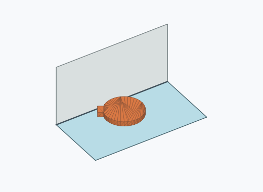 | 330 | 3.30% | 2.97–3.67% |
| 4 | Kf2a_0047 | Group 1 |  | 311 | 3.11% | 2.79–3.47% |
| 5 | Kf2a_0016 | Group 0 |  | 280 | 2.80% | 2.49–3.14% |
| 6 | Kf2a_0012 | Group 0 |  | 248 | 2.48% | 2.19–2.80% |
| 7 | Kf2a_0011 | Group 0 |  | 207 | 2.07% | 1.81–2.37% |
| 8 | Kf2a_0049 | Group 1 |  | 207 | 2.07% | 1.81–2.37% |
| 9 | Kf2a_0010 | Group 0 |  | 189 | 1.89% | 1.64–2.18% |
| 10 | Kf2a_0051 | Group 1 |  | 167 | 1.67% | 1.44–1.94% |
| 11 | Kf2a_0013 | Group 0 |  | 160 | 1.60% | 1.37–1.87% |
| 12 | Kf2a_0021 | Group 0 |  | 159 | 1.59% | 1.36–1.85% |
| 13 | Kf2a_0050 | Group 1 |  | 156 | 1.56% | 1.34–1.82% |
| 14 | Kf2a_0015 | Group 0 |  | 153 | 1.53% | 1.31–1.79% |
| 15 | Kf2a_0048 | Group 1 |  | 144 | 1.44% | 1.22–1.69% |
| 16 | Kf2a_0018 | Group 0 |  | 143 | 1.43% | 1.22–1.68% |
| 17 | Kf2a_0043 | Group 1 | 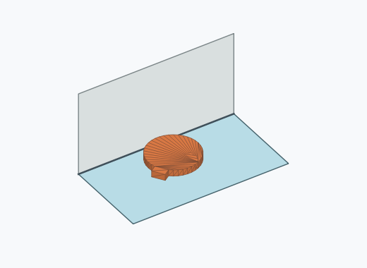 | 142 | 1.42% | 1.21–1.67% |
| 18 | Kf2a_0046 | Group 1 |  | 135 | 1.35% | 1.14–1.60% |
| 19 | Kf2a_0039 | Group 1 |  | 132 | 1.32% | 1.11–1.56% |
| 20 | Kf2a_0031 | Group 4 |  | 127 | 1.27% | 1.07–1.51% |
| 21 | Kf2a_0037 | Group 1 | 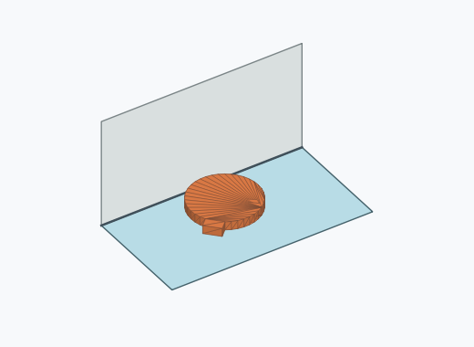 | 126 | 1.26% | 1.06–1.50% |
| 22 | Kf2a_0027 | Group 0 |  | 124 | 1.24% | 1.04–1.48% |
| 23 | Kf2a_0019 | Group 0 |  | 122 | 1.22% | 1.02–1.45% |
| 24 | Kf2a_0007 | Group 1 |  | 121 | 1.21% | 1.01–1.44% |
| 25 | Kf2a_0024 | Group 0 |  | 121 | 1.21% | 1.01–1.44% |
| 26 | Kf2a_0023 | Group 0 | 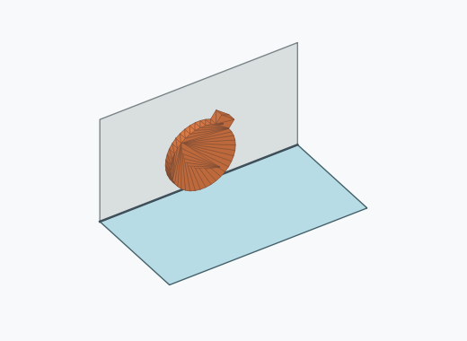 | 119 | 1.19% | 1.00–1.42% |
| 27 | Kf2a_0029 | Group 0 |  | 115 | 1.15% | 0.96–1.38% |
| 28 | Kf2a_0035 | Group 1 |  | 109 | 1.09% | 0.90–1.31% |
| 29 | Kf2a_0006 | Group 1 |  | 97 | 0.97% | 0.80–1.18% |
| 30 | Kf2a_0008 | Group 1 |  | 97 | 0.97% | 0.80–1.18% |
| 31 | Kf2a_0026 | Group 1 |  | 94 | 0.94% | 0.77–1.15% |
| 32 | Kf2a_0032 | Group 0 |  | 94 | 0.94% | 0.77–1.15% |
| 33 | Kf2a_0030 | Group 1 |  | 93 | 0.93% | 0.76–1.14% |
| 34 | Kf2a_0022 | Group 1 | 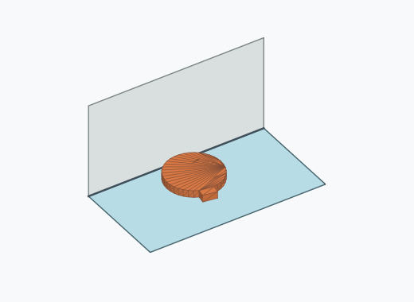 | 91 | 0.91% | 0.74–1.12% |
| 35 | Kf2a_0002 | Group 5 |  | 86 | 0.86% | 0.70–1.06% |
| 36 | Kf2a_0005 | Group 1 | 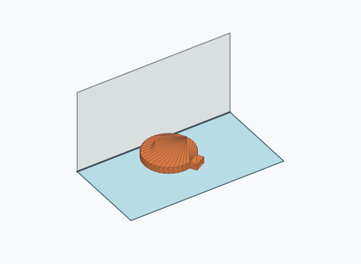 | 77 | 0.77% | 0.62–0.96% |
| 37 | Kf2a_0034 | Group 0 |  | 48 | 0.48% | 0.36–0.64% |
| 38 | Kf2a_0036 | Group 0 |  | 20 | 0.20% | 0.13–0.31% |
| 39 | Kf2a_0038 | Group 0 |  | 18 | 0.18% | 0.11–0.28% |
| 40 | Kf2a_0004 | Group 1 | 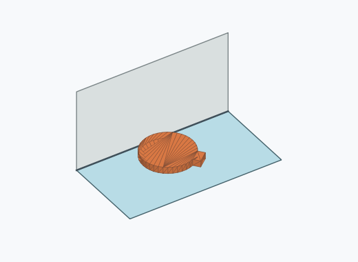 | 6 | 0.06% | 0.03–0.13% |
| 41 | Kf2a_0041 | Group 0 |  | 5 | 0.05% | 0.02–0.12% |
| 42 | Kf2a_0020 | Group 7 | 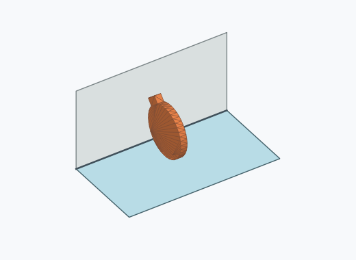 | 3 | 0.03% | 0.01–0.09% |
| 43 | Kf2a_0052 | Group 1 | 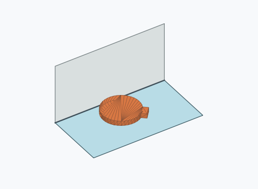 | 3 | 0.03% | 0.01–0.09% |
| 44 | Kf2a_0045 | Group 6 |  | 2 | 0.02% | 0.01–0.07% |
| 45 | Kf2a_0009 | Group 6 | 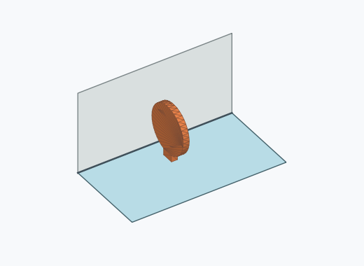 | 1 | 0.01% | 0.00–0.06% |
| 46 | Kf2a_0017 | Group 7 |  | 1 | 0.01% | 0.00–0.06% |
| 47 | Kf2a_0025 | Group 8 |  | 1 | 0.01% | 0.00–0.06% |
| 48 | Kf2a_0028 | Group 8 |  | 1 | 0.01% | 0.00–0.06% |
| 49 | Kf2a_0033 | Group 6 | 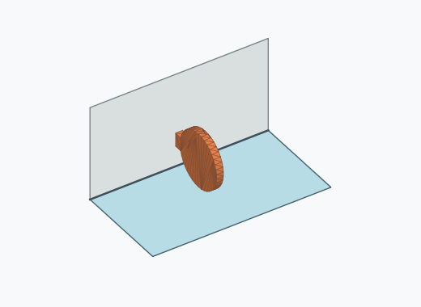 | 1 | 0.01% | 0.00–0.06% |
| 50 | Kf2a_0040 | Group 8 | 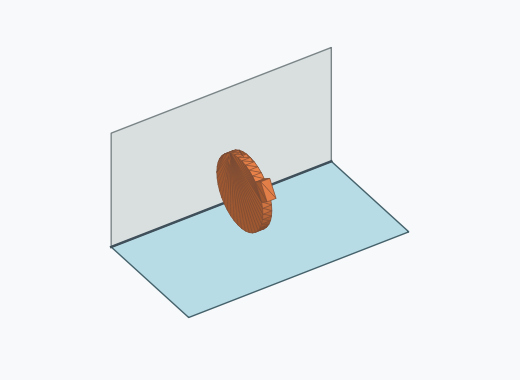 | 1 | 0.01% | 0.00–0.06% |
| 51 | Kf2a_0042 | Group 6 |  | 1 | 0.01% | 0.00–0.06% |

[Post-braking JSON](poses_after_stop.json) · [Post-braking YAML](poses_after_stop.yaml) · [Post-braking trials](trials_after_stop.csv)

## Resting poses after belt stop

9,959 settled observations from 10,000 drops. Incidence uses all drops.

| Pose | Saved ID | Group | Image | Count | Incidence | 95% interval |
| --- | --- | --- | --- | ---: | ---: | ---: |
| 0 | Kf2a_stop_0062 | Group 0 |  | 2496 | 24.96% | 24.12–25.82% |
| 1 | Kf2a_stop_0017 | Group 3 |  | 1019 | 10.19% | 9.61–10.80% |
| 2 | Kf2a_stop_0030 | Group 1 |  | 342 | 3.42% | 3.08–3.79% |
| 3 | Kf2a_stop_0060 | Group 2 |  | 331 | 3.31% | 2.98–3.68% |
| 4 | Kf2a_stop_0065 | Group 2 |  | 311 | 3.11% | 2.79–3.47% |
| 5 | Kf2a_stop_0033 | Group 1 |  | 280 | 2.80% | 2.49–3.14% |
| 6 | Kf2a_stop_0028 | Group 1 |  | 248 | 2.48% | 2.19–2.80% |
| 7 | Kf2a_stop_0069 | Group 2 |  | 208 | 2.08% | 1.82–2.38% |
| 8 | Kf2a_stop_0027 | Group 1 |  | 207 | 2.07% | 1.81–2.37% |
| 9 | Kf2a_stop_0026 | Group 1 |  | 189 | 1.89% | 1.64–2.18% |
| 10 | Kf2a_stop_0076 | Group 2 |  | 167 | 1.67% | 1.44–1.94% |
| 11 | Kf2a_stop_0029 | Group 1 |  | 160 | 1.60% | 1.37–1.87% |
| 12 | Kf2a_stop_0037 | Group 1 |  | 159 | 1.59% | 1.36–1.85% |
| 13 | Kf2a_stop_0075 | Group 2 | 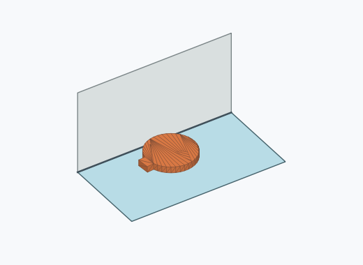 | 156 | 1.56% | 1.34–1.82% |
| 14 | Kf2a_stop_0016 | Group 3 |  | 154 | 1.54% | 1.32–1.80% |
| 15 | Kf2a_stop_0031 | Group 1 |  | 153 | 1.53% | 1.31–1.79% |
| 16 | Kf2a_stop_0068 | Group 2 | 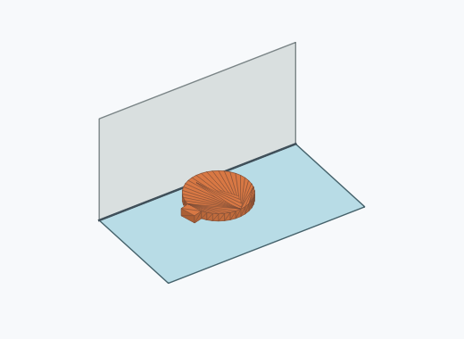 | 147 | 1.47% | 1.25–1.73% |
| 17 | Kf2a_stop_0034 | Group 1 |  | 143 | 1.43% | 1.22–1.68% |
| 18 | Kf2a_stop_0059 | Group 2 |  | 142 | 1.42% | 1.21–1.67% |
| 19 | Kf2a_stop_0064 | Group 2 |  | 135 | 1.35% | 1.14–1.60% |
| 20 | Kf2a_stop_0055 | Group 2 | 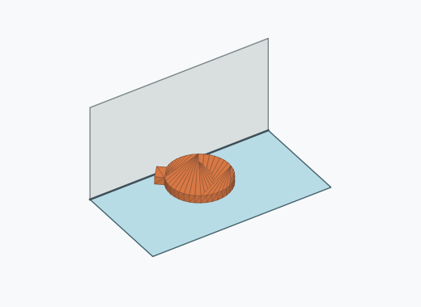 | 132 | 1.32% | 1.11–1.56% |
| 21 | Kf2a_stop_0049 | Group 4 | 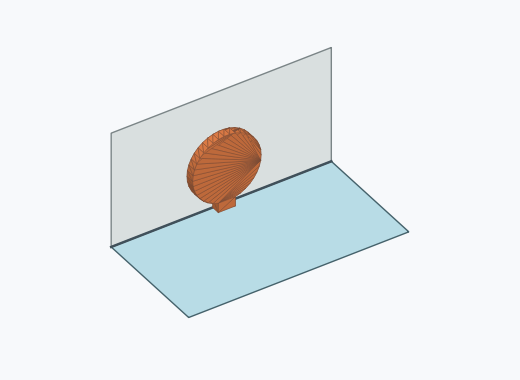 | 127 | 1.27% | 1.07–1.51% |
| 22 | Kf2a_stop_0053 | Group 2 |  | 126 | 1.26% | 1.06–1.50% |
| 23 | Kf2a_stop_0043 | Review 5 |  | 124 | 1.24% | 1.04–1.48% |
| 24 | Kf2a_stop_0036 | Group 1 |  | 122 | 1.22% | 1.02–1.45% |
| 25 | Kf2a_stop_0023 | Review 6 |  | 121 | 1.21% | 1.01–1.44% |
| 26 | Kf2a_stop_0040 | Review 7 |  | 121 | 1.21% | 1.01–1.44% |
| 27 | Kf2a_stop_0012 | Group 3 |  | 120 | 1.20% | 1.00–1.43% |
| 28 | Kf2a_stop_0039 | Review 8 |  | 119 | 1.19% | 1.00–1.42% |
| 29 | Kf2a_stop_0044 | Review 9 | 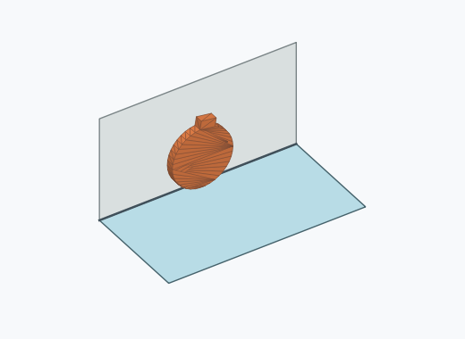 | 115 | 1.15% | 0.96–1.38% |
| 30 | Kf2a_stop_0051 | Review 10 | 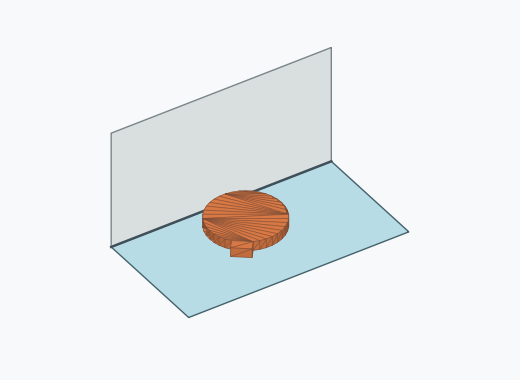 | 109 | 1.09% | 0.90–1.31% |
| 31 | Kf2a_stop_0022 | Review 11 | 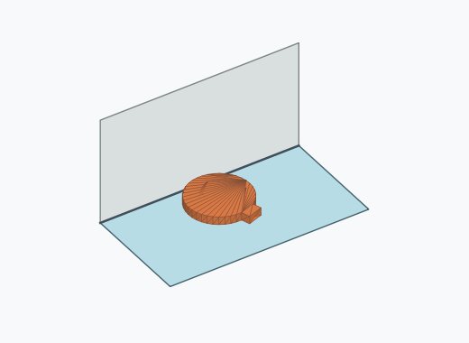 | 97 | 0.97% | 0.80–1.18% |
| 32 | Kf2a_stop_0025 | Review 12 |  | 97 | 0.97% | 0.80–1.18% |
| 33 | Kf2a_stop_0042 | Review 13 |  | 94 | 0.94% | 0.77–1.15% |
| 34 | Kf2a_stop_0048 | Review 14 |  | 94 | 0.94% | 0.77–1.15% |
| 35 | Kf2a_stop_0046 | Review 15 |  | 93 | 0.93% | 0.76–1.14% |
| 36 | Kf2a_stop_0038 | Review 16 | 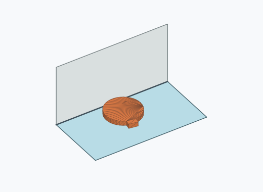 | 92 | 0.92% | 0.75–1.13% |
| 37 | Kf2a_stop_0024 | Group 17 | 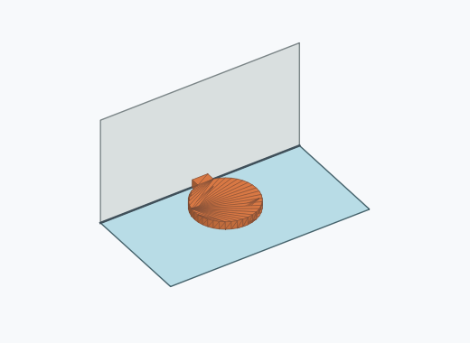 | 86 | 0.86% | 0.70–1.06% |
| 38 | Kf2a_stop_0002 | Group 3 |  | 80 | 0.80% | 0.64–0.99% |
| 39 | Kf2a_stop_0007 | Group 3 |  | 78 | 0.78% | 0.63–0.97% |
| 40 | Kf2a_stop_0021 | Review 18 |  | 77 | 0.77% | 0.62–0.96% |
| 41 | Kf2a_stop_0003 | Group 3 |  | 73 | 0.73% | 0.58–0.92% |
| 42 | Kf2a_stop_0011 | Group 3 | 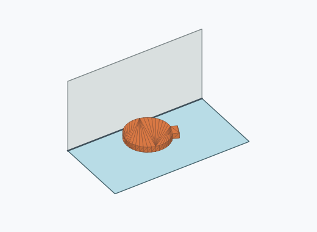 | 57 | 0.57% | 0.44–0.74% |
| 43 | Kf2a_stop_0006 | Group 3 |  | 54 | 0.54% | 0.41–0.70% |
| 44 | Kf2a_stop_0050 | Review 19 |  | 48 | 0.48% | 0.36–0.64% |
| 45 | Kf2a_stop_0019 | Review 20 | 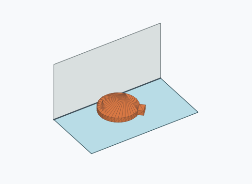 | 33 | 0.33% | 0.24–0.46% |
| 46 | Kf2a_stop_0014 | Group 3 |  | 29 | 0.29% | 0.20–0.42% |
| 47 | Kf2a_stop_0015 | Group 3 | 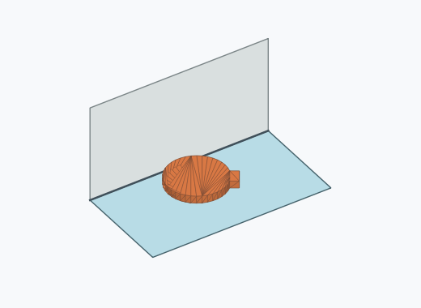 | 29 | 0.29% | 0.20–0.42% |
| 48 | Kf2a_stop_0063 | Group 0 |  | 21 | 0.21% | 0.14–0.32% |
| 49 | Kf2a_stop_0001 | Group 3 |  | 20 | 0.20% | 0.13–0.31% |
| 50 | Kf2a_stop_0052 | Review 21 |  | 20 | 0.20% | 0.13–0.31% |
| 51 | Kf2a_stop_0066 | Group 0 |  | 20 | 0.20% | 0.13–0.31% |
| 52 | Kf2a_stop_0005 | Group 3 |  | 19 | 0.19% | 0.12–0.30% |
| 53 | Kf2a_stop_0008 | Group 3 |  | 19 | 0.19% | 0.12–0.30% |
| 54 | Kf2a_stop_0009 | Group 3 |  | 19 | 0.19% | 0.12–0.30% |
| 55 | Kf2a_stop_0054 | Review 22 |  | 18 | 0.18% | 0.11–0.28% |
| 56 | Kf2a_stop_0004 | Group 3 |  | 17 | 0.17% | 0.11–0.27% |
| 57 | Kf2a_stop_0010 | Group 3 |  | 16 | 0.16% | 0.10–0.26% |
| 58 | Kf2a_stop_0018 | Group 3 | 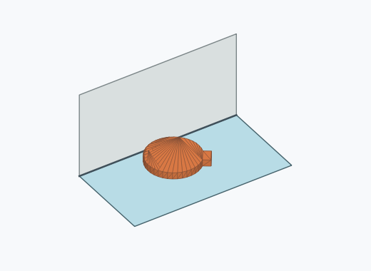 | 15 | 0.15% | 0.09–0.25% |
| 59 | Kf2a_stop_0013 | Group 3 | 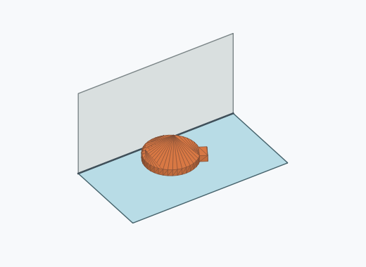 | 11 | 0.11% | 0.06–0.20% |
| 60 | Kf2a_stop_0020 | Review 23 |  | 9 | 0.09% | 0.05–0.17% |
| 61 | Kf2a_stop_0070 | Group 0 |  | 7 | 0.07% | 0.03–0.14% |
| 62 | Kf2a_stop_0057 | Review 24 |  | 6 | 0.06% | 0.03–0.13% |
| 63 | Kf2a_stop_0074 | Group 0 |  | 5 | 0.05% | 0.02–0.12% |
| 64 | Kf2a_stop_0072 | Group 0 | 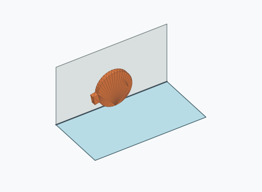 | 4 | 0.04% | 0.02–0.10% |
| 65 | Kf2a_stop_0073 | Group 0 |  | 4 | 0.04% | 0.02–0.10% |
| 66 | Kf2a_stop_0035 | Group 26 |  | 3 | 0.03% | 0.01–0.09% |
| 67 | Kf2a_stop_0061 | Group 25 | 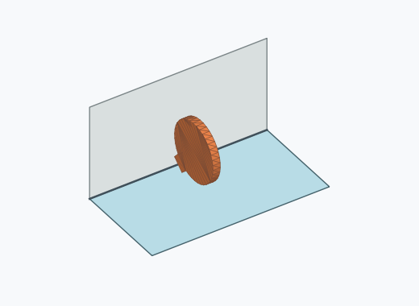 | 2 | 0.02% | 0.01–0.07% |
| 68 | Kf2a_stop_0032 | Group 26 |  | 1 | 0.01% | 0.00–0.06% |
| 69 | Kf2a_stop_0041 | Group 27 | 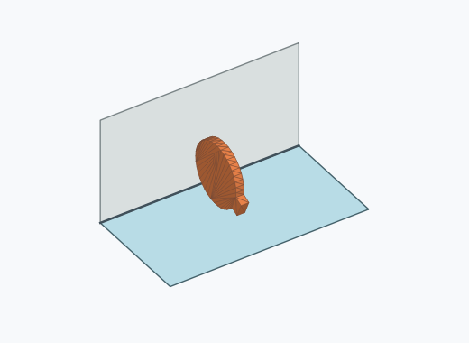 | 1 | 0.01% | 0.00–0.06% |
| 70 | Kf2a_stop_0045 | Group 27 |  | 1 | 0.01% | 0.00–0.06% |
| 71 | Kf2a_stop_0047 | Group 25 |  | 1 | 0.01% | 0.00–0.06% |
| 72 | Kf2a_stop_0056 | Group 27 |  | 1 | 0.01% | 0.00–0.06% |
| 73 | Kf2a_stop_0058 | Group 25 | 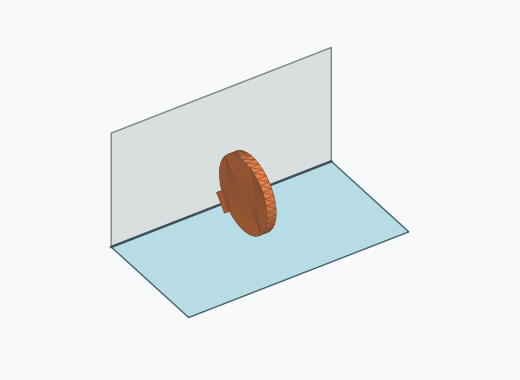 | 1 | 0.01% | 0.00–0.06% |
| 74 | Kf2a_stop_0067 | Group 0 |  | 1 | 0.01% | 0.00–0.06% |
| 75 | Kf2a_stop_0071 | Group 0 |  | 1 | 0.01% | 0.00–0.06% |
| 76 | Kf2a_stop_0077 | Group 0 |  | 1 | 0.01% | 0.00–0.06% |
| 77 | Kf2a_stop_0078 | Group 25 |  | 1 | 0.01% | 0.00–0.06% |

## Preserved history and source data

The original 10,000-drop simulation archives and all earlier grouping/validation studies are unchanged. The prior 1,000-trial catalogue's top-level files and images are preserved in the history snapshot.

[Previous catalogue snapshot](history/catalogue_before_10000_20261116.tar.xz) · [Snapshot checksums](history/catalogue_before_10000_20261116.contents.json) · [Derivation provenance](catalogue/20261116_10000/provenance.json) · [Transport grouping evidence](catalogue/20261116_10000/transport_grouping.json.gz) · [Post-braking grouping evidence](catalogue/20261116_10000/after_stop_grouping.json.gz)

[Stationary and moving source runs](simulations/20261110_10000/README.md). The existing simulation_results.zip, when present, is the preserved historical 1,000-trial run.

Checksums refer to committed Git bytes; Windows checkout line endings may differ.
