# Kf4i

[Workpiece index](../README.md#workpieces)

The two catalogues derive from the saved 10,000-drop runs. Moving outcomes are measured at the virtual exit. Stationary outcomes are measured after 10 s with the belt stopped from release.

Each condition has its own pose ranks (`P000` first) and group IDs (`G0` first), ordered by descending incidence. The source pose ID appears below its rank and the thumbnail links to the full preview. Incidence uses all trials in the condition. The group totals repeat on each member pose row.

## Moving belt

8,997 of 10,000 trials settled. The catalogue contains 98 poses in 7 groups. This condition uses persistent seated-energy minima with a local path angle limit.

| Pose | Group | Preview | Pose drops | Pose incidence | Group drops | Group incidence |
| --- | --- | --- | ---: | ---: | ---: | ---: |
| P000 <code>Kf4i_0026</code> | G0 |  | 1,622 | 16.22% | 2,680 | 26.80% |
| P001 <code>Kf4i_0077</code> | G1 |  | 1,333 | 13.33% | 2,398 | 23.98% |
| P002 <code>Kf4i_0053</code> | G2 |  | 763 | 7.63% | 2,053 | 20.53% |
| P003 <code>Kf4i_0001</code> | G3 |  | 554 | 5.54% | 1,841 | 18.41% |
| P004 <code>Kf4i_0051</code> | G2 |  | 371 | 3.71% | 2,053 | 20.53% |
| P005 <code>Kf4i_0085</code> | G1 |  | 318 | 3.18% | 2,398 | 23.98% |
| P006 <code>Kf4i_0023</code> | G0 |  | 272 | 2.72% | 2,680 | 26.80% |
| P007 <code>Kf4i_0017</code> | G0 |  | 253 | 2.53% | 2,680 | 26.80% |
| P008 <code>Kf4i_0015</code> | G3 |  | 245 | 2.45% | 1,841 | 18.41% |
| P009 <code>Kf4i_0079</code> | G1 |  | 239 | 2.39% | 2,398 | 23.98% |
| P010 <code>Kf4i_0020</code> | G0 |  | 228 | 2.28% | 2,680 | 26.80% |
| P011 <code>Kf4i_0008</code> | G3 |  | 221 | 2.21% | 1,841 | 18.41% |
| P012 <code>Kf4i_0082</code> | G1 |  | 217 | 2.17% | 2,398 | 23.98% |
| P013 <code>Kf4i_0052</code> | G2 |  | 188 | 1.88% | 2,053 | 20.53% |
| P014 <code>Kf4i_0022</code> | G3 |  | 169 | 1.69% | 1,841 | 18.41% |
| P015 <code>Kf4i_0028</code> | G3 |  | 150 | 1.50% | 1,841 | 18.41% |
| P016 <code>Kf4i_0055</code> | G2 |  | 137 | 1.37% | 2,053 | 20.53% |
| P017 <code>Kf4i_0056</code> | G2 |  | 115 | 1.15% | 2,053 | 20.53% |
| P018 <code>Kf4i_0073</code> | G1 |  | 114 | 1.14% | 2,398 | 23.98% |
| P019 <code>Kf4i_0032</code> | G3 |  | 93 | 0.93% | 1,841 | 18.41% |
| P020 <code>Kf4i_0059</code> | G2 |  | 91 | 0.91% | 2,053 | 20.53% |
| P021 <code>Kf4i_0034</code> | G3 | [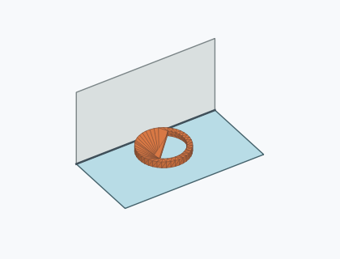](catalogue/grouped_10000/moving/poses/P021.png) | 90 | 0.90% | 1,841 | 18.41% |
| P022 <code>Kf4i_0014</code> | G0 |  | 73 | 0.73% | 2,680 | 26.80% |
| P023 <code>Kf4i_0058</code> | G2 |  | 62 | 0.62% | 2,053 | 20.53% |
| P024 <code>Kf4i_0031</code> | G0 | [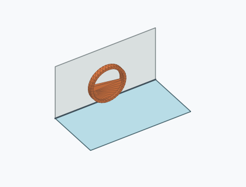](catalogue/grouped_10000/moving/poses/P024.png) | 57 | 0.57% | 2,680 | 26.80% |
| P025 <code>Kf4i_0038</code> | G3 |  | 50 | 0.50% | 1,841 | 18.41% |
| P026 <code>Kf4i_0042</code> | G3 |  | 49 | 0.49% | 1,841 | 18.41% |
| P027 <code>Kf4i_0061</code> | G2 |  | 47 | 0.47% | 2,053 | 20.53% |
| P028 <code>Kf4i_0063</code> | G2 |  | 44 | 0.44% | 2,053 | 20.53% |
| P029 <code>Kf4i_0016</code> | G0 |  | 33 | 0.33% | 2,680 | 26.80% |
| P030 <code>Kf4i_0064</code> | G2 | [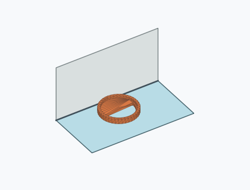](catalogue/grouped_10000/moving/poses/P030.png) | 32 | 0.32% | 2,053 | 20.53% |
| P031 <code>Kf4i_0080</code> | G1 |  | 32 | 0.32% | 2,398 | 23.98% |
| P032 <code>Kf4i_0021</code> | G0 |  | 31 | 0.31% | 2,680 | 26.80% |
| P033 <code>Kf4i_0002</code> | G3 |  | 30 | 0.30% | 1,841 | 18.41% |
| P034 <code>Kf4i_0054</code> | G2 |  | 28 | 0.28% | 2,053 | 20.53% |
| P035 <code>Kf4i_0075</code> | G1 |  | 28 | 0.28% | 2,398 | 23.98% |
| P036 <code>Kf4i_0019</code> | G3 | [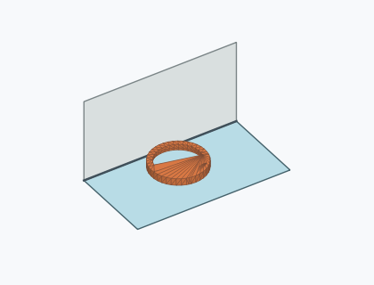](catalogue/grouped_10000/moving/poses/P036.png) | 24 | 0.24% | 1,841 | 18.41% |
| P037 <code>Kf4i_0018</code> | G0 |  | 23 | 0.23% | 2,680 | 26.80% |
| P038 <code>Kf4i_0024</code> | G0 |  | 23 | 0.23% | 2,680 | 26.80% |
| P039 <code>Kf4i_0083</code> | G1 | [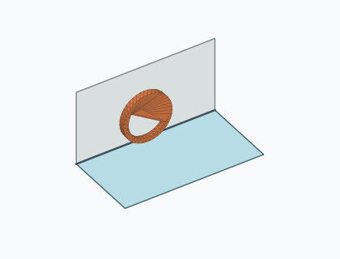](catalogue/grouped_10000/moving/poses/P039.png) | 23 | 0.23% | 2,398 | 23.98% |
| P040 <code>Kf4i_0027</code> | G0 |  | 21 | 0.21% | 2,680 | 26.80% |
| P041 <code>Kf4i_0043</code> | G3 | [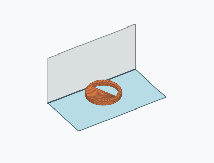](catalogue/grouped_10000/moving/poses/P041.png) | 21 | 0.21% | 1,841 | 18.41% |
| P042 <code>Kf4i_0065</code> | G2 |  | 21 | 0.21% | 2,053 | 20.53% |
| P043 <code>Kf4i_0066</code> | G2 |  | 21 | 0.21% | 2,053 | 20.53% |
| P044 <code>Kf4i_0067</code> | G2 |  | 21 | 0.21% | 2,053 | 20.53% |
| P045 <code>Kf4i_0045</code> | G3 |  | 20 | 0.20% | 1,841 | 18.41% |
| P046 <code>Kf4i_0029</code> | G3 |  | 19 | 0.19% | 1,841 | 18.41% |
| P047 <code>Kf4i_0036</code> | G3 |  | 19 | 0.19% | 1,841 | 18.41% |
| P048 <code>Kf4i_0060</code> | G2 |  | 19 | 0.19% | 2,053 | 20.53% |
| P049 <code>Kf4i_0069</code> | G2 |  | 19 | 0.19% | 2,053 | 20.53% |
| P050 <code>Kf4i_0088</code> | G1 |  | 19 | 0.19% | 2,398 | 23.98% |
| P051 <code>Kf4i_0025</code> | G3 |  | 18 | 0.18% | 1,841 | 18.41% |
| P052 <code>Kf4i_0033</code> | G3 |  | 18 | 0.18% | 1,841 | 18.41% |
| P053 <code>Kf4i_0057</code> | G2 |  | 18 | 0.18% | 2,053 | 20.53% |
| P054 <code>Kf4i_0071</code> | G2 |  | 17 | 0.17% | 2,053 | 20.53% |
| P055 <code>Kf4i_0012</code> | G0 |  | 15 | 0.15% | 2,680 | 26.80% |
| P056 <code>Kf4i_0086</code> | G1 |  | 15 | 0.15% | 2,398 | 23.98% |
| P057 <code>Kf4i_0011</code> | G3 |  | 14 | 0.14% | 1,841 | 18.41% |
| P058 <code>Kf4i_0040</code> | G3 |  | 14 | 0.14% | 1,841 | 18.41% |
| P059 <code>Kf4i_0076</code> | G1 | [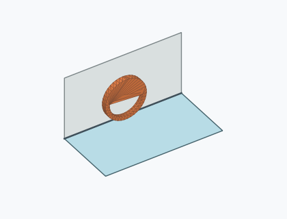](catalogue/grouped_10000/moving/poses/P059.png) | 14 | 0.14% | 2,398 | 23.98% |
| P060 <code>Kf4i_0070</code> | G2 |  | 13 | 0.13% | 2,053 | 20.53% |
| P061 <code>Kf4i_0078</code> | G1 |  | 13 | 0.13% | 2,398 | 23.98% |
| P062 <code>Kf4i_0072</code> | G2 |  | 12 | 0.12% | 2,053 | 20.53% |
| P063 <code>Kf4i_0048</code> | G3 |  | 11 | 0.11% | 1,841 | 18.41% |
| P064 <code>Kf4i_0068</code> | G2 |  | 10 | 0.10% | 2,053 | 20.53% |
| P065 <code>Kf4i_0049</code> | G3 |  | 7 | 0.07% | 1,841 | 18.41% |
| P066 <code>Kf4i_0074</code> | G1 |  | 7 | 0.07% | 2,398 | 23.98% |
| P067 <code>Kf4i_0089</code> | G1 |  | 7 | 0.07% | 2,398 | 23.98% |
| P068 <code>Kf4i_0013</code> | G0 |  | 6 | 0.06% | 2,680 | 26.80% |
| P069 <code>Kf4i_0091</code> | G1 |  | 6 | 0.06% | 2,398 | 23.98% |
| P070 <code>Kf4i_0010</code> | G0 | [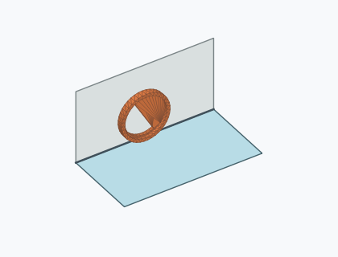](catalogue/grouped_10000/moving/poses/P070.png) | 5 | 0.05% | 2,680 | 26.80% |
| P071 <code>Kf4i_0009</code> | G0 |  | 4 | 0.04% | 2,680 | 26.80% |
| P072 <code>Kf4i_0030</code> | G0 |  | 4 | 0.04% | 2,680 | 26.80% |
| P073 <code>Kf4i_0062</code> | G2 | [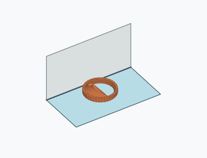](catalogue/grouped_10000/moving/poses/P073.png) | 4 | 0.04% | 2,053 | 20.53% |
| P074 <code>Kf4i_0093</code> | G4 |  | 4 | 0.04% | 14 | 0.14% |
| P075 <code>Kf4i_0096</code> | G1 |  | 4 | 0.04% | 2,398 | 23.98% |
| P076 <code>Kf4i_0004</code> | G0 |  | 3 | 0.03% | 2,680 | 26.80% |
| P077 <code>Kf4i_0007</code> | G0 |  | 3 | 0.03% | 2,680 | 26.80% |
| P078 <code>Kf4i_0035</code> | G5 |  | 3 | 0.03% | 10 | 0.10% |
| P079 <code>Kf4i_0044</code> | G5 |  | 3 | 0.03% | 10 | 0.10% |
| P080 <code>Kf4i_0050</code> | G3 |  | 3 | 0.03% | 1,841 | 18.41% |
| P081 <code>Kf4i_0084</code> | G4 |  | 3 | 0.03% | 14 | 0.14% |
| P082 <code>Kf4i_0090</code> | G4 |  | 3 | 0.03% | 14 | 0.14% |
| P083 <code>Kf4i_0095</code> | G1 |  | 3 | 0.03% | 2,398 | 23.98% |
| P084 <code>Kf4i_0097</code> | G1 |  | 3 | 0.03% | 2,398 | 23.98% |
| P085 <code>Kf4i_0005</code> | G0 |  | 2 | 0.02% | 2,680 | 26.80% |
| P086 <code>Kf4i_0081</code> | G4 |  | 2 | 0.02% | 14 | 0.14% |
| P087 <code>Kf4i_0087</code> | G4 |  | 2 | 0.02% | 14 | 0.14% |
| P088 <code>Kf4i_0094</code> | G1 |  | 2 | 0.02% | 2,398 | 23.98% |
| P089 <code>Kf4i_0098</code> | G3 |  | 2 | 0.02% | 1,841 | 18.41% |
| P090 <code>Kf4i_0003</code> | G0 | [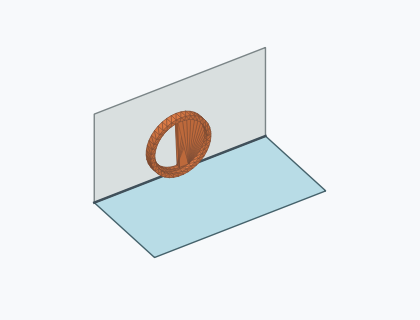](catalogue/grouped_10000/moving/poses/P090.png) | 1 | 0.01% | 2,680 | 26.80% |
| P091 <code>Kf4i_0006</code> | G0 |  | 1 | 0.01% | 2,680 | 26.80% |
| P092 <code>Kf4i_0037</code> | G5 | [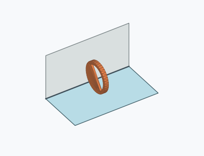](catalogue/grouped_10000/moving/poses/P092.png) | 1 | 0.01% | 10 | 0.10% |
| P093 <code>Kf4i_0039</code> | G5 |  | 1 | 0.01% | 10 | 0.10% |
| P094 <code>Kf4i_0041</code> | G5 |  | 1 | 0.01% | 10 | 0.10% |
| P095 <code>Kf4i_0046</code> | G6 | [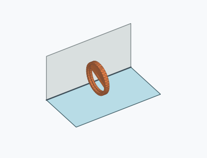](catalogue/grouped_10000/moving/poses/P095.png) | 1 | 0.01% | 1 | 0.01% |
| P096 <code>Kf4i_0047</code> | G5 |  | 1 | 0.01% | 10 | 0.10% |
| P097 <code>Kf4i_0092</code> | G1 |  | 1 | 0.01% | 2,398 | 23.98% |

Outcomes from the archived run: settled 8,997, stalled 1, unsettled 1,002.

## Stationary belt

8,982 of 10,000 trials settled. The catalogue contains 209 poses in 19 groups. This condition uses persistent seated-energy minima with a local path angle limit.

| Pose | Group | Preview | Pose drops | Pose incidence | Group drops | Group incidence |
| --- | --- | --- | ---: | ---: | ---: | ---: |
| P000 <code>Kf4i_0063</code> | G0 |  | 260 | 2.60% | 2,493 | 24.93% |
| P001 <code>Kf4i_0099</code> | G1 |  | 247 | 2.47% | 2,256 | 22.56% |
| P002 <code>Kf4i_0051</code> | G0 |  | 244 | 2.44% | 2,493 | 24.93% |
| P003 <code>Kf4i_0180</code> | G2 |  | 243 | 2.43% | 2,197 | 21.97% |
| P004 <code>Kf4i_0174</code> | G2 |  | 240 | 2.40% | 2,197 | 21.97% |
| P005 <code>Kf4i_0115</code> | G1 | [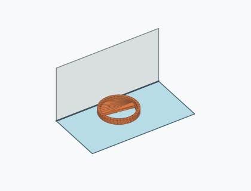](catalogue/grouped_10000/stationary/poses/P005.png) | 234 | 2.34% | 2,256 | 22.56% |
| P006 <code>Kf4i_0171</code> | G2 |  | 214 | 2.14% | 2,197 | 21.97% |
| P007 <code>Kf4i_0036</code> | G3 | [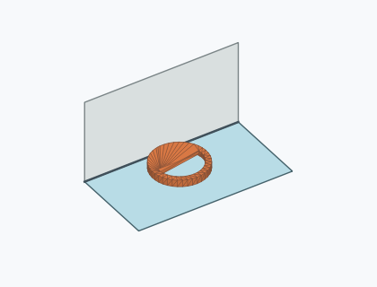](catalogue/grouped_10000/stationary/poses/P007.png) | 212 | 2.12% | 1,995 | 19.95% |
| P008 <code>Kf4i_0019</code> | G3 |  | 211 | 2.11% | 1,995 | 19.95% |
| P009 <code>Kf4i_0067</code> | G0 |  | 204 | 2.04% | 2,493 | 24.93% |
| P010 <code>Kf4i_0113</code> | G1 |  | 203 | 2.03% | 2,256 | 22.56% |
| P011 <code>Kf4i_0184</code> | G2 |  | 187 | 1.87% | 2,197 | 21.97% |
| P012 <code>Kf4i_0074</code> | G0 |  | 183 | 1.83% | 2,493 | 24.93% |
| P013 <code>Kf4i_0047</code> | G0 |  | 182 | 1.82% | 2,493 | 24.93% |
| P014 <code>Kf4i_0045</code> | G3 |  | 175 | 1.75% | 1,995 | 19.95% |
| P015 <code>Kf4i_0016</code> | G3 |  | 167 | 1.67% | 1,995 | 19.95% |
| P016 <code>Kf4i_0168</code> | G2 |  | 165 | 1.65% | 2,197 | 21.97% |
| P017 <code>Kf4i_0043</code> | G0 |  | 159 | 1.59% | 2,493 | 24.93% |
| P018 <code>Kf4i_0134</code> | G1 |  | 155 | 1.55% | 2,256 | 22.56% |
| P019 <code>Kf4i_0189</code> | G2 |  | 151 | 1.51% | 2,197 | 21.97% |
| P020 <code>Kf4i_0119</code> | G1 | [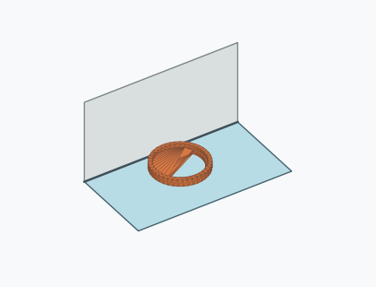](catalogue/grouped_10000/stationary/poses/P020.png) | 148 | 1.48% | 2,256 | 22.56% |
| P021 <code>Kf4i_0163</code> | G2 |  | 138 | 1.38% | 2,197 | 21.97% |
| P022 <code>Kf4i_0013</code> | G3 |  | 136 | 1.36% | 1,995 | 19.95% |
| P023 <code>Kf4i_0078</code> | G0 |  | 136 | 1.36% | 2,493 | 24.93% |
| P024 <code>Kf4i_0055</code> | G0 |  | 133 | 1.33% | 2,493 | 24.93% |
| P025 <code>Kf4i_0177</code> | G2 |  | 132 | 1.32% | 2,197 | 21.97% |
| P026 <code>Kf4i_0061</code> | G3 |  | 125 | 1.25% | 1,995 | 19.95% |
| P027 <code>Kf4i_0146</code> | G1 | [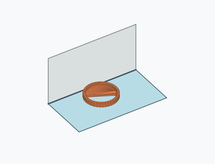](catalogue/grouped_10000/stationary/poses/P027.png) | 125 | 1.25% | 2,256 | 22.56% |
| P028 <code>Kf4i_0057</code> | G0 |  | 122 | 1.22% | 2,493 | 24.93% |
| P029 <code>Kf4i_0052</code> | G3 |  | 118 | 1.18% | 1,995 | 19.95% |
| P030 <code>Kf4i_0176</code> | G2 |  | 114 | 1.14% | 2,197 | 21.97% |
| P031 <code>Kf4i_0117</code> | G1 | [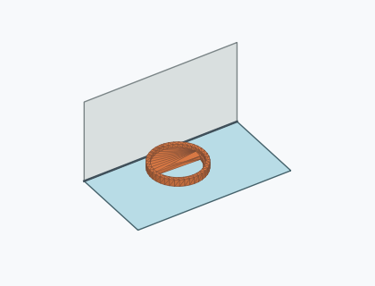](catalogue/grouped_10000/stationary/poses/P031.png) | 105 | 1.05% | 2,256 | 22.56% |
| P032 <code>Kf4i_0121</code> | G1 |  | 102 | 1.02% | 2,256 | 22.56% |
| P033 <code>Kf4i_0123</code> | G1 |  | 102 | 1.02% | 2,256 | 22.56% |
| P034 <code>Kf4i_0010</code> | G3 |  | 101 | 1.01% | 1,995 | 19.95% |
| P035 <code>Kf4i_0021</code> | G3 |  | 101 | 1.01% | 1,995 | 19.95% |
| P036 <code>Kf4i_0038</code> | G0 |  | 100 | 1.00% | 2,493 | 24.93% |
| P037 <code>Kf4i_0025</code> | G3 |  | 97 | 0.97% | 1,995 | 19.95% |
| P038 <code>Kf4i_0111</code> | G1 |  | 95 | 0.95% | 2,256 | 22.56% |
| P039 <code>Kf4i_0194</code> | G2 |  | 92 | 0.92% | 2,197 | 21.97% |
| P040 <code>Kf4i_0160</code> | G2 |  | 86 | 0.86% | 2,197 | 21.97% |
| P041 <code>Kf4i_0082</code> | G0 |  | 83 | 0.83% | 2,493 | 24.93% |
| P042 <code>Kf4i_0034</code> | G0 |  | 75 | 0.75% | 2,493 | 24.93% |
| P043 <code>Kf4i_0098</code> | G1 |  | 63 | 0.63% | 2,256 | 22.56% |
| P044 <code>Kf4i_0197</code> | G2 |  | 60 | 0.60% | 2,197 | 21.97% |
| P045 <code>Kf4i_0007</code> | G3 |  | 56 | 0.56% | 1,995 | 19.95% |
| P046 <code>Kf4i_0005</code> | G3 |  | 49 | 0.49% | 1,995 | 19.95% |
| P047 <code>Kf4i_0095</code> | G0 |  | 48 | 0.48% | 2,493 | 24.93% |
| P048 <code>Kf4i_0127</code> | G1 |  | 46 | 0.46% | 2,256 | 22.56% |
| P049 <code>Kf4i_0071</code> | G3 |  | 45 | 0.45% | 1,995 | 19.95% |
| P050 <code>Kf4i_0107</code> | G1 |  | 43 | 0.43% | 2,256 | 22.56% |
| P051 <code>Kf4i_0109</code> | G1 |  | 43 | 0.43% | 2,256 | 22.56% |
| P052 <code>Kf4i_0158</code> | G2 |  | 36 | 0.36% | 2,197 | 21.97% |
| P053 <code>Kf4i_0087</code> | G0 |  | 35 | 0.35% | 2,493 | 24.93% |
| P054 <code>Kf4i_0125</code> | G1 |  | 34 | 0.34% | 2,256 | 22.56% |
| P055 <code>Kf4i_0030</code> | G0 |  | 32 | 0.32% | 2,493 | 24.93% |
| P056 <code>Kf4i_0054</code> | G0 |  | 31 | 0.31% | 2,493 | 24.93% |
| P057 <code>Kf4i_0128</code> | G1 |  | 30 | 0.30% | 2,256 | 22.56% |
| P058 <code>Kf4i_0141</code> | G1 |  | 30 | 0.30% | 2,256 | 22.56% |
| P059 <code>Kf4i_0179</code> | G2 |  | 30 | 0.30% | 2,197 | 21.97% |
| P060 <code>Kf4i_0100</code> | G1 |  | 29 | 0.29% | 2,256 | 22.56% |
| P061 <code>Kf4i_0049</code> | G0 |  | 28 | 0.28% | 2,493 | 24.93% |
| P062 <code>Kf4i_0062</code> | G0 |  | 28 | 0.28% | 2,493 | 24.93% |
| P063 <code>Kf4i_0072</code> | G0 |  | 28 | 0.28% | 2,493 | 24.93% |
| P064 <code>Kf4i_0079</code> | G3 | [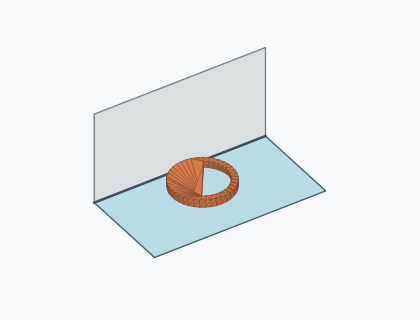](catalogue/grouped_10000/stationary/poses/P064.png) | 28 | 0.28% | 1,995 | 19.95% |
| P065 <code>Kf4i_0175</code> | G2 |  | 28 | 0.28% | 2,197 | 21.97% |
| P066 <code>Kf4i_0076</code> | G3 | [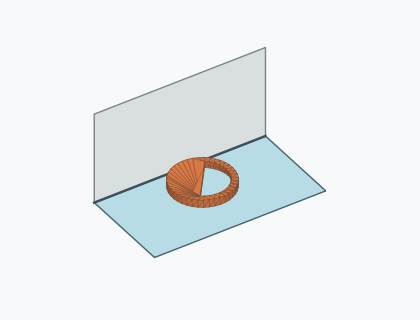](catalogue/grouped_10000/stationary/poses/P066.png) | 27 | 0.27% | 1,995 | 19.95% |
| P067 <code>Kf4i_0110</code> | G1 |  | 26 | 0.26% | 2,256 | 22.56% |
| P068 <code>Kf4i_0142</code> | G1 |  | 26 | 0.26% | 2,256 | 22.56% |
| P069 <code>Kf4i_0044</code> | G0 | [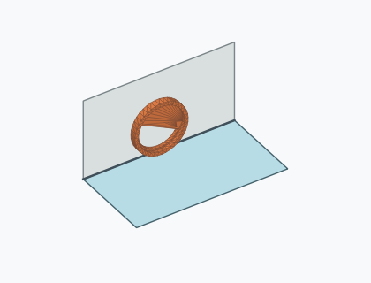](catalogue/grouped_10000/stationary/poses/P069.png) | 25 | 0.25% | 2,493 | 24.93% |
| P070 <code>Kf4i_0046</code> | G0 |  | 25 | 0.25% | 2,493 | 24.93% |
| P071 <code>Kf4i_0172</code> | G2 |  | 25 | 0.25% | 2,197 | 21.97% |
| P072 <code>Kf4i_0069</code> | G3 |  | 24 | 0.24% | 1,995 | 19.95% |
| P073 <code>Kf4i_0003</code> | G3 | [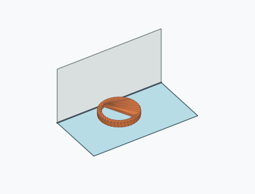](catalogue/grouped_10000/stationary/poses/P073.png) | 23 | 0.23% | 1,995 | 19.95% |
| P074 <code>Kf4i_0065</code> | G0 |  | 23 | 0.23% | 2,493 | 24.93% |
| P075 <code>Kf4i_0081</code> | G0 |  | 23 | 0.23% | 2,493 | 24.93% |
| P076 <code>Kf4i_0116</code> | G1 |  | 23 | 0.23% | 2,256 | 22.56% |
| P077 <code>Kf4i_0139</code> | G1 |  | 23 | 0.23% | 2,256 | 22.56% |
| P078 <code>Kf4i_0156</code> | G2 |  | 23 | 0.23% | 2,197 | 21.97% |
| P079 <code>Kf4i_0201</code> | G2 |  | 23 | 0.23% | 2,197 | 21.97% |
| P080 <code>Kf4i_0183</code> | G2 |  | 22 | 0.22% | 2,197 | 21.97% |
| P081 <code>Kf4i_0028</code> | G3 |  | 21 | 0.21% | 1,995 | 19.95% |
| P082 <code>Kf4i_0035</code> | G0 |  | 21 | 0.21% | 2,493 | 24.93% |
| P083 <code>Kf4i_0042</code> | G3 |  | 21 | 0.21% | 1,995 | 19.95% |
| P084 <code>Kf4i_0118</code> | G1 |  | 21 | 0.21% | 2,256 | 22.56% |
| P085 <code>Kf4i_0136</code> | G1 |  | 21 | 0.21% | 2,256 | 22.56% |
| P086 <code>Kf4i_0085</code> | G0 |  | 20 | 0.20% | 2,493 | 24.93% |
| P087 <code>Kf4i_0015</code> | G3 |  | 19 | 0.19% | 1,995 | 19.95% |
| P088 <code>Kf4i_0018</code> | G3 |  | 19 | 0.19% | 1,995 | 19.95% |
| P089 <code>Kf4i_0077</code> | G0 |  | 19 | 0.19% | 2,493 | 24.93% |
| P090 <code>Kf4i_0089</code> | G0 |  | 19 | 0.19% | 2,493 | 24.93% |
| P091 <code>Kf4i_0112</code> | G1 |  | 19 | 0.19% | 2,256 | 22.56% |
| P092 <code>Kf4i_0140</code> | G1 |  | 19 | 0.19% | 2,256 | 22.56% |
| P093 <code>Kf4i_0020</code> | G3 |  | 18 | 0.18% | 1,995 | 19.95% |
| P094 <code>Kf4i_0039</code> | G0 |  | 18 | 0.18% | 2,493 | 24.93% |
| P095 <code>Kf4i_0048</code> | G0 |  | 18 | 0.18% | 2,493 | 24.93% |
| P096 <code>Kf4i_0053</code> | G0 |  | 18 | 0.18% | 2,493 | 24.93% |
| P097 <code>Kf4i_0105</code> | G1 |  | 18 | 0.18% | 2,256 | 22.56% |
| P098 <code>Kf4i_0108</code> | G1 |  | 18 | 0.18% | 2,256 | 22.56% |
| P099 <code>Kf4i_0132</code> | G1 |  | 18 | 0.18% | 2,256 | 22.56% |
| P100 <code>Kf4i_0133</code> | G1 |  | 18 | 0.18% | 2,256 | 22.56% |
| P101 <code>Kf4i_0165</code> | G2 |  | 18 | 0.18% | 2,197 | 21.97% |
| P102 <code>Kf4i_0169</code> | G2 |  | 18 | 0.18% | 2,197 | 21.97% |
| P103 <code>Kf4i_0011</code> | G3 |  | 17 | 0.17% | 1,995 | 19.95% |
| P104 <code>Kf4i_0014</code> | G3 |  | 17 | 0.17% | 1,995 | 19.95% |
| P105 <code>Kf4i_0037</code> | G0 |  | 17 | 0.17% | 2,493 | 24.93% |
| P106 <code>Kf4i_0060</code> | G3 |  | 17 | 0.17% | 1,995 | 19.95% |
| P107 <code>Kf4i_0104</code> | G1 | [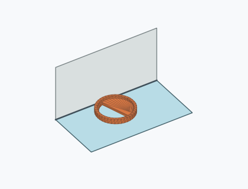](catalogue/grouped_10000/stationary/poses/P107.png) | 17 | 0.17% | 2,256 | 22.56% |
| P108 <code>Kf4i_0050</code> | G3 |  | 16 | 0.16% | 1,995 | 19.95% |
| P109 <code>Kf4i_0129</code> | G1 |  | 16 | 0.16% | 2,256 | 22.56% |
| P110 <code>Kf4i_0188</code> | G2 |  | 16 | 0.16% | 2,197 | 21.97% |
| P111 <code>Kf4i_0009</code> | G3 |  | 15 | 0.15% | 1,995 | 19.95% |
| P112 <code>Kf4i_0040</code> | G0 |  | 15 | 0.15% | 2,493 | 24.93% |
| P113 <code>Kf4i_0101</code> | G1 |  | 14 | 0.14% | 2,256 | 22.56% |
| P114 <code>Kf4i_0103</code> | G1 |  | 14 | 0.14% | 2,256 | 22.56% |
| P115 <code>Kf4i_0114</code> | G1 |  | 14 | 0.14% | 2,256 | 22.56% |
| P116 <code>Kf4i_0192</code> | G2 |  | 14 | 0.14% | 2,197 | 21.97% |
| P117 <code>Kf4i_0004</code> | G3 | [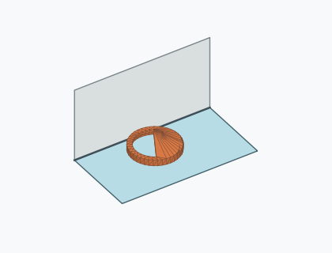](catalogue/grouped_10000/stationary/poses/P117.png) | 13 | 0.13% | 1,995 | 19.95% |
| P118 <code>Kf4i_0027</code> | G0 |  | 13 | 0.13% | 2,493 | 24.93% |
| P119 <code>Kf4i_0075</code> | G0 |  | 13 | 0.13% | 2,493 | 24.93% |
| P120 <code>Kf4i_0086</code> | G0 |  | 13 | 0.13% | 2,493 | 24.93% |
| P121 <code>Kf4i_0122</code> | G1 |  | 13 | 0.13% | 2,256 | 22.56% |
| P122 <code>Kf4i_0196</code> | G2 |  | 13 | 0.13% | 2,197 | 21.97% |
| P123 <code>Kf4i_0130</code> | G1 |  | 12 | 0.12% | 2,256 | 22.56% |
| P124 <code>Kf4i_0135</code> | G1 |  | 12 | 0.12% | 2,256 | 22.56% |
| P125 <code>Kf4i_0161</code> | G2 |  | 12 | 0.12% | 2,197 | 21.97% |
| P126 <code>Kf4i_0193</code> | G2 |  | 12 | 0.12% | 2,197 | 21.97% |
| P127 <code>Kf4i_0070</code> | G0 |  | 11 | 0.11% | 2,493 | 24.93% |
| P128 <code>Kf4i_0080</code> | G0 |  | 11 | 0.11% | 2,493 | 24.93% |
| P129 <code>Kf4i_0091</code> | G3 |  | 11 | 0.11% | 1,995 | 19.95% |
| P130 <code>Kf4i_0026</code> | G0 |  | 10 | 0.10% | 2,493 | 24.93% |
| P131 <code>Kf4i_0083</code> | G3 |  | 10 | 0.10% | 1,995 | 19.95% |
| P132 <code>Kf4i_0102</code> | G1 |  | 10 | 0.10% | 2,256 | 22.56% |
| P133 <code>Kf4i_0182</code> | G2 |  | 10 | 0.10% | 2,197 | 21.97% |
| P134 <code>Kf4i_0200</code> | G2 |  | 10 | 0.10% | 2,197 | 21.97% |
| P135 <code>Kf4i_0066</code> | G3 |  | 9 | 0.09% | 1,995 | 19.95% |
| P136 <code>Kf4i_0090</code> | G0 | [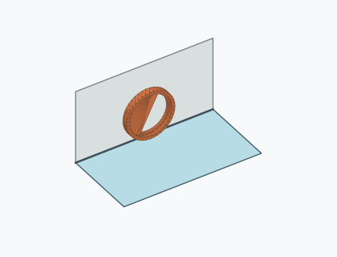](catalogue/grouped_10000/stationary/poses/P136.png) | 9 | 0.09% | 2,493 | 24.93% |
| P137 <code>Kf4i_0092</code> | G0 |  | 9 | 0.09% | 2,493 | 24.93% |
| P138 <code>Kf4i_0164</code> | G3 |  | 9 | 0.09% | 1,995 | 19.95% |
| P139 <code>Kf4i_0012</code> | G3 |  | 8 | 0.08% | 1,995 | 19.95% |
| P140 <code>Kf4i_0031</code> | G3 |  | 8 | 0.08% | 1,995 | 19.95% |
| P141 <code>Kf4i_0064</code> | G0 |  | 8 | 0.08% | 2,493 | 24.93% |
| P142 <code>Kf4i_0106</code> | G1 |  | 8 | 0.08% | 2,256 | 22.56% |
| P143 <code>Kf4i_0120</code> | G1 |  | 8 | 0.08% | 2,256 | 22.56% |
| P144 <code>Kf4i_0131</code> | G1 |  | 8 | 0.08% | 2,256 | 22.56% |
| P145 <code>Kf4i_0166</code> | G2 |  | 8 | 0.08% | 2,197 | 21.97% |
| P146 <code>Kf4i_0084</code> | G3 |  | 7 | 0.07% | 1,995 | 19.95% |
| P147 <code>Kf4i_0178</code> | G2 |  | 7 | 0.07% | 2,197 | 21.97% |
| P148 <code>Kf4i_0186</code> | G4 | [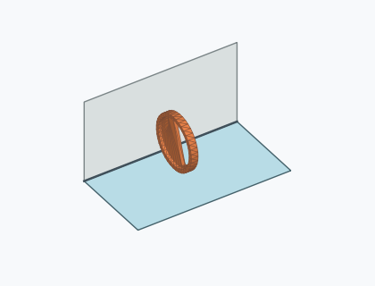](catalogue/grouped_10000/stationary/poses/P148.png) | 7 | 0.07% | 7 | 0.07% |
| P149 <code>Kf4i_0032</code> | G0 |  | 6 | 0.06% | 2,493 | 24.93% |
| P150 <code>Kf4i_0068</code> | G5 | [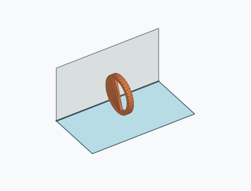](catalogue/grouped_10000/stationary/poses/P150.png) | 6 | 0.06% | 6 | 0.06% |
| P151 <code>Kf4i_0157</code> | G2 | [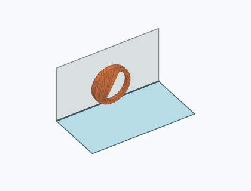](catalogue/grouped_10000/stationary/poses/P151.png) | 6 | 0.06% | 2,197 | 21.97% |
| P152 <code>Kf4i_0159</code> | G2 |  | 6 | 0.06% | 2,197 | 21.97% |
| P153 <code>Kf4i_0162</code> | G3 |  | 6 | 0.06% | 1,995 | 19.95% |
| P154 <code>Kf4i_0170</code> | G2 |  | 6 | 0.06% | 2,197 | 21.97% |
| P155 <code>Kf4i_0187</code> | G2 |  | 6 | 0.06% | 2,197 | 21.97% |
| P156 <code>Kf4i_0002</code> | G3 |  | 5 | 0.05% | 1,995 | 19.95% |
| P157 <code>Kf4i_0017</code> | G3 |  | 5 | 0.05% | 1,995 | 19.95% |
| P158 <code>Kf4i_0024</code> | G0 |  | 5 | 0.05% | 2,493 | 24.93% |
| P159 <code>Kf4i_0041</code> | G3 |  | 5 | 0.05% | 1,995 | 19.95% |
| P160 <code>Kf4i_0056</code> | G3 |  | 5 | 0.05% | 1,995 | 19.95% |
| P161 <code>Kf4i_0204</code> | G2 |  | 5 | 0.05% | 2,197 | 21.97% |
| P162 <code>Kf4i_0006</code> | G3 |  | 4 | 0.04% | 1,995 | 19.95% |
| P163 <code>Kf4i_0008</code> | G3 | [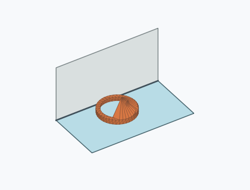](catalogue/grouped_10000/stationary/poses/P163.png) | 4 | 0.04% | 1,995 | 19.95% |
| P164 <code>Kf4i_0073</code> | G6 |  | 4 | 0.04% | 4 | 0.04% |
| P165 <code>Kf4i_0093</code> | G7 |  | 4 | 0.04% | 4 | 0.04% |
| P166 <code>Kf4i_0124</code> | G1 | [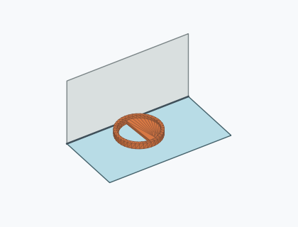](catalogue/grouped_10000/stationary/poses/P166.png) | 4 | 0.04% | 2,256 | 22.56% |
| P167 <code>Kf4i_0154</code> | G2 |  | 4 | 0.04% | 2,197 | 21.97% |
| P168 <code>Kf4i_0195</code> | G8 | [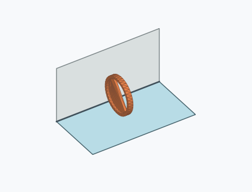](catalogue/grouped_10000/stationary/poses/P168.png) | 4 | 0.04% | 4 | 0.04% |
| P169 <code>Kf4i_0205</code> | G9 |  | 4 | 0.04% | 4 | 0.04% |
| P170 <code>Kf4i_0001</code> | G3 |  | 3 | 0.03% | 1,995 | 19.95% |
| P171 <code>Kf4i_0022</code> | G3 |  | 3 | 0.03% | 1,995 | 19.95% |
| P172 <code>Kf4i_0023</code> | G0 |  | 3 | 0.03% | 2,493 | 24.93% |
| P173 <code>Kf4i_0033</code> | G0 |  | 3 | 0.03% | 2,493 | 24.93% |
| P174 <code>Kf4i_0097</code> | G0 |  | 3 | 0.03% | 2,493 | 24.93% |
| P175 <code>Kf4i_0137</code> | G1 |  | 3 | 0.03% | 2,256 | 22.56% |
| P176 <code>Kf4i_0143</code> | G1 |  | 3 | 0.03% | 2,256 | 22.56% |
| P177 <code>Kf4i_0147</code> | G1 |  | 3 | 0.03% | 2,256 | 22.56% |
| P178 <code>Kf4i_0149</code> | G1 | [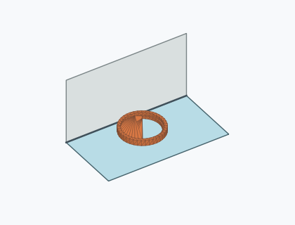](catalogue/grouped_10000/stationary/poses/P178.png) | 3 | 0.03% | 2,256 | 22.56% |
| P179 <code>Kf4i_0155</code> | G2 |  | 3 | 0.03% | 2,197 | 21.97% |
| P180 <code>Kf4i_0167</code> | G3 |  | 3 | 0.03% | 1,995 | 19.95% |
| P181 <code>Kf4i_0173</code> | G2 |  | 3 | 0.03% | 2,197 | 21.97% |
| P182 <code>Kf4i_0199</code> | G10 |  | 3 | 0.03% | 3 | 0.03% |
| P183 <code>Kf4i_0206</code> | G2 | [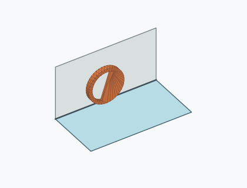](catalogue/grouped_10000/stationary/poses/P183.png) | 3 | 0.03% | 2,197 | 21.97% |
| P184 <code>Kf4i_0126</code> | G1 |  | 2 | 0.02% | 2,256 | 22.56% |
| P185 <code>Kf4i_0138</code> | G1 | [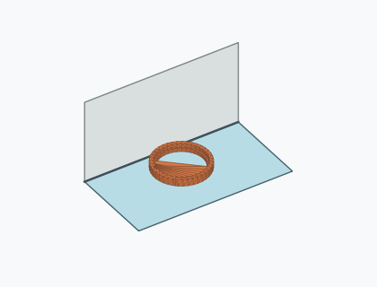](catalogue/grouped_10000/stationary/poses/P185.png) | 2 | 0.02% | 2,256 | 22.56% |
| P186 <code>Kf4i_0144</code> | G1 |  | 2 | 0.02% | 2,256 | 22.56% |
| P187 <code>Kf4i_0150</code> | G1 |  | 2 | 0.02% | 2,256 | 22.56% |
| P188 <code>Kf4i_0153</code> | G3 |  | 2 | 0.02% | 1,995 | 19.95% |
| P189 <code>Kf4i_0190</code> | G2 |  | 2 | 0.02% | 2,197 | 21.97% |
| P190 <code>Kf4i_0198</code> | G11 |  | 2 | 0.02% | 2 | 0.02% |
| P191 <code>Kf4i_0207</code> | G2 |  | 2 | 0.02% | 2,197 | 21.97% |
| P192 <code>Kf4i_0029</code> | G0 |  | 1 | 0.01% | 2,493 | 24.93% |
| P193 <code>Kf4i_0058</code> | G0 |  | 1 | 0.01% | 2,493 | 24.93% |
| P194 <code>Kf4i_0059</code> | G12 |  | 1 | 0.01% | 1 | 0.01% |
| P195 <code>Kf4i_0088</code> | G13 |  | 1 | 0.01% | 1 | 0.01% |
| P196 <code>Kf4i_0094</code> | G0 |  | 1 | 0.01% | 2,493 | 24.93% |
| P197 <code>Kf4i_0096</code> | G0 |  | 1 | 0.01% | 2,493 | 24.93% |
| P198 <code>Kf4i_0145</code> | G1 | [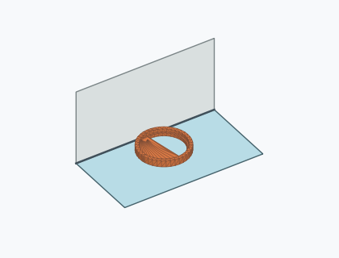](catalogue/grouped_10000/stationary/poses/P198.png) | 1 | 0.01% | 2,256 | 22.56% |
| P199 <code>Kf4i_0148</code> | G1 |  | 1 | 0.01% | 2,256 | 22.56% |
| P200 <code>Kf4i_0151</code> | G2 |  | 1 | 0.01% | 2,197 | 21.97% |
| P201 <code>Kf4i_0152</code> | G2 |  | 1 | 0.01% | 2,197 | 21.97% |
| P202 <code>Kf4i_0181</code> | G14 |  | 1 | 0.01% | 1 | 0.01% |
| P203 <code>Kf4i_0185</code> | G15 |  | 1 | 0.01% | 1 | 0.01% |
| P204 <code>Kf4i_0191</code> | G16 |  | 1 | 0.01% | 1 | 0.01% |
| P205 <code>Kf4i_0202</code> | G17 | [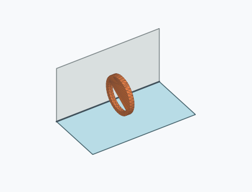](catalogue/grouped_10000/stationary/poses/P205.png) | 1 | 0.01% | 1 | 0.01% |
| P206 <code>Kf4i_0203</code> | G2 |  | 1 | 0.01% | 2,197 | 21.97% |
| P207 <code>Kf4i_0208</code> | G18 | [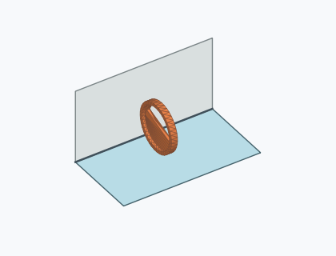](catalogue/grouped_10000/stationary/poses/P207.png) | 1 | 0.01% | 1 | 0.01% |
| P208 <code>Kf4i_0209</code> | G2 |  | 1 | 0.01% | 2,197 | 21.97% |

Outcomes from the archived run: settled stationary 8,982, unsettled stationary 1,018.

## Data and source runs

- **Moving belt** · [Catalogue JSON](catalogue/grouped_10000/moving/catalogue.json) · [Grouping evidence](catalogue/grouped_10000/moving/grouping-evidence.json) · [Checksums](catalogue/grouped_10000/moving/files.sha256.json) · [Source run and validation](simulations/20261110_10000/100mm_s/README.md) · [Raw run archive](simulations/20261110_10000/100mm_s/simulation_results.tar.xz)
- **Stationary belt** · [Catalogue JSON](catalogue/grouped_10000/stationary/catalogue.json) · [Grouping evidence](catalogue/grouped_10000/stationary/grouping-evidence.json) · [Checksums](catalogue/grouped_10000/stationary/files.sha256.json) · [Source run and validation](simulations/20261110_10000/static/README.md) · [Raw run archive](simulations/20261110_10000/static/simulation_results.tar.xz)
