# Kk2i

[Workpiece index](../README.md#workpieces)

The two catalogues derive from the saved 10,000-drop runs. Moving outcomes are measured at the virtual exit. Stationary outcomes are measured after 10 s with the belt stopped from release.

Each condition has its own pose ranks (`P000` first) and group IDs (`G0` first), ordered by descending incidence. The source pose ID appears below its rank and the thumbnail links to the full preview. Incidence uses all trials in the condition. The group totals repeat on each member pose row.

## Moving belt

9,385 of 10,000 trials settled. The catalogue contains 64 poses in 7 groups. This condition uses rounded support-family grouping.

| Pose | Group | Preview | Pose drops | Pose incidence | Group drops | Group incidence |
| --- | --- | --- | ---: | ---: | ---: | ---: |
| P000 <code>Kk2i_0047</code> | G0 |  | 1,003 | 10.03% | 5,000 | 50.00% |
| P001 <code>Kk2i_0053</code> | G0 | [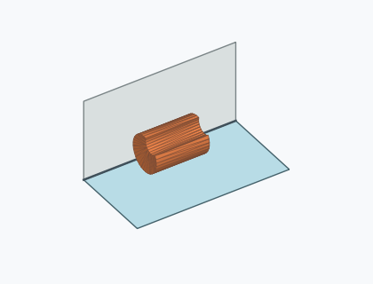](catalogue/grouped_10000/moving/poses/P001.png) | 978 | 9.78% | 5,000 | 50.00% |
| P002 <code>Kk2i_0050</code> | G0 |  | 920 | 9.20% | 5,000 | 50.00% |
| P003 <code>Kk2i_0044</code> | G0 | [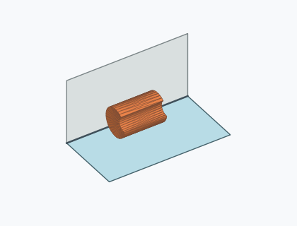](catalogue/grouped_10000/moving/poses/P003.png) | 751 | 7.51% | 5,000 | 50.00% |
| P004 <code>Kk2i_0057</code> | G0 |  | 707 | 7.07% | 5,000 | 50.00% |
| P005 <code>Kk2i_0035</code> | G3 |  | 497 | 4.97% | 497 | 4.97% |
| P006 <code>Kk2i_0015</code> | G4 |  | 495 | 4.95% | 495 | 4.95% |
| P007 <code>Kk2i_0030</code> | G1 |  | 265 | 2.65% | 1,526 | 15.26% |
| P008 <code>Kk2i_0032</code> | G2 |  | 212 | 2.12% | 1,511 | 15.11% |
| P009 <code>Kk2i_0025</code> | G2 |  | 194 | 1.94% | 1,511 | 15.11% |
| P010 <code>Kk2i_0014</code> | G2 |  | 185 | 1.85% | 1,511 | 15.11% |
| P011 <code>Kk2i_0017</code> | G5 |  | 181 | 1.81% | 181 | 1.81% |
| P012 <code>Kk2i_0037</code> | G6 |  | 175 | 1.75% | 175 | 1.75% |
| P013 <code>Kk2i_0016</code> | G2 |  | 173 | 1.73% | 1,511 | 15.11% |
| P014 <code>Kk2i_0041</code> | G0 |  | 172 | 1.72% | 5,000 | 50.00% |
| P015 <code>Kk2i_0036</code> | G1 |  | 171 | 1.71% | 1,526 | 15.26% |
| P016 <code>Kk2i_0040</code> | G1 |  | 161 | 1.61% | 1,526 | 15.26% |
| P017 <code>Kk2i_0013</code> | G2 |  | 144 | 1.44% | 1,511 | 15.11% |
| P018 <code>Kk2i_0042</code> | G1 |  | 142 | 1.42% | 1,526 | 15.26% |
| P019 <code>Kk2i_0033</code> | G1 |  | 126 | 1.26% | 1,526 | 15.26% |
| P020 <code>Kk2i_0046</code> | G1 |  | 126 | 1.26% | 1,526 | 15.26% |
| P021 <code>Kk2i_0060</code> | G0 |  | 116 | 1.16% | 5,000 | 50.00% |
| P022 <code>Kk2i_0011</code> | G2 |  | 115 | 1.15% | 1,511 | 15.11% |
| P023 <code>Kk2i_0009</code> | G2 |  | 105 | 1.05% | 1,511 | 15.11% |
| P024 <code>Kk2i_0054</code> | G1 |  | 88 | 0.88% | 1,526 | 15.26% |
| P025 <code>Kk2i_0051</code> | G1 |  | 83 | 0.83% | 1,526 | 15.26% |
| P026 <code>Kk2i_0058</code> | G1 |  | 78 | 0.78% | 1,526 | 15.26% |
| P027 <code>Kk2i_0061</code> | G1 |  | 74 | 0.74% | 1,526 | 15.26% |
| P028 <code>Kk2i_0038</code> | G0 |  | 67 | 0.67% | 5,000 | 50.00% |
| P029 <code>Kk2i_0007</code> | G2 |  | 66 | 0.66% | 1,511 | 15.11% |
| P030 <code>Kk2i_0005</code> | G2 |  | 65 | 0.65% | 1,511 | 15.11% |
| P031 <code>Kk2i_0064</code> | G1 |  | 59 | 0.59% | 1,526 | 15.26% |
| P032 <code>Kk2i_0039</code> | G2 |  | 58 | 0.58% | 1,511 | 15.11% |
| P033 <code>Kk2i_0063</code> | G0 |  | 53 | 0.53% | 5,000 | 50.00% |
| P034 <code>Kk2i_0003</code> | G2 |  | 51 | 0.51% | 1,511 | 15.11% |
| P035 <code>Kk2i_0049</code> | G0 |  | 45 | 0.45% | 5,000 | 50.00% |
| P036 <code>Kk2i_0052</code> | G1 |  | 39 | 0.39% | 1,526 | 15.26% |
| P037 <code>Kk2i_0045</code> | G0 |  | 36 | 0.36% | 5,000 | 50.00% |
| P038 <code>Kk2i_0059</code> | G1 | [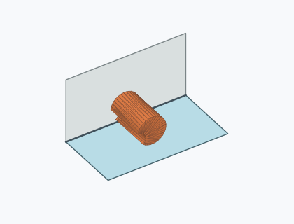](catalogue/grouped_10000/moving/poses/P038.png) | 36 | 0.36% | 1,526 | 15.26% |
| P039 <code>Kk2i_0062</code> | G1 |  | 34 | 0.34% | 1,526 | 15.26% |
| P040 <code>Kk2i_0001</code> | G2 |  | 33 | 0.33% | 1,511 | 15.11% |
| P041 <code>Kk2i_0002</code> | G2 |  | 33 | 0.33% | 1,511 | 15.11% |
| P042 <code>Kk2i_0055</code> | G0 |  | 33 | 0.33% | 5,000 | 50.00% |
| P043 <code>Kk2i_0034</code> | G0 |  | 29 | 0.29% | 5,000 | 50.00% |
| P044 <code>Kk2i_0004</code> | G2 |  | 27 | 0.27% | 1,511 | 15.11% |
| P045 <code>Kk2i_0056</code> | G1 |  | 26 | 0.26% | 1,526 | 15.26% |
| P046 <code>Kk2i_0018</code> | G0 |  | 21 | 0.21% | 5,000 | 50.00% |
| P047 <code>Kk2i_0006</code> | G2 |  | 18 | 0.18% | 1,511 | 15.11% |
| P048 <code>Kk2i_0010</code> | G2 |  | 16 | 0.16% | 1,511 | 15.11% |
| P049 <code>Kk2i_0008</code> | G2 |  | 14 | 0.14% | 1,511 | 15.11% |
| P050 <code>Kk2i_0019</code> | G0 |  | 13 | 0.13% | 5,000 | 50.00% |
| P051 <code>Kk2i_0048</code> | G1 |  | 12 | 0.12% | 1,526 | 15.26% |
| P052 <code>Kk2i_0020</code> | G0 |  | 10 | 0.10% | 5,000 | 50.00% |
| P053 <code>Kk2i_0029</code> | G0 |  | 10 | 0.10% | 5,000 | 50.00% |
| P054 <code>Kk2i_0031</code> | G0 |  | 10 | 0.10% | 5,000 | 50.00% |
| P055 <code>Kk2i_0023</code> | G0 | [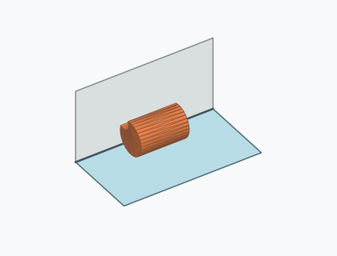](catalogue/grouped_10000/moving/poses/P055.png) | 8 | 0.08% | 5,000 | 50.00% |
| P056 <code>Kk2i_0024</code> | G0 |  | 6 | 0.06% | 5,000 | 50.00% |
| P057 <code>Kk2i_0028</code> | G1 |  | 6 | 0.06% | 1,526 | 15.26% |
| P058 <code>Kk2i_0026</code> | G0 |  | 4 | 0.04% | 5,000 | 50.00% |
| P059 <code>Kk2i_0021</code> | G0 |  | 3 | 0.03% | 5,000 | 50.00% |
| P060 <code>Kk2i_0022</code> | G0 |  | 3 | 0.03% | 5,000 | 50.00% |
| P061 <code>Kk2i_0027</code> | G0 |  | 2 | 0.02% | 5,000 | 50.00% |
| P062 <code>Kk2i_0012</code> | G2 |  | 1 | 0.01% | 1,511 | 15.11% |
| P063 <code>Kk2i_0043</code> | G2 |  | 1 | 0.01% | 1,511 | 15.11% |

Outcomes from the archived run: settled 9,385, unsettled 615.

## Stationary belt

9,978 of 10,000 trials settled. The catalogue contains 134 poses in 17 groups. This condition uses rounded support-family grouping.

| Pose | Group | Preview | Pose drops | Pose incidence | Group drops | Group incidence |
| --- | --- | --- | ---: | ---: | ---: | ---: |
| P000 <code>Kk2i_0095</code> | G0 |  | 898 | 8.98% | 4,998 | 49.98% |
| P001 <code>Kk2i_0085</code> | G0 |  | 877 | 8.77% | 4,998 | 49.98% |
| P002 <code>Kk2i_0102</code> | G0 |  | 872 | 8.72% | 4,998 | 49.98% |
| P003 <code>Kk2i_0078</code> | G0 |  | 706 | 7.06% | 4,998 | 49.98% |
| P004 <code>Kk2i_0115</code> | G0 |  | 669 | 6.69% | 4,998 | 49.98% |
| P005 <code>Kk2i_0066</code> | G3 |  | 541 | 5.41% | 541 | 5.41% |
| P006 <code>Kk2i_0019</code> | G4 |  | 472 | 4.72% | 472 | 4.72% |
| P007 <code>Kk2i_0072</code> | G0 |  | 322 | 3.22% | 4,998 | 49.98% |
| P008 <code>Kk2i_0124</code> | G0 |  | 266 | 2.66% | 4,998 | 49.98% |
| P009 <code>Kk2i_0047</code> | G1 |  | 191 | 1.91% | 1,974 | 19.74% |
| P010 <code>Kk2i_0058</code> | G1 |  | 191 | 1.91% | 1,974 | 19.74% |
| P011 <code>Kk2i_0015</code> | G1 |  | 170 | 1.70% | 1,974 | 19.74% |
| P012 <code>Kk2i_0018</code> | G5 | [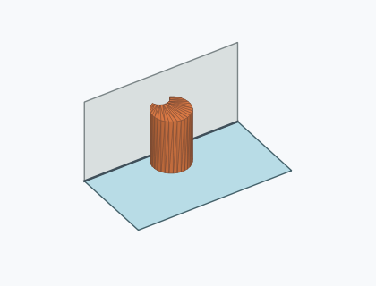](catalogue/grouped_10000/stationary/poses/P012.png) | 166 | 1.66% | 166 | 1.66% |
| P013 <code>Kk2i_0065</code> | G6 |  | 165 | 1.65% | 165 | 1.65% |
| P014 <code>Kk2i_0016</code> | G1 |  | 163 | 1.63% | 1,974 | 19.74% |
| P015 <code>Kk2i_0068</code> | G1 |  | 139 | 1.39% | 1,974 | 19.74% |
| P016 <code>Kk2i_0014</code> | G1 |  | 136 | 1.36% | 1,974 | 19.74% |
| P017 <code>Kk2i_0064</code> | G2 |  | 129 | 1.29% | 1,652 | 16.52% |
| P018 <code>Kk2i_0060</code> | G2 |  | 128 | 1.28% | 1,652 | 16.52% |
| P019 <code>Kk2i_0075</code> | G1 |  | 122 | 1.22% | 1,974 | 19.74% |
| P020 <code>Kk2i_0012</code> | G1 |  | 117 | 1.17% | 1,974 | 19.74% |
| P021 <code>Kk2i_0071</code> | G2 |  | 109 | 1.09% | 1,652 | 16.52% |
| P022 <code>Kk2i_0076</code> | G2 |  | 106 | 1.06% | 1,652 | 16.52% |
| P023 <code>Kk2i_0083</code> | G2 |  | 99 | 0.99% | 1,652 | 16.52% |
| P024 <code>Kk2i_0053</code> | G2 |  | 94 | 0.94% | 1,652 | 16.52% |
| P025 <code>Kk2i_0090</code> | G1 |  | 85 | 0.85% | 1,974 | 19.74% |
| P026 <code>Kk2i_0050</code> | G2 |  | 80 | 0.80% | 1,652 | 16.52% |
| P027 <code>Kk2i_0092</code> | G2 |  | 78 | 0.78% | 1,652 | 16.52% |
| P028 <code>Kk2i_0010</code> | G1 |  | 72 | 0.72% | 1,974 | 19.74% |
| P029 <code>Kk2i_0067</code> | G0 |  | 72 | 0.72% | 4,998 | 49.98% |
| P030 <code>Kk2i_0131</code> | G0 |  | 71 | 0.71% | 4,998 | 49.98% |
| P031 <code>Kk2i_0042</code> | G2 |  | 70 | 0.70% | 1,652 | 16.52% |
| P032 <code>Kk2i_0007</code> | G1 |  | 66 | 0.66% | 1,974 | 19.74% |
| P033 <code>Kk2i_0105</code> | G1 |  | 64 | 0.64% | 1,974 | 19.74% |
| P034 <code>Kk2i_0005</code> | G1 |  | 60 | 0.60% | 1,974 | 19.74% |
| P035 <code>Kk2i_0119</code> | G1 |  | 58 | 0.58% | 1,974 | 19.74% |
| P036 <code>Kk2i_0035</code> | G2 |  | 46 | 0.46% | 1,652 | 16.52% |
| P037 <code>Kk2i_0101</code> | G2 |  | 46 | 0.46% | 1,652 | 16.52% |
| P038 <code>Kk2i_0127</code> | G1 |  | 46 | 0.46% | 1,974 | 19.74% |
| P039 <code>Kk2i_0003</code> | G1 |  | 44 | 0.44% | 1,974 | 19.74% |
| P040 <code>Kk2i_0113</code> | G2 |  | 40 | 0.40% | 1,652 | 16.52% |
| P041 <code>Kk2i_0122</code> | G2 |  | 40 | 0.40% | 1,652 | 16.52% |
| P042 <code>Kk2i_0024</code> | G0 |  | 39 | 0.39% | 4,998 | 49.98% |
| P043 <code>Kk2i_0028</code> | G2 |  | 38 | 0.38% | 1,652 | 16.52% |
| P044 <code>Kk2i_0094</code> | G0 |  | 36 | 0.36% | 4,998 | 49.98% |
| P045 <code>Kk2i_0022</code> | G2 |  | 35 | 0.35% | 1,652 | 16.52% |
| P046 <code>Kk2i_0017</code> | G2 |  | 34 | 0.34% | 1,652 | 16.52% |
| P047 <code>Kk2i_0104</code> | G0 |  | 33 | 0.33% | 4,998 | 49.98% |
| P048 <code>Kk2i_0121</code> | G1 |  | 32 | 0.32% | 1,974 | 19.74% |
| P049 <code>Kk2i_0129</code> | G2 |  | 32 | 0.32% | 1,652 | 16.52% |
| P050 <code>Kk2i_0002</code> | G1 | [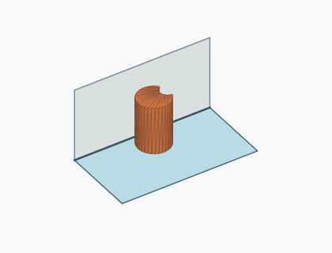](catalogue/grouped_10000/stationary/poses/P050.png) | 30 | 0.30% | 1,974 | 19.74% |
| P051 <code>Kk2i_0023</code> | G2 |  | 29 | 0.29% | 1,652 | 16.52% |
| P052 <code>Kk2i_0061</code> | G0 |  | 29 | 0.29% | 4,998 | 49.98% |
| P053 <code>Kk2i_0004</code> | G1 |  | 26 | 0.26% | 1,974 | 19.74% |
| P054 <code>Kk2i_0108</code> | G1 |  | 26 | 0.26% | 1,974 | 19.74% |
| P055 <code>Kk2i_0027</code> | G2 |  | 25 | 0.25% | 1,652 | 16.52% |
| P056 <code>Kk2i_0097</code> | G2 |  | 25 | 0.25% | 1,652 | 16.52% |
| P057 <code>Kk2i_0123</code> | G2 |  | 25 | 0.25% | 1,652 | 16.52% |
| P058 <code>Kk2i_0001</code> | G1 |  | 24 | 0.24% | 1,974 | 19.74% |
| P059 <code>Kk2i_0033</code> | G2 |  | 24 | 0.24% | 1,652 | 16.52% |
| P060 <code>Kk2i_0084</code> | G0 | [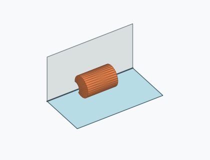](catalogue/grouped_10000/stationary/poses/P060.png) | 24 | 0.24% | 4,998 | 49.98% |
| P061 <code>Kk2i_0093</code> | G1 |  | 23 | 0.23% | 1,974 | 19.74% |
| P062 <code>Kk2i_0080</code> | G1 | [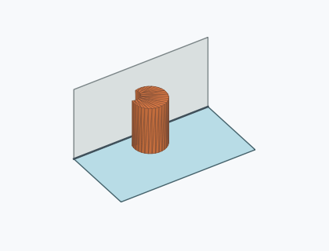](catalogue/grouped_10000/stationary/poses/P062.png) | 22 | 0.22% | 1,974 | 19.74% |
| P063 <code>Kk2i_0006</code> | G1 |  | 21 | 0.21% | 1,974 | 19.74% |
| P064 <code>Kk2i_0103</code> | G2 |  | 20 | 0.20% | 1,652 | 16.52% |
| P065 <code>Kk2i_0056</code> | G0 |  | 17 | 0.17% | 4,998 | 49.98% |
| P066 <code>Kk2i_0069</code> | G2 |  | 17 | 0.17% | 1,652 | 16.52% |
| P067 <code>Kk2i_0099</code> | G2 |  | 17 | 0.17% | 1,652 | 16.52% |
| P068 <code>Kk2i_0009</code> | G1 |  | 15 | 0.15% | 1,974 | 19.74% |
| P069 <code>Kk2i_0116</code> | G2 |  | 15 | 0.15% | 1,652 | 16.52% |
| P070 <code>Kk2i_0029</code> | G0 |  | 14 | 0.14% | 4,998 | 49.98% |
| P071 <code>Kk2i_0074</code> | G2 |  | 14 | 0.14% | 1,652 | 16.52% |
| P072 <code>Kk2i_0030</code> | G0 |  | 13 | 0.13% | 4,998 | 49.98% |
| P073 <code>Kk2i_0048</code> | G2 | [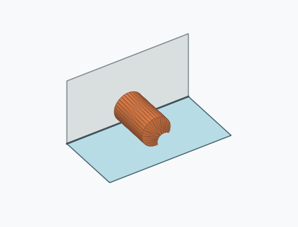](catalogue/grouped_10000/stationary/poses/P073.png) | 13 | 0.13% | 1,652 | 16.52% |
| P074 <code>Kk2i_0041</code> | G2 |  | 12 | 0.12% | 1,652 | 16.52% |
| P075 <code>Kk2i_0087</code> | G2 |  | 12 | 0.12% | 1,652 | 16.52% |
| P076 <code>Kk2i_0120</code> | G2 |  | 12 | 0.12% | 1,652 | 16.52% |
| P077 <code>Kk2i_0032</code> | G2 |  | 11 | 0.11% | 1,652 | 16.52% |
| P078 <code>Kk2i_0052</code> | G2 |  | 11 | 0.11% | 1,652 | 16.52% |
| P079 <code>Kk2i_0070</code> | G1 |  | 11 | 0.11% | 1,974 | 19.74% |
| P080 <code>Kk2i_0089</code> | G2 |  | 11 | 0.11% | 1,652 | 16.52% |
| P081 <code>Kk2i_0034</code> | G0 |  | 10 | 0.10% | 4,998 | 49.98% |
| P082 <code>Kk2i_0055</code> | G0 |  | 10 | 0.10% | 4,998 | 49.98% |
| P083 <code>Kk2i_0057</code> | G2 |  | 10 | 0.10% | 1,652 | 16.52% |
| P084 <code>Kk2i_0063</code> | G2 |  | 10 | 0.10% | 1,652 | 16.52% |
| P085 <code>Kk2i_0086</code> | G2 |  | 10 | 0.10% | 1,652 | 16.52% |
| P086 <code>Kk2i_0110</code> | G2 |  | 10 | 0.10% | 1,652 | 16.52% |
| P087 <code>Kk2i_0046</code> | G2 |  | 9 | 0.09% | 1,652 | 16.52% |
| P088 <code>Kk2i_0011</code> | G1 | [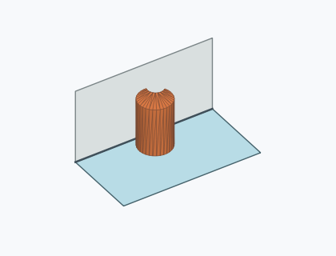](catalogue/grouped_10000/stationary/poses/P088.png) | 8 | 0.08% | 1,974 | 19.74% |
| P089 <code>Kk2i_0059</code> | G2 |  | 8 | 0.08% | 1,652 | 16.52% |
| P090 <code>Kk2i_0021</code> | G2 |  | 7 | 0.07% | 1,652 | 16.52% |
| P091 <code>Kk2i_0038</code> | G2 |  | 7 | 0.07% | 1,652 | 16.52% |
| P092 <code>Kk2i_0079</code> | G2 | [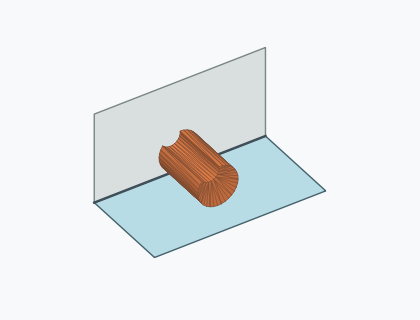](catalogue/grouped_10000/stationary/poses/P092.png) | 7 | 0.07% | 1,652 | 16.52% |
| P093 <code>Kk2i_0096</code> | G2 |  | 7 | 0.07% | 1,652 | 16.52% |
| P094 <code>Kk2i_0025</code> | G2 |  | 6 | 0.06% | 1,652 | 16.52% |
| P095 <code>Kk2i_0062</code> | G2 |  | 6 | 0.06% | 1,652 | 16.52% |
| P096 <code>Kk2i_0117</code> | G2 |  | 6 | 0.06% | 1,652 | 16.52% |
| P097 <code>Kk2i_0125</code> | G2 |  | 6 | 0.06% | 1,652 | 16.52% |
| P098 <code>Kk2i_0037</code> | G2 |  | 5 | 0.05% | 1,652 | 16.52% |
| P099 <code>Kk2i_0043</code> | G0 |  | 5 | 0.05% | 4,998 | 49.98% |
| P100 <code>Kk2i_0044</code> | G0 |  | 5 | 0.05% | 4,998 | 49.98% |
| P101 <code>Kk2i_0051</code> | G0 |  | 5 | 0.05% | 4,998 | 49.98% |
| P102 <code>Kk2i_0106</code> | G2 |  | 5 | 0.05% | 1,652 | 16.52% |
| P103 <code>Kk2i_0088</code> | G2 |  | 4 | 0.04% | 1,652 | 16.52% |
| P104 <code>Kk2i_0100</code> | G2 |  | 4 | 0.04% | 1,652 | 16.52% |
| P105 <code>Kk2i_0111</code> | G2 |  | 4 | 0.04% | 1,652 | 16.52% |
| P106 <code>Kk2i_0128</code> | G2 |  | 4 | 0.04% | 1,652 | 16.52% |
| P107 <code>Kk2i_0132</code> | G1 |  | 4 | 0.04% | 1,974 | 19.74% |
| P108 <code>Kk2i_0020</code> | G2 |  | 3 | 0.03% | 1,652 | 16.52% |
| P109 <code>Kk2i_0040</code> | G2 |  | 3 | 0.03% | 1,652 | 16.52% |
| P110 <code>Kk2i_0049</code> | G0 |  | 3 | 0.03% | 4,998 | 49.98% |
| P111 <code>Kk2i_0112</code> | G1 |  | 3 | 0.03% | 1,974 | 19.74% |
| P112 <code>Kk2i_0126</code> | G2 |  | 3 | 0.03% | 1,652 | 16.52% |
| P113 <code>Kk2i_0026</code> | G2 |  | 2 | 0.02% | 1,652 | 16.52% |
| P114 <code>Kk2i_0031</code> | G2 |  | 2 | 0.02% | 1,652 | 16.52% |
| P115 <code>Kk2i_0036</code> | G0 |  | 2 | 0.02% | 4,998 | 49.98% |
| P116 <code>Kk2i_0054</code> | G2 | [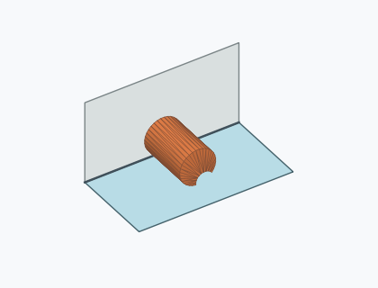](catalogue/grouped_10000/stationary/poses/P116.png) | 2 | 0.02% | 1,652 | 16.52% |
| P117 <code>Kk2i_0098</code> | G1 |  | 2 | 0.02% | 1,974 | 19.74% |
| P118 <code>Kk2i_0118</code> | G2 |  | 2 | 0.02% | 1,652 | 16.52% |
| P119 <code>Kk2i_0134</code> | G1 |  | 2 | 0.02% | 1,974 | 19.74% |
| P120 <code>Kk2i_0008</code> | G7 | [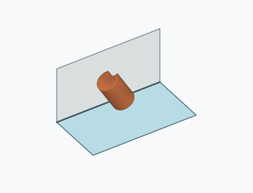](catalogue/grouped_10000/stationary/poses/P120.png) | 1 | 0.01% | 1 | 0.01% |
| P121 <code>Kk2i_0013</code> | G8 |  | 1 | 0.01% | 1 | 0.01% |
| P122 <code>Kk2i_0039</code> | G9 |  | 1 | 0.01% | 1 | 0.01% |
| P123 <code>Kk2i_0045</code> | G2 |  | 1 | 0.01% | 1,652 | 16.52% |
| P124 <code>Kk2i_0073</code> | G10 | [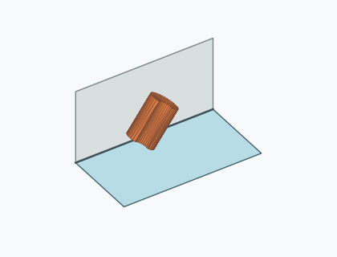](catalogue/grouped_10000/stationary/poses/P124.png) | 1 | 0.01% | 1 | 0.01% |
| P125 <code>Kk2i_0077</code> | G2 |  | 1 | 0.01% | 1,652 | 16.52% |
| P126 <code>Kk2i_0081</code> | G2 |  | 1 | 0.01% | 1,652 | 16.52% |
| P127 <code>Kk2i_0082</code> | G11 | [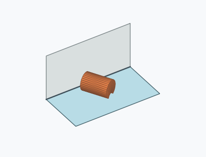](catalogue/grouped_10000/stationary/poses/P127.png) | 1 | 0.01% | 1 | 0.01% |
| P128 <code>Kk2i_0091</code> | G12 | [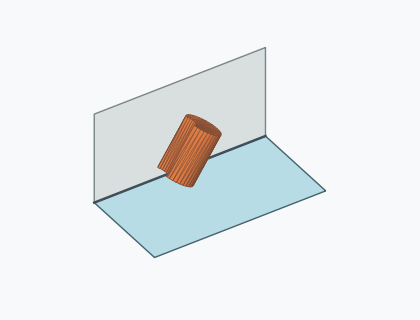](catalogue/grouped_10000/stationary/poses/P128.png) | 1 | 0.01% | 1 | 0.01% |
| P129 <code>Kk2i_0107</code> | G13 | [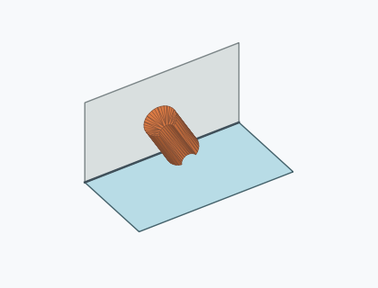](catalogue/grouped_10000/stationary/poses/P129.png) | 1 | 0.01% | 1 | 0.01% |
| P130 <code>Kk2i_0109</code> | G14 | [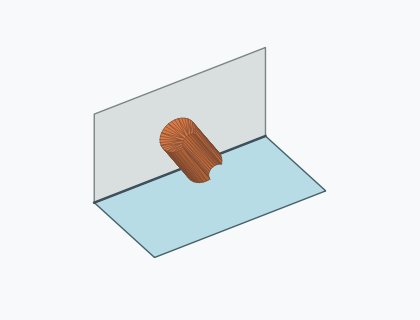](catalogue/grouped_10000/stationary/poses/P130.png) | 1 | 0.01% | 1 | 0.01% |
| P131 <code>Kk2i_0114</code> | G15 | [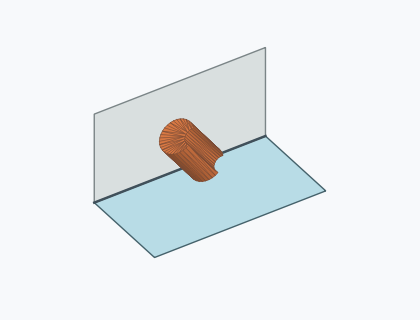](catalogue/grouped_10000/stationary/poses/P131.png) | 1 | 0.01% | 1 | 0.01% |
| P132 <code>Kk2i_0130</code> | G16 |  | 1 | 0.01% | 1 | 0.01% |
| P133 <code>Kk2i_0133</code> | G1 |  | 1 | 0.01% | 1,974 | 19.74% |

Outcomes from the archived run: settled stationary 9,978, unsettled stationary 22.

## Data and source runs

- **Moving belt** · [Catalogue JSON](catalogue/grouped_10000/moving/catalogue.json) · [Grouping evidence](catalogue/grouped_10000/moving/grouping-evidence.json) · [Checksums](catalogue/grouped_10000/moving/files.sha256.json) · [Source run and validation](simulations/20261110_10000/100mm_s/README.md) · [Raw run archive](simulations/20261110_10000/100mm_s/simulation_results.tar.xz)
- **Stationary belt** · [Catalogue JSON](catalogue/grouped_10000/stationary/catalogue.json) · [Grouping evidence](catalogue/grouped_10000/stationary/grouping-evidence.json) · [Checksums](catalogue/grouped_10000/stationary/files.sha256.json) · [Source run and validation](simulations/20261110_10000/static/README.md) · [Raw run archive](simulations/20261110_10000/static/simulation_results.tar.xz)
- [Separate 100-drop contact and grouping validation](https://github.com/match-BiBaZu/BiBaZu_Stable_ComponentPoses/blob/0cc7a4a95c9fd472c379700ffded127e32022233/Kk2i/simulations/20261113_contact_100/README.md)
- [Earlier catalogue and source records](https://github.com/match-BiBaZu/BiBaZu_Stable_ComponentPoses/blob/0cc7a4a95c9fd472c379700ffded127e32022233/Kk2i/README.md)
