# Kk4a

[Workpiece index](../README.md#workpieces)

The two catalogues derive from the saved 10,000-drop runs. Moving outcomes are measured at the virtual exit. Stationary outcomes are measured after 10 s with the belt stopped from release.

Each condition has its own pose ranks (`P000` first) and group IDs (`G0` first), ordered by descending incidence. The source pose ID appears below its rank and the thumbnail links to the full preview. Incidence uses all trials in the condition. The group totals repeat on each member pose row.

## Moving belt

9,988 of 10,000 trials settled. The catalogue contains 190 poses in 8 groups. This condition uses rounded support-family grouping.

| Pose | Group | Preview | Pose drops | Pose incidence | Group drops | Group incidence |
| --- | --- | --- | ---: | ---: | ---: | ---: |
| P000 <code>Kk4a_0143</code> | G0 |  | 104 | 1.04% | 4,171 | 41.71% |
| P001 <code>Kk4a_0023</code> | G0 |  | 100 | 1.00% | 4,171 | 41.71% |
| P002 <code>Kk4a_0008</code> | G1 |  | 93 | 0.93% | 3,969 | 39.69% |
| P003 <code>Kk4a_0014</code> | G1 |  | 93 | 0.93% | 3,969 | 39.69% |
| P004 <code>Kk4a_0187</code> | G1 |  | 92 | 0.92% | 3,969 | 39.69% |
| P005 <code>Kk4a_0018</code> | G0 |  | 91 | 0.91% | 4,171 | 41.71% |
| P006 <code>Kk4a_0074</code> | G0 |  | 91 | 0.91% | 4,171 | 41.71% |
| P007 <code>Kk4a_0025</code> | G1 |  | 90 | 0.90% | 3,969 | 39.69% |
| P008 <code>Kk4a_0073</code> | G0 |  | 88 | 0.88% | 4,171 | 41.71% |
| P009 <code>Kk4a_0130</code> | G0 |  | 84 | 0.84% | 4,171 | 41.71% |
| P010 <code>Kk4a_0166</code> | G1 | [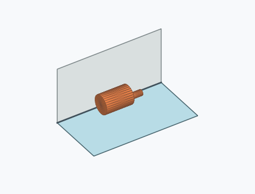](catalogue/grouped_10000/moving/poses/P010.png) | 82 | 0.82% | 3,969 | 39.69% |
| P011 <code>Kk4a_0176</code> | G1 |  | 82 | 0.82% | 3,969 | 39.69% |
| P012 <code>Kk4a_0056</code> | G0 |  | 81 | 0.81% | 4,171 | 41.71% |
| P013 <code>Kk4a_0177</code> | G1 |  | 81 | 0.81% | 3,969 | 39.69% |
| P014 <code>Kk4a_0002</code> | G1 |  | 80 | 0.80% | 3,969 | 39.69% |
| P015 <code>Kk4a_0069</code> | G1 |  | 80 | 0.80% | 3,969 | 39.69% |
| P016 <code>Kk4a_0006</code> | G0 |  | 79 | 0.79% | 4,171 | 41.71% |
| P017 <code>Kk4a_0017</code> | G0 | [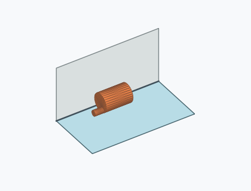](catalogue/grouped_10000/moving/poses/P017.png) | 78 | 0.78% | 4,171 | 41.71% |
| P018 <code>Kk4a_0062</code> | G0 |  | 78 | 0.78% | 4,171 | 41.71% |
| P019 <code>Kk4a_0134</code> | G0 |  | 78 | 0.78% | 4,171 | 41.71% |
| P020 <code>Kk4a_0145</code> | G0 | [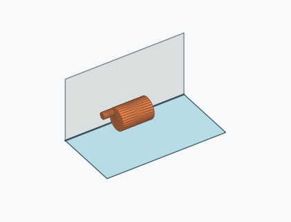](catalogue/grouped_10000/moving/poses/P020.png) | 78 | 0.78% | 4,171 | 41.71% |
| P021 <code>Kk4a_0147</code> | G0 |  | 78 | 0.78% | 4,171 | 41.71% |
| P022 <code>Kk4a_0035</code> | G0 |  | 75 | 0.75% | 4,171 | 41.71% |
| P023 <code>Kk4a_0159</code> | G1 |  | 75 | 0.75% | 3,969 | 39.69% |
| P024 <code>Kk4a_0174</code> | G0 |  | 75 | 0.75% | 4,171 | 41.71% |
| P025 <code>Kk4a_0037</code> | G0 |  | 74 | 0.74% | 4,171 | 41.71% |
| P026 <code>Kk4a_0055</code> | G0 |  | 74 | 0.74% | 4,171 | 41.71% |
| P027 <code>Kk4a_0068</code> | G0 |  | 74 | 0.74% | 4,171 | 41.71% |
| P028 <code>Kk4a_0150</code> | G0 |  | 74 | 0.74% | 4,171 | 41.71% |
| P029 <code>Kk4a_0152</code> | G0 |  | 74 | 0.74% | 4,171 | 41.71% |
| P030 <code>Kk4a_0186</code> | G0 |  | 74 | 0.74% | 4,171 | 41.71% |
| P031 <code>Kk4a_0042</code> | G1 |  | 73 | 0.73% | 3,969 | 39.69% |
| P032 <code>Kk4a_0057</code> | G1 |  | 73 | 0.73% | 3,969 | 39.69% |
| P033 <code>Kk4a_0084</code> | G0 |  | 73 | 0.73% | 4,171 | 41.71% |
| P034 <code>Kk4a_0182</code> | G1 |  | 73 | 0.73% | 3,969 | 39.69% |
| P035 <code>Kk4a_0026</code> | G0 |  | 72 | 0.72% | 4,171 | 41.71% |
| P036 <code>Kk4a_0128</code> | G0 |  | 72 | 0.72% | 4,171 | 41.71% |
| P037 <code>Kk4a_0004</code> | G1 |  | 71 | 0.71% | 3,969 | 39.69% |
| P038 <code>Kk4a_0020</code> | G1 |  | 71 | 0.71% | 3,969 | 39.69% |
| P039 <code>Kk4a_0153</code> | G1 |  | 71 | 0.71% | 3,969 | 39.69% |
| P040 <code>Kk4a_0155</code> | G0 |  | 71 | 0.71% | 4,171 | 41.71% |
| P041 <code>Kk4a_0024</code> | G1 |  | 70 | 0.70% | 3,969 | 39.69% |
| P042 <code>Kk4a_0038</code> | G1 |  | 70 | 0.70% | 3,969 | 39.69% |
| P043 <code>Kk4a_0138</code> | G1 |  | 70 | 0.70% | 3,969 | 39.69% |
| P044 <code>Kk4a_0148</code> | G1 |  | 70 | 0.70% | 3,969 | 39.69% |
| P045 <code>Kk4a_0185</code> | G1 | [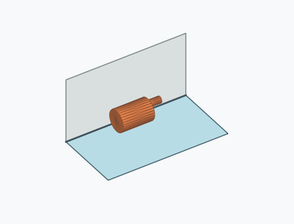](catalogue/grouped_10000/moving/poses/P045.png) | 70 | 0.70% | 3,969 | 39.69% |
| P046 <code>Kk4a_0011</code> | G0 |  | 69 | 0.69% | 4,171 | 41.71% |
| P047 <code>Kk4a_0043</code> | G0 |  | 69 | 0.69% | 4,171 | 41.71% |
| P048 <code>Kk4a_0044</code> | G1 |  | 69 | 0.69% | 3,969 | 39.69% |
| P049 <code>Kk4a_0161</code> | G1 |  | 69 | 0.69% | 3,969 | 39.69% |
| P050 <code>Kk4a_0050</code> | G0 |  | 68 | 0.68% | 4,171 | 41.71% |
| P051 <code>Kk4a_0179</code> | G1 |  | 68 | 0.68% | 3,969 | 39.69% |
| P052 <code>Kk4a_0183</code> | G0 |  | 68 | 0.68% | 4,171 | 41.71% |
| P053 <code>Kk4a_0033</code> | G1 |  | 67 | 0.67% | 3,969 | 39.69% |
| P054 <code>Kk4a_0088</code> | G0 |  | 67 | 0.67% | 4,171 | 41.71% |
| P055 <code>Kk4a_0142</code> | G1 | [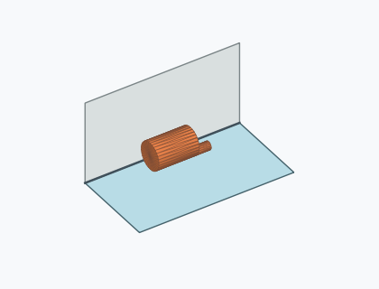](catalogue/grouped_10000/moving/poses/P055.png) | 67 | 0.67% | 3,969 | 39.69% |
| P056 <code>Kk4a_0188</code> | G0 |  | 67 | 0.67% | 4,171 | 41.71% |
| P057 <code>Kk4a_0030</code> | G1 |  | 66 | 0.66% | 3,969 | 39.69% |
| P058 <code>Kk4a_0047</code> | G0 |  | 66 | 0.66% | 4,171 | 41.71% |
| P059 <code>Kk4a_0087</code> | G1 |  | 66 | 0.66% | 3,969 | 39.69% |
| P060 <code>Kk4a_0139</code> | G0 |  | 66 | 0.66% | 4,171 | 41.71% |
| P061 <code>Kk4a_0151</code> | G1 |  | 66 | 0.66% | 3,969 | 39.69% |
| P062 <code>Kk4a_0164</code> | G1 |  | 66 | 0.66% | 3,969 | 39.69% |
| P063 <code>Kk4a_0165</code> | G0 |  | 66 | 0.66% | 4,171 | 41.71% |
| P064 <code>Kk4a_0167</code> | G0 |  | 66 | 0.66% | 4,171 | 41.71% |
| P065 <code>Kk4a_0172</code> | G0 |  | 66 | 0.66% | 4,171 | 41.71% |
| P066 <code>Kk4a_0013</code> | G0 |  | 65 | 0.65% | 4,171 | 41.71% |
| P067 <code>Kk4a_0041</code> | G0 |  | 65 | 0.65% | 4,171 | 41.71% |
| P068 <code>Kk4a_0078</code> | G0 |  | 65 | 0.65% | 4,171 | 41.71% |
| P069 <code>Kk4a_0144</code> | G1 |  | 65 | 0.65% | 3,969 | 39.69% |
| P070 <code>Kk4a_0160</code> | G0 |  | 65 | 0.65% | 4,171 | 41.71% |
| P071 <code>Kk4a_0173</code> | G1 |  | 65 | 0.65% | 3,969 | 39.69% |
| P072 <code>Kk4a_0081</code> | G0 |  | 64 | 0.64% | 4,171 | 41.71% |
| P073 <code>Kk4a_0137</code> | G0 |  | 64 | 0.64% | 4,171 | 41.71% |
| P074 <code>Kk4a_0141</code> | G0 |  | 64 | 0.64% | 4,171 | 41.71% |
| P075 <code>Kk4a_0129</code> | G1 |  | 63 | 0.63% | 3,969 | 39.69% |
| P076 <code>Kk4a_0158</code> | G0 |  | 63 | 0.63% | 4,171 | 41.71% |
| P077 <code>Kk4a_0171</code> | G1 |  | 63 | 0.63% | 3,969 | 39.69% |
| P078 <code>Kk4a_0029</code> | G0 |  | 62 | 0.62% | 4,171 | 41.71% |
| P079 <code>Kk4a_0036</code> | G1 |  | 62 | 0.62% | 3,969 | 39.69% |
| P080 <code>Kk4a_0060</code> | G1 |  | 62 | 0.62% | 3,969 | 39.69% |
| P081 <code>Kk4a_0080</code> | G1 |  | 62 | 0.62% | 3,969 | 39.69% |
| P082 <code>Kk4a_0136</code> | G1 |  | 62 | 0.62% | 3,969 | 39.69% |
| P083 <code>Kk4a_0031</code> | G0 |  | 61 | 0.61% | 4,171 | 41.71% |
| P084 <code>Kk4a_0067</code> | G0 |  | 61 | 0.61% | 4,171 | 41.71% |
| P085 <code>Kk4a_0095</code> | G0 |  | 61 | 0.61% | 4,171 | 41.71% |
| P086 <code>Kk4a_0140</code> | G1 |  | 61 | 0.61% | 3,969 | 39.69% |
| P087 <code>Kk4a_0184</code> | G1 |  | 61 | 0.61% | 3,969 | 39.69% |
| P088 <code>Kk4a_0063</code> | G1 |  | 60 | 0.60% | 3,969 | 39.69% |
| P089 <code>Kk4a_0146</code> | G1 |  | 60 | 0.60% | 3,969 | 39.69% |
| P090 <code>Kk4a_0154</code> | G1 |  | 60 | 0.60% | 3,969 | 39.69% |
| P091 <code>Kk4a_0175</code> | G0 |  | 60 | 0.60% | 4,171 | 41.71% |
| P092 <code>Kk4a_0189</code> | G0 |  | 60 | 0.60% | 4,171 | 41.71% |
| P093 <code>Kk4a_0190</code> | G1 |  | 60 | 0.60% | 3,969 | 39.69% |
| P094 <code>Kk4a_0010</code> | G1 |  | 59 | 0.59% | 3,969 | 39.69% |
| P095 <code>Kk4a_0048</code> | G1 |  | 59 | 0.59% | 3,969 | 39.69% |
| P096 <code>Kk4a_0061</code> | G0 |  | 59 | 0.59% | 4,171 | 41.71% |
| P097 <code>Kk4a_0093</code> | G1 |  | 59 | 0.59% | 3,969 | 39.69% |
| P098 <code>Kk4a_0132</code> | G1 |  | 59 | 0.59% | 3,969 | 39.69% |
| P099 <code>Kk4a_0133</code> | G0 |  | 59 | 0.59% | 4,171 | 41.71% |
| P100 <code>Kk4a_0149</code> | G0 |  | 59 | 0.59% | 4,171 | 41.71% |
| P101 <code>Kk4a_0169</code> | G1 | [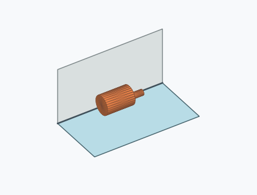](catalogue/grouped_10000/moving/poses/P101.png) | 59 | 0.59% | 3,969 | 39.69% |
| P102 <code>Kk4a_0135</code> | G1 |  | 58 | 0.58% | 3,969 | 39.69% |
| P103 <code>Kk4a_0180</code> | G0 |  | 58 | 0.58% | 4,171 | 41.71% |
| P104 <code>Kk4a_0003</code> | G0 |  | 56 | 0.56% | 4,171 | 41.71% |
| P105 <code>Kk4a_0051</code> | G1 |  | 56 | 0.56% | 3,969 | 39.69% |
| P106 <code>Kk4a_0092</code> | G0 |  | 56 | 0.56% | 4,171 | 41.71% |
| P107 <code>Kk4a_0170</code> | G0 |  | 56 | 0.56% | 4,171 | 41.71% |
| P108 <code>Kk4a_0178</code> | G0 |  | 56 | 0.56% | 4,171 | 41.71% |
| P109 <code>Kk4a_0005</code> | G0 |  | 55 | 0.55% | 4,171 | 41.71% |
| P110 <code>Kk4a_0091</code> | G1 |  | 54 | 0.54% | 3,969 | 39.69% |
| P111 <code>Kk4a_0111</code> | G2 |  | 54 | 0.54% | 1,015 | 10.15% |
| P112 <code>Kk4a_0075</code> | G1 |  | 53 | 0.53% | 3,969 | 39.69% |
| P113 <code>Kk4a_0100</code> | G2 |  | 53 | 0.53% | 1,015 | 10.15% |
| P114 <code>Kk4a_0079</code> | G1 |  | 52 | 0.52% | 3,969 | 39.69% |
| P115 <code>Kk4a_0085</code> | G1 |  | 52 | 0.52% | 3,969 | 39.69% |
| P116 <code>Kk4a_0127</code> | G1 |  | 52 | 0.52% | 3,969 | 39.69% |
| P117 <code>Kk4a_0072</code> | G1 |  | 51 | 0.51% | 3,969 | 39.69% |
| P118 <code>Kk4a_0054</code> | G1 |  | 50 | 0.50% | 3,969 | 39.69% |
| P119 <code>Kk4a_0016</code> | G1 |  | 49 | 0.49% | 3,969 | 39.69% |
| P120 <code>Kk4a_0181</code> | G0 |  | 49 | 0.49% | 4,171 | 41.71% |
| P121 <code>Kk4a_0122</code> | G2 |  | 48 | 0.48% | 1,015 | 10.15% |
| P122 <code>Kk4a_0066</code> | G1 |  | 47 | 0.47% | 3,969 | 39.69% |
| P123 <code>Kk4a_0096</code> | G2 |  | 47 | 0.47% | 1,015 | 10.15% |
| P124 <code>Kk4a_0124</code> | G2 |  | 46 | 0.46% | 1,015 | 10.15% |
| P125 <code>Kk4a_0113</code> | G2 |  | 41 | 0.41% | 1,015 | 10.15% |
| P126 <code>Kk4a_0118</code> | G2 |  | 41 | 0.41% | 1,015 | 10.15% |
| P127 <code>Kk4a_0105</code> | G2 |  | 40 | 0.40% | 1,015 | 10.15% |
| P128 <code>Kk4a_0082</code> | G3 |  | 39 | 0.39% | 818 | 8.18% |
| P129 <code>Kk4a_0012</code> | G3 |  | 38 | 0.38% | 818 | 8.18% |
| P130 <code>Kk4a_0102</code> | G2 |  | 37 | 0.37% | 1,015 | 10.15% |
| P131 <code>Kk4a_0103</code> | G2 |  | 37 | 0.37% | 1,015 | 10.15% |
| P132 <code>Kk4a_0112</code> | G2 |  | 36 | 0.36% | 1,015 | 10.15% |
| P133 <code>Kk4a_0116</code> | G3 |  | 36 | 0.36% | 818 | 8.18% |
| P134 <code>Kk4a_0121</code> | G2 |  | 36 | 0.36% | 1,015 | 10.15% |
| P135 <code>Kk4a_0019</code> | G3 | [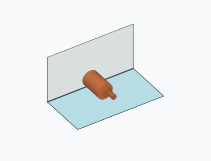](catalogue/grouped_10000/moving/poses/P135.png) | 35 | 0.35% | 818 | 8.18% |
| P136 <code>Kk4a_0108</code> | G2 |  | 35 | 0.35% | 1,015 | 10.15% |
| P137 <code>Kk4a_0094</code> | G2 |  | 34 | 0.34% | 1,015 | 10.15% |
| P138 <code>Kk4a_0104</code> | G2 |  | 34 | 0.34% | 1,015 | 10.15% |
| P139 <code>Kk4a_0101</code> | G2 |  | 33 | 0.33% | 1,015 | 10.15% |
| P140 <code>Kk4a_0058</code> | G3 | [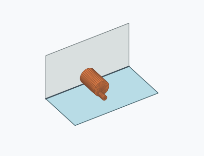](catalogue/grouped_10000/moving/poses/P140.png) | 32 | 0.32% | 818 | 8.18% |
| P141 <code>Kk4a_0089</code> | G3 |  | 32 | 0.32% | 818 | 8.18% |
| P142 <code>Kk4a_0114</code> | G2 |  | 32 | 0.32% | 1,015 | 10.15% |
| P143 <code>Kk4a_0123</code> | G2 |  | 32 | 0.32% | 1,015 | 10.15% |
| P144 <code>Kk4a_0027</code> | G3 |  | 31 | 0.31% | 818 | 8.18% |
| P145 <code>Kk4a_0034</code> | G3 |  | 30 | 0.30% | 818 | 8.18% |
| P146 <code>Kk4a_0070</code> | G3 |  | 30 | 0.30% | 818 | 8.18% |
| P147 <code>Kk4a_0106</code> | G2 |  | 30 | 0.30% | 1,015 | 10.15% |
| P148 <code>Kk4a_0009</code> | G3 |  | 29 | 0.29% | 818 | 8.18% |
| P149 <code>Kk4a_0039</code> | G3 | [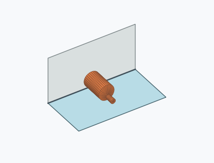](catalogue/grouped_10000/moving/poses/P149.png) | 29 | 0.29% | 818 | 8.18% |
| P150 <code>Kk4a_0099</code> | G2 |  | 29 | 0.29% | 1,015 | 10.15% |
| P151 <code>Kk4a_0119</code> | G2 |  | 29 | 0.29% | 1,015 | 10.15% |
| P152 <code>Kk4a_0015</code> | G3 |  | 28 | 0.28% | 818 | 8.18% |
| P153 <code>Kk4a_0032</code> | G3 |  | 28 | 0.28% | 818 | 8.18% |
| P154 <code>Kk4a_0046</code> | G3 |  | 28 | 0.28% | 818 | 8.18% |
| P155 <code>Kk4a_0076</code> | G3 |  | 28 | 0.28% | 818 | 8.18% |
| P156 <code>Kk4a_0007</code> | G3 |  | 27 | 0.27% | 818 | 8.18% |
| P157 <code>Kk4a_0120</code> | G2 |  | 27 | 0.27% | 1,015 | 10.15% |
| P158 <code>Kk4a_0001</code> | G3 |  | 26 | 0.26% | 818 | 8.18% |
| P159 <code>Kk4a_0021</code> | G3 |  | 26 | 0.26% | 818 | 8.18% |
| P160 <code>Kk4a_0053</code> | G3 |  | 26 | 0.26% | 818 | 8.18% |
| P161 <code>Kk4a_0083</code> | G3 |  | 26 | 0.26% | 818 | 8.18% |
| P162 <code>Kk4a_0098</code> | G2 |  | 26 | 0.26% | 1,015 | 10.15% |
| P163 <code>Kk4a_0065</code> | G3 |  | 25 | 0.25% | 818 | 8.18% |
| P164 <code>Kk4a_0077</code> | G3 |  | 25 | 0.25% | 818 | 8.18% |
| P165 <code>Kk4a_0117</code> | G2 |  | 25 | 0.25% | 1,015 | 10.15% |
| P166 <code>Kk4a_0028</code> | G3 |  | 24 | 0.24% | 818 | 8.18% |
| P167 <code>Kk4a_0059</code> | G3 |  | 24 | 0.24% | 818 | 8.18% |
| P168 <code>Kk4a_0107</code> | G2 |  | 24 | 0.24% | 1,015 | 10.15% |
| P169 <code>Kk4a_0052</code> | G3 |  | 23 | 0.23% | 818 | 8.18% |
| P170 <code>Kk4a_0109</code> | G2 |  | 23 | 0.23% | 1,015 | 10.15% |
| P171 <code>Kk4a_0110</code> | G2 |  | 23 | 0.23% | 1,015 | 10.15% |
| P172 <code>Kk4a_0115</code> | G2 |  | 23 | 0.23% | 1,015 | 10.15% |
| P173 <code>Kk4a_0097</code> | G2 |  | 22 | 0.22% | 1,015 | 10.15% |
| P174 <code>Kk4a_0064</code> | G3 |  | 21 | 0.21% | 818 | 8.18% |
| P175 <code>Kk4a_0071</code> | G3 |  | 20 | 0.20% | 818 | 8.18% |
| P176 <code>Kk4a_0090</code> | G3 |  | 19 | 0.19% | 818 | 8.18% |
| P177 <code>Kk4a_0045</code> | G3 | [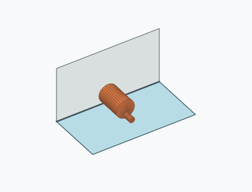](catalogue/grouped_10000/moving/poses/P177.png) | 17 | 0.17% | 818 | 8.18% |
| P178 <code>Kk4a_0040</code> | G3 |  | 16 | 0.16% | 818 | 8.18% |
| P179 <code>Kk4a_0125</code> | G2 |  | 16 | 0.16% | 1,015 | 10.15% |
| P180 <code>Kk4a_0022</code> | G4 | [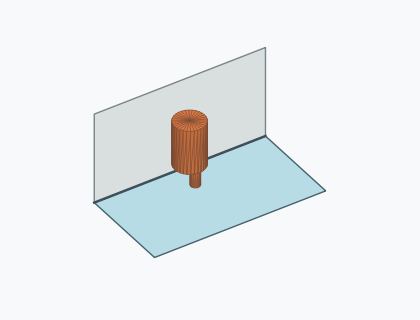](catalogue/grouped_10000/moving/poses/P180.png) | 3 | 0.03% | 6 | 0.06% |
| P181 <code>Kk4a_0131</code> | G6 | [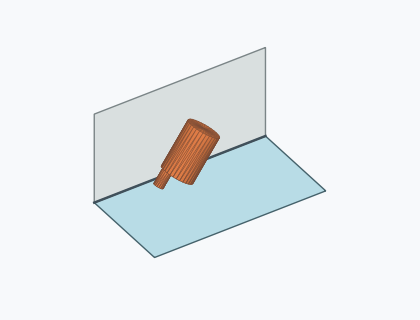](catalogue/grouped_10000/moving/poses/P181.png) | 3 | 0.03% | 3 | 0.03% |
| P182 <code>Kk4a_0126</code> | G2 |  | 2 | 0.02% | 1,015 | 10.15% |
| P183 <code>Kk4a_0163</code> | G5 | [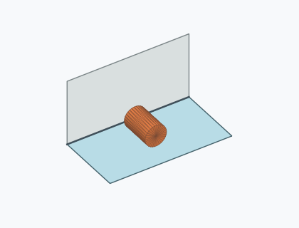](catalogue/grouped_10000/moving/poses/P183.png) | 2 | 0.02% | 5 | 0.05% |
| P184 <code>Kk4a_0168</code> | G4 |  | 2 | 0.02% | 6 | 0.06% |
| P185 <code>Kk4a_0049</code> | G4 | [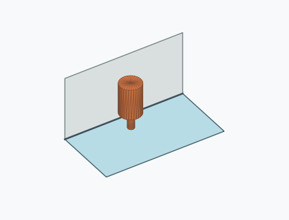](catalogue/grouped_10000/moving/poses/P185.png) | 1 | 0.01% | 6 | 0.06% |
| P186 <code>Kk4a_0086</code> | G7 | [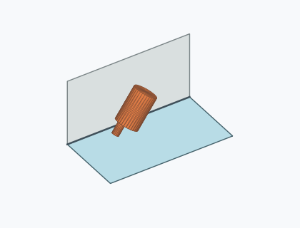](catalogue/grouped_10000/moving/poses/P186.png) | 1 | 0.01% | 1 | 0.01% |
| P187 <code>Kk4a_0156</code> | G5 |  | 1 | 0.01% | 5 | 0.05% |
| P188 <code>Kk4a_0157</code> | G5 |  | 1 | 0.01% | 5 | 0.05% |
| P189 <code>Kk4a_0162</code> | G5 |  | 1 | 0.01% | 5 | 0.05% |

Outcomes from the archived run: settled 9,988, unsettled 12.

## Stationary belt

9,995 of 10,000 trials settled. The catalogue contains 242 poses in 12 groups. This condition uses rounded support-family grouping.

| Pose | Group | Preview | Pose drops | Pose incidence | Group drops | Group incidence |
| --- | --- | --- | ---: | ---: | ---: | ---: |
| P000 <code>Kk4a_0045</code> | G0 |  | 94 | 0.94% | 4,126 | 41.26% |
| P001 <code>Kk4a_0124</code> | G0 |  | 93 | 0.93% | 4,126 | 41.26% |
| P002 <code>Kk4a_0185</code> | G0 |  | 92 | 0.92% | 4,126 | 41.26% |
| P003 <code>Kk4a_0051</code> | G1 |  | 90 | 0.90% | 4,011 | 40.11% |
| P004 <code>Kk4a_0053</code> | G0 |  | 90 | 0.90% | 4,126 | 41.26% |
| P005 <code>Kk4a_0106</code> | G0 |  | 90 | 0.90% | 4,126 | 41.26% |
| P006 <code>Kk4a_0018</code> | G1 |  | 89 | 0.89% | 4,011 | 40.11% |
| P007 <code>Kk4a_0071</code> | G0 |  | 89 | 0.89% | 4,126 | 41.26% |
| P008 <code>Kk4a_0013</code> | G1 |  | 87 | 0.87% | 4,011 | 40.11% |
| P009 <code>Kk4a_0181</code> | G0 |  | 87 | 0.87% | 4,126 | 41.26% |
| P010 <code>Kk4a_0238</code> | G1 |  | 86 | 0.86% | 4,011 | 40.11% |
| P011 <code>Kk4a_0114</code> | G0 |  | 85 | 0.85% | 4,126 | 41.26% |
| P012 <code>Kk4a_0195</code> | G0 |  | 85 | 0.85% | 4,126 | 41.26% |
| P013 <code>Kk4a_0234</code> | G1 |  | 85 | 0.85% | 4,011 | 40.11% |
| P014 <code>Kk4a_0197</code> | G0 |  | 84 | 0.84% | 4,126 | 41.26% |
| P015 <code>Kk4a_0180</code> | G1 |  | 83 | 0.83% | 4,011 | 40.11% |
| P016 <code>Kk4a_0221</code> | G1 |  | 83 | 0.83% | 4,011 | 40.11% |
| P017 <code>Kk4a_0212</code> | G1 |  | 82 | 0.82% | 4,011 | 40.11% |
| P018 <code>Kk4a_0026</code> | G1 |  | 81 | 0.81% | 4,011 | 40.11% |
| P019 <code>Kk4a_0098</code> | G0 |  | 81 | 0.81% | 4,126 | 41.26% |
| P020 <code>Kk4a_0190</code> | G0 |  | 81 | 0.81% | 4,126 | 41.26% |
| P021 <code>Kk4a_0202</code> | G0 |  | 80 | 0.80% | 4,126 | 41.26% |
| P022 <code>Kk4a_0228</code> | G1 |  | 79 | 0.79% | 4,011 | 40.11% |
| P023 <code>Kk4a_0232</code> | G1 |  | 79 | 0.79% | 4,011 | 40.11% |
| P024 <code>Kk4a_0240</code> | G1 |  | 78 | 0.78% | 4,011 | 40.11% |
| P025 <code>Kk4a_0035</code> | G1 |  | 76 | 0.76% | 4,011 | 40.11% |
| P026 <code>Kk4a_0062</code> | G0 |  | 76 | 0.76% | 4,126 | 41.26% |
| P027 <code>Kk4a_0087</code> | G0 |  | 76 | 0.76% | 4,126 | 41.26% |
| P028 <code>Kk4a_0097</code> | G1 |  | 76 | 0.76% | 4,011 | 40.11% |
| P029 <code>Kk4a_0011</code> | G1 |  | 75 | 0.75% | 4,011 | 40.11% |
| P030 <code>Kk4a_0057</code> | G0 |  | 75 | 0.75% | 4,126 | 41.26% |
| P031 <code>Kk4a_0219</code> | G1 |  | 75 | 0.75% | 4,011 | 40.11% |
| P032 <code>Kk4a_0223</code> | G1 | [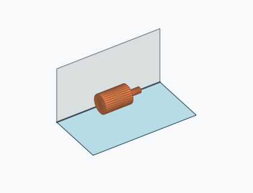](catalogue/grouped_10000/stationary/poses/P032.png) | 75 | 0.75% | 4,011 | 40.11% |
| P033 <code>Kk4a_0034</code> | G0 |  | 74 | 0.74% | 4,126 | 41.26% |
| P034 <code>Kk4a_0189</code> | G1 |  | 74 | 0.74% | 4,011 | 40.11% |
| P035 <code>Kk4a_0204</code> | G0 |  | 74 | 0.74% | 4,126 | 41.26% |
| P036 <code>Kk4a_0210</code> | G1 |  | 74 | 0.74% | 4,011 | 40.11% |
| P037 <code>Kk4a_0217</code> | G1 |  | 74 | 0.74% | 4,011 | 40.11% |
| P038 <code>Kk4a_0241</code> | G1 |  | 74 | 0.74% | 4,011 | 40.11% |
| P039 <code>Kk4a_0010</code> | G0 |  | 73 | 0.73% | 4,126 | 41.26% |
| P040 <code>Kk4a_0050</code> | G0 |  | 73 | 0.73% | 4,126 | 41.26% |
| P041 <code>Kk4a_0039</code> | G0 |  | 72 | 0.72% | 4,126 | 41.26% |
| P042 <code>Kk4a_0199</code> | G0 |  | 72 | 0.72% | 4,126 | 41.26% |
| P043 <code>Kk4a_0230</code> | G1 |  | 72 | 0.72% | 4,011 | 40.11% |
| P044 <code>Kk4a_0025</code> | G0 |  | 71 | 0.71% | 4,126 | 41.26% |
| P045 <code>Kk4a_0187</code> | G0 |  | 71 | 0.71% | 4,126 | 41.26% |
| P046 <code>Kk4a_0194</code> | G1 |  | 71 | 0.71% | 4,011 | 40.11% |
| P047 <code>Kk4a_0225</code> | G1 |  | 71 | 0.71% | 4,011 | 40.11% |
| P048 <code>Kk4a_0002</code> | G0 |  | 70 | 0.70% | 4,126 | 41.26% |
| P049 <code>Kk4a_0017</code> | G0 | [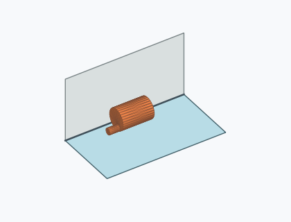](catalogue/grouped_10000/stationary/poses/P049.png) | 70 | 0.70% | 4,126 | 41.26% |
| P050 <code>Kk4a_0078</code> | G0 |  | 70 | 0.70% | 4,126 | 41.26% |
| P051 <code>Kk4a_0092</code> | G0 |  | 70 | 0.70% | 4,126 | 41.26% |
| P052 <code>Kk4a_0183</code> | G0 |  | 70 | 0.70% | 4,126 | 41.26% |
| P053 <code>Kk4a_0192</code> | G1 |  | 70 | 0.70% | 4,011 | 40.11% |
| P054 <code>Kk4a_0236</code> | G1 |  | 70 | 0.70% | 4,011 | 40.11% |
| P055 <code>Kk4a_0101</code> | G0 |  | 69 | 0.69% | 4,126 | 41.26% |
| P056 <code>Kk4a_0196</code> | G1 |  | 69 | 0.69% | 4,011 | 40.11% |
| P057 <code>Kk4a_0208</code> | G0 |  | 69 | 0.69% | 4,126 | 41.26% |
| P058 <code>Kk4a_0215</code> | G1 |  | 69 | 0.69% | 4,011 | 40.11% |
| P059 <code>Kk4a_0220</code> | G0 |  | 69 | 0.69% | 4,126 | 41.26% |
| P060 <code>Kk4a_0075</code> | G0 |  | 68 | 0.68% | 4,126 | 41.26% |
| P061 <code>Kk4a_0201</code> | G1 |  | 68 | 0.68% | 4,011 | 40.11% |
| P062 <code>Kk4a_0193</code> | G0 |  | 67 | 0.67% | 4,126 | 41.26% |
| P063 <code>Kk4a_0205</code> | G1 | [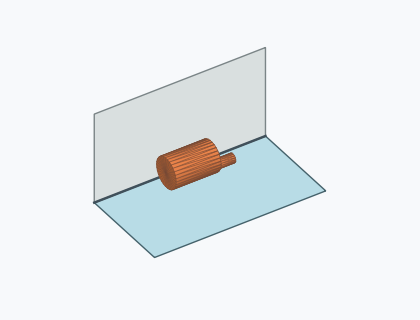](catalogue/grouped_10000/stationary/poses/P063.png) | 67 | 0.67% | 4,011 | 40.11% |
| P064 <code>Kk4a_0222</code> | G0 |  | 67 | 0.67% | 4,126 | 41.26% |
| P065 <code>Kk4a_0020</code> | G0 |  | 66 | 0.66% | 4,126 | 41.26% |
| P066 <code>Kk4a_0042</code> | G1 |  | 66 | 0.66% | 4,011 | 40.11% |
| P067 <code>Kk4a_0076</code> | G1 |  | 66 | 0.66% | 4,011 | 40.11% |
| P068 <code>Kk4a_0182</code> | G1 |  | 66 | 0.66% | 4,011 | 40.11% |
| P069 <code>Kk4a_0186</code> | G1 |  | 66 | 0.66% | 4,011 | 40.11% |
| P070 <code>Kk4a_0041</code> | G0 |  | 65 | 0.65% | 4,126 | 41.26% |
| P071 <code>Kk4a_0079</code> | G1 |  | 65 | 0.65% | 4,011 | 40.11% |
| P072 <code>Kk4a_0229</code> | G0 |  | 64 | 0.64% | 4,126 | 41.26% |
| P073 <code>Kk4a_0054</code> | G1 |  | 63 | 0.63% | 4,011 | 40.11% |
| P074 <code>Kk4a_0058</code> | G1 |  | 63 | 0.63% | 4,011 | 40.11% |
| P075 <code>Kk4a_0068</code> | G0 |  | 63 | 0.63% | 4,126 | 41.26% |
| P076 <code>Kk4a_0082</code> | G0 |  | 63 | 0.63% | 4,126 | 41.26% |
| P077 <code>Kk4a_0110</code> | G0 |  | 63 | 0.63% | 4,126 | 41.26% |
| P078 <code>Kk4a_0203</code> | G1 |  | 63 | 0.63% | 4,011 | 40.11% |
| P079 <code>Kk4a_0207</code> | G1 |  | 63 | 0.63% | 4,011 | 40.11% |
| P080 <code>Kk4a_0061</code> | G0 |  | 62 | 0.62% | 4,126 | 41.26% |
| P081 <code>Kk4a_0113</code> | G1 |  | 62 | 0.62% | 4,011 | 40.11% |
| P082 <code>Kk4a_0177</code> | G1 |  | 62 | 0.62% | 4,011 | 40.11% |
| P083 <code>Kk4a_0063</code> | G1 |  | 61 | 0.61% | 4,011 | 40.11% |
| P084 <code>Kk4a_0227</code> | G0 |  | 61 | 0.61% | 4,126 | 41.26% |
| P085 <code>Kk4a_0237</code> | G0 |  | 61 | 0.61% | 4,126 | 41.26% |
| P086 <code>Kk4a_0012</code> | G0 |  | 60 | 0.60% | 4,126 | 41.26% |
| P087 <code>Kk4a_0118</code> | G0 |  | 60 | 0.60% | 4,126 | 41.26% |
| P088 <code>Kk4a_0005</code> | G1 | [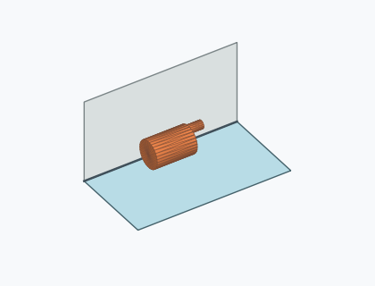](catalogue/grouped_10000/stationary/poses/P088.png) | 59 | 0.59% | 4,011 | 40.11% |
| P089 <code>Kk4a_0178</code> | G0 |  | 59 | 0.59% | 4,126 | 41.26% |
| P090 <code>Kk4a_0184</code> | G1 |  | 59 | 0.59% | 4,011 | 40.11% |
| P091 <code>Kk4a_0224</code> | G0 |  | 59 | 0.59% | 4,126 | 41.26% |
| P092 <code>Kk4a_0006</code> | G0 |  | 58 | 0.58% | 4,126 | 41.26% |
| P093 <code>Kk4a_0088</code> | G1 |  | 58 | 0.58% | 4,011 | 40.11% |
| P094 <code>Kk4a_0117</code> | G1 |  | 58 | 0.58% | 4,011 | 40.11% |
| P095 <code>Kk4a_0206</code> | G0 |  | 58 | 0.58% | 4,126 | 41.26% |
| P096 <code>Kk4a_0072</code> | G1 |  | 56 | 0.56% | 4,011 | 40.11% |
| P097 <code>Kk4a_0198</code> | G1 |  | 56 | 0.56% | 4,011 | 40.11% |
| P098 <code>Kk4a_0239</code> | G0 | [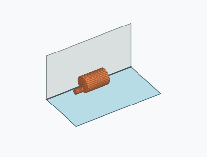](catalogue/grouped_10000/stationary/poses/P098.png) | 56 | 0.56% | 4,126 | 41.26% |
| P099 <code>Kk4a_0029</code> | G0 |  | 55 | 0.55% | 4,126 | 41.26% |
| P100 <code>Kk4a_0030</code> | G1 |  | 55 | 0.55% | 4,011 | 40.11% |
| P101 <code>Kk4a_0038</code> | G1 |  | 55 | 0.55% | 4,011 | 40.11% |
| P102 <code>Kk4a_0021</code> | G1 |  | 54 | 0.54% | 4,011 | 40.11% |
| P103 <code>Kk4a_0060</code> | G1 |  | 53 | 0.53% | 4,011 | 40.11% |
| P104 <code>Kk4a_0121</code> | G1 |  | 53 | 0.53% | 4,011 | 40.11% |
| P105 <code>Kk4a_0211</code> | G0 |  | 52 | 0.52% | 4,126 | 41.26% |
| P106 <code>Kk4a_0218</code> | G0 |  | 52 | 0.52% | 4,126 | 41.26% |
| P107 <code>Kk4a_0231</code> | G0 |  | 52 | 0.52% | 4,126 | 41.26% |
| P108 <code>Kk4a_0105</code> | G1 |  | 51 | 0.51% | 4,011 | 40.11% |
| P109 <code>Kk4a_0235</code> | G0 |  | 51 | 0.51% | 4,126 | 41.26% |
| P110 <code>Kk4a_0091</code> | G1 |  | 49 | 0.49% | 4,011 | 40.11% |
| P111 <code>Kk4a_0214</code> | G0 |  | 49 | 0.49% | 4,126 | 41.26% |
| P112 <code>Kk4a_0100</code> | G1 |  | 47 | 0.47% | 4,011 | 40.11% |
| P113 <code>Kk4a_0216</code> | G0 |  | 47 | 0.47% | 4,126 | 41.26% |
| P114 <code>Kk4a_0233</code> | G0 |  | 47 | 0.47% | 4,126 | 41.26% |
| P115 <code>Kk4a_0083</code> | G1 |  | 46 | 0.46% | 4,011 | 40.11% |
| P116 <code>Kk4a_0226</code> | G0 |  | 46 | 0.46% | 4,126 | 41.26% |
| P117 <code>Kk4a_0046</code> | G1 |  | 45 | 0.45% | 4,011 | 40.11% |
| P118 <code>Kk4a_0069</code> | G1 |  | 45 | 0.45% | 4,011 | 40.11% |
| P119 <code>Kk4a_0109</code> | G1 |  | 44 | 0.44% | 4,011 | 40.11% |
| P120 <code>Kk4a_0158</code> | G2 |  | 44 | 0.44% | 1,017 | 10.17% |
| P121 <code>Kk4a_0163</code> | G2 |  | 44 | 0.44% | 1,017 | 10.17% |
| P122 <code>Kk4a_0137</code> | G2 |  | 43 | 0.43% | 1,017 | 10.17% |
| P123 <code>Kk4a_0133</code> | G2 |  | 41 | 0.41% | 1,017 | 10.17% |
| P124 <code>Kk4a_0130</code> | G2 |  | 38 | 0.38% | 1,017 | 10.17% |
| P125 <code>Kk4a_0157</code> | G2 |  | 38 | 0.38% | 1,017 | 10.17% |
| P126 <code>Kk4a_0008</code> | G3 |  | 37 | 0.37% | 829 | 8.29% |
| P127 <code>Kk4a_0132</code> | G2 |  | 37 | 0.37% | 1,017 | 10.17% |
| P128 <code>Kk4a_0136</code> | G2 |  | 37 | 0.37% | 1,017 | 10.17% |
| P129 <code>Kk4a_0138</code> | G2 |  | 37 | 0.37% | 1,017 | 10.17% |
| P130 <code>Kk4a_0126</code> | G2 | [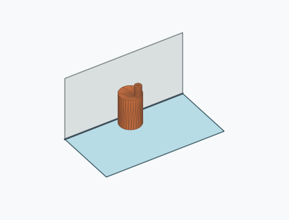](catalogue/grouped_10000/stationary/poses/P130.png) | 36 | 0.36% | 1,017 | 10.17% |
| P131 <code>Kk4a_0159</code> | G2 |  | 36 | 0.36% | 1,017 | 10.17% |
| P132 <code>Kk4a_0009</code> | G3 |  | 35 | 0.35% | 829 | 8.29% |
| P133 <code>Kk4a_0146</code> | G2 |  | 35 | 0.35% | 1,017 | 10.17% |
| P134 <code>Kk4a_0151</code> | G2 |  | 34 | 0.34% | 1,017 | 10.17% |
| P135 <code>Kk4a_0154</code> | G2 |  | 34 | 0.34% | 1,017 | 10.17% |
| P136 <code>Kk4a_0160</code> | G2 |  | 34 | 0.34% | 1,017 | 10.17% |
| P137 <code>Kk4a_0023</code> | G3 |  | 33 | 0.33% | 829 | 8.29% |
| P138 <code>Kk4a_0112</code> | G3 |  | 33 | 0.33% | 829 | 8.29% |
| P139 <code>Kk4a_0152</code> | G2 |  | 33 | 0.33% | 1,017 | 10.17% |
| P140 <code>Kk4a_0156</code> | G2 |  | 33 | 0.33% | 1,017 | 10.17% |
| P141 <code>Kk4a_0032</code> | G3 |  | 32 | 0.32% | 829 | 8.29% |
| P142 <code>Kk4a_0104</code> | G3 |  | 31 | 0.31% | 829 | 8.29% |
| P143 <code>Kk4a_0128</code> | G2 |  | 30 | 0.30% | 1,017 | 10.17% |
| P144 <code>Kk4a_0149</code> | G2 |  | 29 | 0.29% | 1,017 | 10.17% |
| P145 <code>Kk4a_0003</code> | G3 |  | 28 | 0.28% | 829 | 8.29% |
| P146 <code>Kk4a_0015</code> | G3 |  | 28 | 0.28% | 829 | 8.29% |
| P147 <code>Kk4a_0089</code> | G3 |  | 28 | 0.28% | 829 | 8.29% |
| P148 <code>Kk4a_0103</code> | G3 |  | 28 | 0.28% | 829 | 8.29% |
| P149 <code>Kk4a_0123</code> | G2 |  | 28 | 0.28% | 1,017 | 10.17% |
| P150 <code>Kk4a_0147</code> | G2 |  | 28 | 0.28% | 1,017 | 10.17% |
| P151 <code>Kk4a_0164</code> | G2 |  | 28 | 0.28% | 1,017 | 10.17% |
| P152 <code>Kk4a_0056</code> | G3 |  | 27 | 0.27% | 829 | 8.29% |
| P153 <code>Kk4a_0096</code> | G3 |  | 26 | 0.26% | 829 | 8.29% |
| P154 <code>Kk4a_0129</code> | G2 |  | 26 | 0.26% | 1,017 | 10.17% |
| P155 <code>Kk4a_0033</code> | G3 |  | 25 | 0.25% | 829 | 8.29% |
| P156 <code>Kk4a_0065</code> | G3 |  | 25 | 0.25% | 829 | 8.29% |
| P157 <code>Kk4a_0073</code> | G3 |  | 25 | 0.25% | 829 | 8.29% |
| P158 <code>Kk4a_0134</code> | G2 | [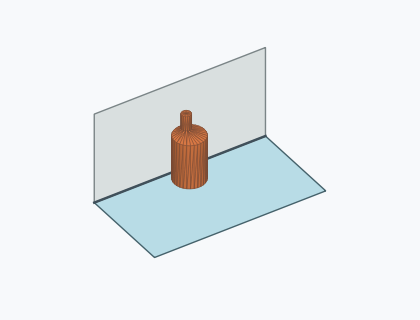](catalogue/grouped_10000/stationary/poses/P158.png) | 25 | 0.25% | 1,017 | 10.17% |
| P159 <code>Kk4a_0155</code> | G2 |  | 25 | 0.25% | 1,017 | 10.17% |
| P160 <code>Kk4a_0040</code> | G3 |  | 24 | 0.24% | 829 | 8.29% |
| P161 <code>Kk4a_0095</code> | G3 |  | 24 | 0.24% | 829 | 8.29% |
| P162 <code>Kk4a_0140</code> | G2 |  | 24 | 0.24% | 1,017 | 10.17% |
| P163 <code>Kk4a_0024</code> | G3 |  | 23 | 0.23% | 829 | 8.29% |
| P164 <code>Kk4a_0049</code> | G3 |  | 23 | 0.23% | 829 | 8.29% |
| P165 <code>Kk4a_0016</code> | G3 |  | 22 | 0.22% | 829 | 8.29% |
| P166 <code>Kk4a_0070</code> | G3 |  | 21 | 0.21% | 829 | 8.29% |
| P167 <code>Kk4a_0077</code> | G3 |  | 21 | 0.21% | 829 | 8.29% |
| P168 <code>Kk4a_0086</code> | G3 |  | 21 | 0.21% | 829 | 8.29% |
| P169 <code>Kk4a_0115</code> | G3 |  | 21 | 0.21% | 829 | 8.29% |
| P170 <code>Kk4a_0120</code> | G3 | [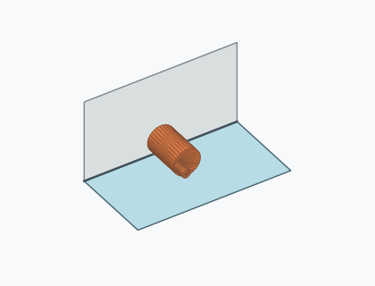](catalogue/grouped_10000/stationary/poses/P170.png) | 21 | 0.21% | 829 | 8.29% |
| P171 <code>Kk4a_0080</code> | G3 |  | 20 | 0.20% | 829 | 8.29% |
| P172 <code>Kk4a_0139</code> | G2 |  | 20 | 0.20% | 1,017 | 10.17% |
| P173 <code>Kk4a_0048</code> | G3 |  | 19 | 0.19% | 829 | 8.29% |
| P174 <code>Kk4a_0055</code> | G3 |  | 19 | 0.19% | 829 | 8.29% |
| P175 <code>Kk4a_0122</code> | G2 |  | 19 | 0.19% | 1,017 | 10.17% |
| P176 <code>Kk4a_0165</code> | G2 |  | 19 | 0.19% | 1,017 | 10.17% |
| P177 <code>Kk4a_0043</code> | G3 |  | 16 | 0.16% | 829 | 8.29% |
| P178 <code>Kk4a_0125</code> | G2 |  | 14 | 0.14% | 1,017 | 10.17% |
| P179 <code>Kk4a_0064</code> | G3 |  | 13 | 0.13% | 829 | 8.29% |
| P180 <code>Kk4a_0052</code> | G3 |  | 6 | 0.06% | 829 | 8.29% |
| P181 <code>Kk4a_0116</code> | G3 |  | 6 | 0.06% | 829 | 8.29% |
| P182 <code>Kk4a_0004</code> | G3 |  | 5 | 0.05% | 829 | 8.29% |
| P183 <code>Kk4a_0019</code> | G3 |  | 4 | 0.04% | 829 | 8.29% |
| P184 <code>Kk4a_0028</code> | G3 | [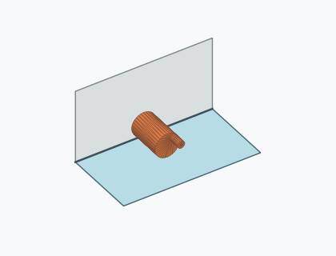](catalogue/grouped_10000/stationary/poses/P184.png) | 4 | 0.04% | 829 | 8.29% |
| P185 <code>Kk4a_0044</code> | G3 |  | 4 | 0.04% | 829 | 8.29% |
| P186 <code>Kk4a_0066</code> | G3 |  | 4 | 0.04% | 829 | 8.29% |
| P187 <code>Kk4a_0090</code> | G3 |  | 4 | 0.04% | 829 | 8.29% |
| P188 <code>Kk4a_0093</code> | G3 |  | 4 | 0.04% | 829 | 8.29% |
| P189 <code>Kk4a_0099</code> | G3 |  | 4 | 0.04% | 829 | 8.29% |
| P190 <code>Kk4a_0111</code> | G3 |  | 4 | 0.04% | 829 | 8.29% |
| P191 <code>Kk4a_0148</code> | G2 |  | 4 | 0.04% | 1,017 | 10.17% |
| P192 <code>Kk4a_0150</code> | G2 |  | 4 | 0.04% | 1,017 | 10.17% |
| P193 <code>Kk4a_0153</code> | G2 |  | 4 | 0.04% | 1,017 | 10.17% |
| P194 <code>Kk4a_0161</code> | G2 |  | 4 | 0.04% | 1,017 | 10.17% |
| P195 <code>Kk4a_0036</code> | G3 |  | 3 | 0.03% | 829 | 8.29% |
| P196 <code>Kk4a_0067</code> | G3 |  | 3 | 0.03% | 829 | 8.29% |
| P197 <code>Kk4a_0085</code> | G3 |  | 3 | 0.03% | 829 | 8.29% |
| P198 <code>Kk4a_0108</code> | G3 |  | 3 | 0.03% | 829 | 8.29% |
| P199 <code>Kk4a_0131</code> | G2 |  | 3 | 0.03% | 1,017 | 10.17% |
| P200 <code>Kk4a_0135</code> | G2 |  | 3 | 0.03% | 1,017 | 10.17% |
| P201 <code>Kk4a_0142</code> | G2 |  | 3 | 0.03% | 1,017 | 10.17% |
| P202 <code>Kk4a_0143</code> | G2 |  | 3 | 0.03% | 1,017 | 10.17% |
| P203 <code>Kk4a_0144</code> | G2 |  | 3 | 0.03% | 1,017 | 10.17% |
| P204 <code>Kk4a_0145</code> | G2 |  | 3 | 0.03% | 1,017 | 10.17% |
| P205 <code>Kk4a_0166</code> | G2 |  | 3 | 0.03% | 1,017 | 10.17% |
| P206 <code>Kk4a_0167</code> | G2 |  | 3 | 0.03% | 1,017 | 10.17% |
| P207 <code>Kk4a_0170</code> | G2 | [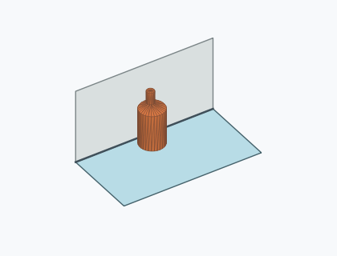](catalogue/grouped_10000/stationary/poses/P207.png) | 3 | 0.03% | 1,017 | 10.17% |
| P208 <code>Kk4a_0171</code> | G2 |  | 3 | 0.03% | 1,017 | 10.17% |
| P209 <code>Kk4a_0172</code> | G2 |  | 3 | 0.03% | 1,017 | 10.17% |
| P210 <code>Kk4a_0173</code> | G2 |  | 3 | 0.03% | 1,017 | 10.17% |
| P211 <code>Kk4a_0175</code> | G2 |  | 3 | 0.03% | 1,017 | 10.17% |
| P212 <code>Kk4a_0007</code> | G3 |  | 2 | 0.02% | 829 | 8.29% |
| P213 <code>Kk4a_0022</code> | G3 |  | 2 | 0.02% | 829 | 8.29% |
| P214 <code>Kk4a_0027</code> | G4 |  | 2 | 0.02% | 4 | 0.04% |
| P215 <code>Kk4a_0047</code> | G3 |  | 2 | 0.02% | 829 | 8.29% |
| P216 <code>Kk4a_0081</code> | G3 |  | 2 | 0.02% | 829 | 8.29% |
| P217 <code>Kk4a_0102</code> | G3 |  | 2 | 0.02% | 829 | 8.29% |
| P218 <code>Kk4a_0107</code> | G3 |  | 2 | 0.02% | 829 | 8.29% |
| P219 <code>Kk4a_0119</code> | G3 |  | 2 | 0.02% | 829 | 8.29% |
| P220 <code>Kk4a_0127</code> | G2 |  | 2 | 0.02% | 1,017 | 10.17% |
| P221 <code>Kk4a_0141</code> | G2 |  | 2 | 0.02% | 1,017 | 10.17% |
| P222 <code>Kk4a_0168</code> | G2 |  | 2 | 0.02% | 1,017 | 10.17% |
| P223 <code>Kk4a_0169</code> | G2 |  | 2 | 0.02% | 1,017 | 10.17% |
| P224 <code>Kk4a_0174</code> | G2 |  | 2 | 0.02% | 1,017 | 10.17% |
| P225 <code>Kk4a_0176</code> | G2 |  | 2 | 0.02% | 1,017 | 10.17% |
| P226 <code>Kk4a_0001</code> | G4 |  | 1 | 0.01% | 4 | 0.04% |
| P227 <code>Kk4a_0014</code> | G3 |  | 1 | 0.01% | 829 | 8.29% |
| P228 <code>Kk4a_0031</code> | G3 |  | 1 | 0.01% | 829 | 8.29% |
| P229 <code>Kk4a_0037</code> | G3 |  | 1 | 0.01% | 829 | 8.29% |
| P230 <code>Kk4a_0059</code> | G3 |  | 1 | 0.01% | 829 | 8.29% |
| P231 <code>Kk4a_0074</code> | G3 |  | 1 | 0.01% | 829 | 8.29% |
| P232 <code>Kk4a_0084</code> | G6 | [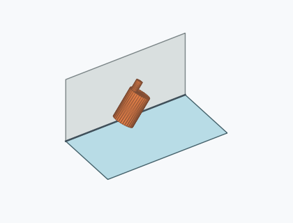](catalogue/grouped_10000/stationary/poses/P232.png) | 1 | 0.01% | 1 | 0.01% |
| P233 <code>Kk4a_0094</code> | G7 | [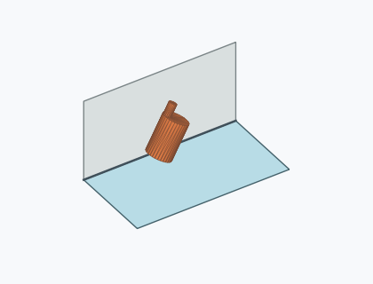](catalogue/grouped_10000/stationary/poses/P233.png) | 1 | 0.01% | 1 | 0.01% |
| P234 <code>Kk4a_0162</code> | G2 |  | 1 | 0.01% | 1,017 | 10.17% |
| P235 <code>Kk4a_0179</code> | G8 | [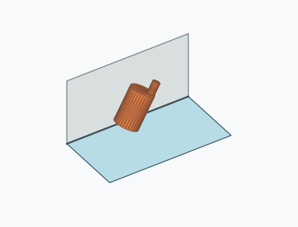](catalogue/grouped_10000/stationary/poses/P235.png) | 1 | 0.01% | 1 | 0.01% |
| P236 <code>Kk4a_0188</code> | G9 | [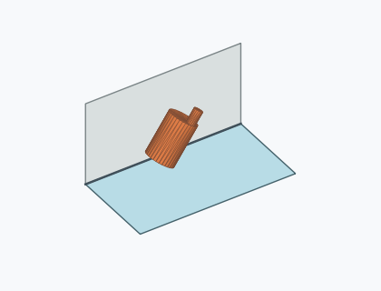](catalogue/grouped_10000/stationary/poses/P236.png) | 1 | 0.01% | 1 | 0.01% |
| P237 <code>Kk4a_0191</code> | G10 | [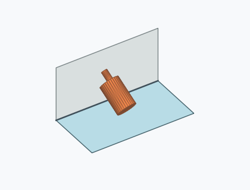](catalogue/grouped_10000/stationary/poses/P237.png) | 1 | 0.01% | 1 | 0.01% |
| P238 <code>Kk4a_0200</code> | G11 | [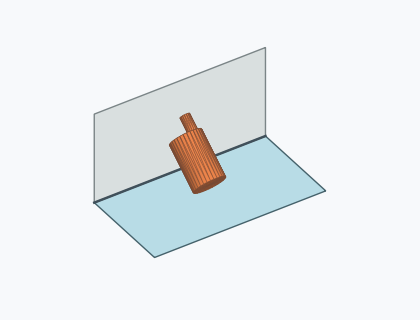](catalogue/grouped_10000/stationary/poses/P238.png) | 1 | 0.01% | 1 | 0.01% |
| P239 <code>Kk4a_0209</code> | G5 | [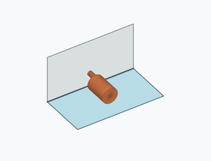](catalogue/grouped_10000/stationary/poses/P239.png) | 1 | 0.01% | 2 | 0.02% |
| P240 <code>Kk4a_0213</code> | G5 |  | 1 | 0.01% | 2 | 0.02% |
| P241 <code>Kk4a_0242</code> | G4 | [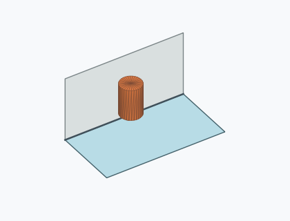](catalogue/grouped_10000/stationary/poses/P241.png) | 1 | 0.01% | 4 | 0.04% |

Outcomes from the archived run: settled stationary 9,995, unsettled stationary 5.

## Data and source runs

- **Moving belt** · [Catalogue JSON](catalogue/grouped_10000/moving/catalogue.json) · [Grouping evidence](catalogue/grouped_10000/moving/grouping-evidence.json) · [Checksums](catalogue/grouped_10000/moving/files.sha256.json) · [Source run and validation](simulations/20261110_10000/100mm_s/README.md) · [Raw run archive](simulations/20261110_10000/100mm_s/simulation_results.tar.xz)
- **Stationary belt** · [Catalogue JSON](catalogue/grouped_10000/stationary/catalogue.json) · [Grouping evidence](catalogue/grouped_10000/stationary/grouping-evidence.json) · [Checksums](catalogue/grouped_10000/stationary/files.sha256.json) · [Source run and validation](simulations/20261110_10000/static/README.md) · [Raw run archive](simulations/20261110_10000/static/simulation_results.tar.xz)
