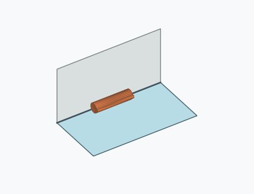
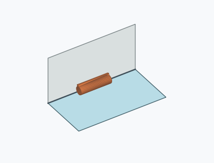
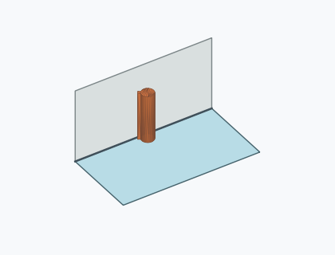
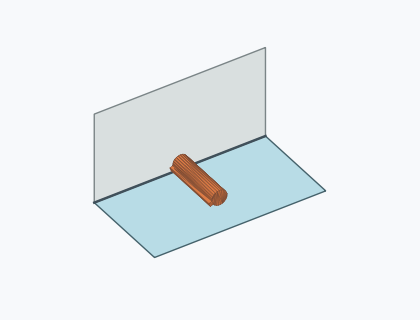
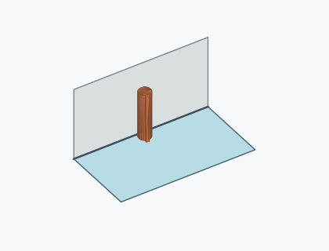
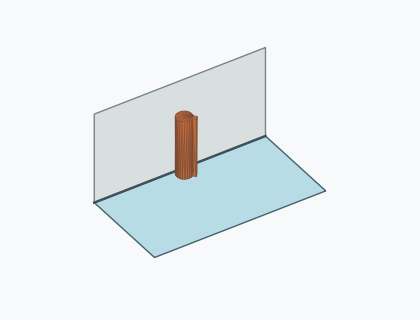
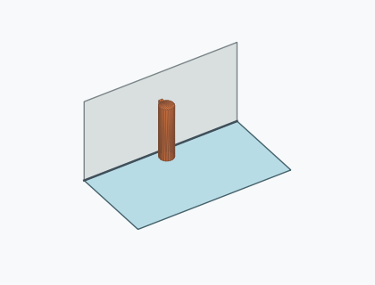
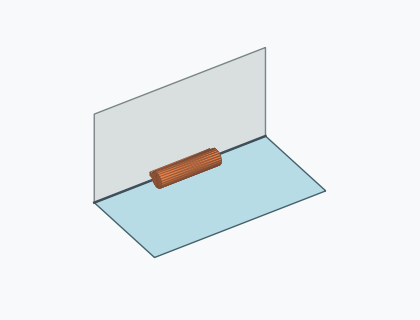
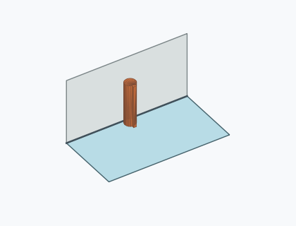
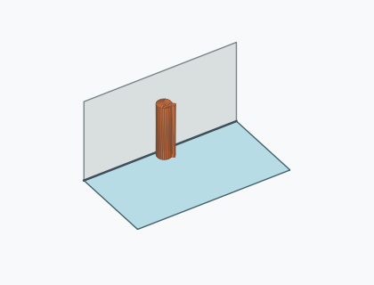

# Kl2a

[Workpiece index](../README.md#workpieces)

The two catalogues derive from the saved 10,000-drop runs. Moving outcomes are measured at the virtual exit. Stationary outcomes are measured after 10 s with the belt stopped from release.

Each condition has its own pose ranks (`P000` first) and group IDs (`G0` first), ordered by descending incidence. The source pose ID appears below its rank and the thumbnail links to the full preview. Incidence uses all trials in the condition. The group totals repeat on each member pose row.

## Moving belt

9,994 of 10,000 trials settled. The catalogue contains 53 poses in 6 groups. This condition uses rounded support-family grouping.

| Pose | Group | Preview | Pose drops | Pose incidence | Group drops | Group incidence | Stability | Lift to tip (mm) | Easiest target |
| --- | --- | --- | ---: | ---: | ---: | ---: | --- | ---: | --- |
| P000 <code>Kl2a_0019</code> | G1 |  | 2,403 | 24.03% | 3,153 | 31.53% | Medium | 0.1790 | Kl2a_0016 |
| P001 <code>Kl2a_0022</code> | G2 |  | 2,039 | 20.39% | 2,698 | 26.98% | Medium | 0.1792 | Kl2a_0025 |
| P002 <code>Kl2a_0043</code> | G1 |  | 750 | 7.50% | 3,153 | 31.53% | Medium | 0.2755 | Kl2a_0038 |
| P003 <code>Kl2a_0038</code> | G2 |  | 659 | 6.59% | 2,698 | 26.98% | Medium | 0.2774 | Kl2a_0043 |
| P015 <code>Kl2a_0044</code> | G5 |  | 83 | 0.83% | 112 | 1.12% | Medium | 0.1006 | Kl2a_0048 |
| P017 <code>Kl2a_0005</code> | G3 |  | 62 | 0.62% | 477 | 4.77% | Medium | 0.1006 | Kl2a_0003 (rocking within group) |
| P022 <code>Kl2a_0020</code> | G5 |  | 29 | 0.29% | 112 | 1.12% | Medium | 0.1028 | Kl2a_0017 |
| P050 <code>Kl2a_0011</code> | G3 |  | 5 | 0.05% | 477 | 4.77% | Medium | 0.1632 | Kl2a_0039 (rocking within group) |
| P051 <code>Kl2a_0030</code> | G4 |  | 5 | 0.05% | 245 | 2.45% | Medium | 0.1645 | Kl2a_0013 (rocking within group) |
| P004 <code>Kl2a_0045</code> | G0 |  | 355 | 3.55% | 3,309 | 33.09% | Low | 0.0432 | Kl2a_0012 (rocking within group) |
| P005 <code>Kl2a_0035</code> | G0 |  | 351 | 3.51% | 3,309 | 33.09% | Low | 0.0434 | Kl2a_0025 (rocking within group) |
| P006 <code>Kl2a_0050</code> | G0 |  | 342 | 3.42% | 3,309 | 33.09% | Low | 0.0299 | Kl2a_0012 (rocking within group) |
| P007 <code>Kl2a_0033</code> | G0 |  | 327 | 3.27% | 3,309 | 33.09% | Low | 0.0308 | Kl2a_0022 |
| P008 <code>Kl2a_0025</code> | G0 |  | 314 | 3.14% | 3,309 | 33.09% | Low | 0.0167 | Kl2a_0022 |
| P009 <code>Kl2a_0016</code> | G0 |  | 312 | 3.12% | 3,309 | 33.09% | Low | 0.0167 | Kl2a_0019 |
| P010 <code>Kl2a_0040</code> | G0 |  | 305 | 3.05% | 3,309 | 33.09% | Low | 0.0594 | Kl2a_0050 (rocking within group) |
| P011 <code>Kl2a_0028</code> | G0 |  | 280 | 2.80% | 3,309 | 33.09% | Low | 0.0213 | Kl2a_0025 (rocking within group) |
| P012 <code>Kl2a_0012</code> | G0 |  | 249 | 2.49% | 3,309 | 33.09% | Low | 0.0205 | Kl2a_0016 (rocking within group) |
| P013 <code>Kl2a_0009</code> | G0 |  | 246 | 2.46% | 3,309 | 33.09% | Low | 0.0780 | Kl2a_0038 |
| P014 <code>Kl2a_0029</code> | G0 |  | 188 | 1.88% | 3,309 | 33.09% | Low | 0.0767 | Kl2a_0038 |
| P016 <code>Kl2a_0039</code> | G3 |  | 68 | 0.68% | 477 | 4.77% | Low | 0.1000 | Kl2a_0046 (rocking within group) |
| P018 <code>Kl2a_0046</code> | G3 |  | 47 | 0.47% | 477 | 4.77% | Low | 0.0151 | Kl2a_0039 (rocking within group) |
| P019 <code>Kl2a_0003</code> | G3 |  | 39 | 0.39% | 477 | 4.77% | Low | 0.0154 | Kl2a_0005 (rocking within group) |
| P020 <code>Kl2a_0052</code> | G3 |  | 35 | 0.35% | 477 | 4.77% | Low | 0.0136 | Kl2a_0039 (rocking within group) |
| P021 <code>Kl2a_0017</code> | G4 |  | 33 | 0.33% | 245 | 2.45% | Low | 0.0161 | Kl2a_0020 |
| P023 <code>Kl2a_0049</code> | G3 |  | 28 | 0.28% | 477 | 4.77% | Low | 0.0140 | Kl2a_0039 (rocking within group) |
| P024 <code>Kl2a_0001</code> | G3 |  | 26 | 0.26% | 477 | 4.77% | Low | 0.0137 | Kl2a_0003 (rocking within group) |
| P025 <code>Kl2a_0042</code> | G3 |  | 26 | 0.26% | 477 | 4.77% | Low | 0.0168 | Kl2a_0039 (rocking within group) |
| P026 <code>Kl2a_0013</code> | G4 |  | 25 | 0.25% | 245 | 2.45% | Low | 0.0134 | Kl2a_0017 (rocking within group) |
| P027 <code>Kl2a_0014</code> | G4 |  | 25 | 0.25% | 245 | 2.45% | Low | 0.0135 | Kl2a_0013 (rocking within group) |
| P028 <code>Kl2a_0002</code> | G3 |  | 24 | 0.24% | 477 | 4.77% | Low | 0.0125 | Kl2a_0001 (rocking within group) |
| P029 <code>Kl2a_0007</code> | G3 |  | 24 | 0.24% | 477 | 4.77% | Low | 0.0286 | Kl2a_0006 (rocking within group) |
| P030 <code>Kl2a_0048</code> | G4 |  | 24 | 0.24% | 245 | 2.45% | Low | 0.0129 | Kl2a_0044 |
| P031 <code>Kl2a_0015</code> | G0 |  | 21 | 0.21% | 3,309 | 33.09% | Low | 0.0083 | Kl2a_0029 (rocking within group) |
| P032 <code>Kl2a_0027</code> | G0 |  | 19 | 0.19% | 3,309 | 33.09% | Low | 0.0079 | Kl2a_0029 (rocking within group) |
| P033 <code>Kl2a_0053</code> | G4 |  | 19 | 0.19% | 245 | 2.45% | Low | 0.0133 | Kl2a_0044 |
| P034 <code>Kl2a_0004</code> | G3 |  | 17 | 0.17% | 477 | 4.77% | Low | 0.0169 | Kl2a_0003 (rocking within group) |
| P035 <code>Kl2a_0018</code> | G4 |  | 17 | 0.17% | 245 | 2.45% | Low | 0.0164 | Kl2a_0014 (rocking within group) |
| P036 <code>Kl2a_0021</code> | G4 |  | 16 | 0.16% | 245 | 2.45% | Low | 0.0221 | Kl2a_0014 (rocking within group) |
| P037 <code>Kl2a_0047</code> | G4 |  | 16 | 0.16% | 245 | 2.45% | Low | 0.0169 | Kl2a_0044 |
| P038 <code>Kl2a_0010</code> | G3 |  | 15 | 0.15% | 477 | 4.77% | Low | 0.0618 | Kl2a_0024 (rocking within group) |
| P039 <code>Kl2a_0032</code> | G3 |  | 15 | 0.15% | 477 | 4.77% | Low | 0.0290 | Kl2a_0036 (rocking within group) |
| P040 <code>Kl2a_0036</code> | G3 |  | 13 | 0.13% | 477 | 4.77% | Low | 0.0212 | Kl2a_0042 (rocking within group) |
| P041 <code>Kl2a_0023</code> | G4 |  | 12 | 0.12% | 245 | 2.45% | Low | 0.0312 | Kl2a_0013 (rocking within group) |
| P042 <code>Kl2a_0024</code> | G3 |  | 12 | 0.12% | 477 | 4.77% | Low | 0.0446 | Kl2a_0046 (rocking within group) |
| P043 <code>Kl2a_0006</code> | G3 |  | 11 | 0.11% | 477 | 4.77% | Low | 0.0214 | Kl2a_0002 (rocking within group) |
| P044 <code>Kl2a_0026</code> | G4 |  | 11 | 0.11% | 245 | 2.45% | Low | 0.0450 | Kl2a_0013 (rocking within group) |
| P045 <code>Kl2a_0031</code> | G4 |  | 11 | 0.11% | 245 | 2.45% | Low | 0.0619 | Kl2a_0021 (rocking within group) |
| P046 <code>Kl2a_0008</code> | G3 |  | 10 | 0.10% | 477 | 4.77% | Low | 0.0424 | Kl2a_0006 (rocking within group) |
| P047 <code>Kl2a_0034</code> | G4 |  | 10 | 0.10% | 245 | 2.45% | Low | 0.0435 | Kl2a_0037 (rocking within group) |
| P048 <code>Kl2a_0041</code> | G4 |  | 10 | 0.10% | 245 | 2.45% | Low | 0.0218 | Kl2a_0047 (rocking within group) |
| P049 <code>Kl2a_0051</code> | G4 |  | 8 | 0.08% | 245 | 2.45% | Low | 0.0131 | Kl2a_0053 (rocking within group) |
| P052 <code>Kl2a_0037</code> | G4 |  | 3 | 0.03% | 245 | 2.45% | Low | 0.0313 | Kl2a_0047 (rocking within group) |

Outcomes from the archived run: settled 9,994, unsettled 6.

## Stationary belt

9,989 of 10,000 trials settled. The catalogue contains 79 poses in 16 groups. This condition uses rounded support-family grouping.

| Pose | Group | Preview | Pose drops | Pose incidence | Group drops | Group incidence | Stability | Lift to tip (mm) | Easiest target |
| --- | --- | --- | ---: | ---: | ---: | ---: | --- | ---: | --- |
| P000 <code>Kl2a_0026</code> | G1 |  | 2,028 | 20.28% | 2,788 | 27.88% | Medium | 0.1763 | Kl2a_0022 |
| P001 <code>Kl2a_0031</code> | G2 |  | 1,767 | 17.67% | 2,465 | 24.65% | Medium | 0.1825 | Kl2a_0035 |
| P002 <code>Kl2a_0061</code> | G1 |  | 760 | 7.60% | 2,788 | 27.88% | Medium | 0.2724 | Kl2a_0052 |
| P003 <code>Kl2a_0052</code> | G2 |  | 698 | 6.98% | 2,465 | 24.65% | Medium | 0.2761 | Kl2a_0061 |
| P017 <code>Kl2a_0007</code> | G3 |  | 49 | 0.49% | 498 | 4.98% | Medium | 0.1026 | Kl2a_0004 (rocking within group) |
| P020 <code>Kl2a_0025</code> | G5 |  | 41 | 0.41% | 87 | 0.87% | Medium | 0.1025 | Kl2a_0023 |
| P050 <code>Kl2a_0041</code> | G4 |  | 7 | 0.07% | 279 | 2.79% | Medium | 0.1652 | Kl2a_0067 (rocking within group) |
| P052 <code>Kl2a_0016</code> | G3 |  | 5 | 0.05% | 498 | 4.98% | Medium | 0.1653 | Kl2a_0011 (rocking within group) |
| P004 <code>Kl2a_0022</code> | G0 |  | 505 | 5.05% | 3,860 | 38.60% | Low | 0.0174 | Kl2a_0026 |
| P005 <code>Kl2a_0035</code> | G0 |  | 483 | 4.83% | 3,860 | 38.60% | Low | 0.0157 | Kl2a_0031 |
| P006 <code>Kl2a_0038</code> | G0 |  | 376 | 3.76% | 3,860 | 38.60% | Low | 0.0222 | Kl2a_0031 |
| P007 <code>Kl2a_0045</code> | G0 |  | 352 | 3.52% | 3,860 | 38.60% | Low | 0.0312 | Kl2a_0031 |
| P008 <code>Kl2a_0074</code> | G0 |  | 342 | 3.42% | 3,860 | 38.60% | Low | 0.0311 | Kl2a_0017 (rocking within group) |
| P009 <code>Kl2a_0017</code> | G0 |  | 338 | 3.38% | 3,860 | 38.60% | Low | 0.0222 | Kl2a_0022 (rocking within group) |
| P010 <code>Kl2a_0056</code> | G0 |  | 336 | 3.36% | 3,860 | 38.60% | Low | 0.0609 | Kl2a_0064 (rocking within group) |
| P011 <code>Kl2a_0049</code> | G0 |  | 333 | 3.33% | 3,860 | 38.60% | Low | 0.0437 | Kl2a_0045 (rocking within group) |
| P012 <code>Kl2a_0064</code> | G0 |  | 317 | 3.17% | 3,860 | 38.60% | Low | 0.0440 | Kl2a_0017 (rocking within group) |
| P013 <code>Kl2a_0039</code> | G0 |  | 226 | 2.26% | 3,860 | 38.60% | Low | 0.0784 | Kl2a_0052 |
| P014 <code>Kl2a_0014</code> | G0 |  | 223 | 2.23% | 3,860 | 38.60% | Low | 0.0625 | Kl2a_0061 |
| P015 <code>Kl2a_0055</code> | G3 |  | 87 | 0.87% | 498 | 4.98% | Low | 0.0964 | Kl2a_0059 (rocking within group) |
| P016 <code>Kl2a_0004</code> | G3 |  | 58 | 0.58% | 498 | 4.98% | Low | 0.0162 | Kl2a_0007 (rocking within group) |
| P018 <code>Kl2a_0062</code> | G5 |  | 46 | 0.46% | 87 | 0.87% | Low | 0.0806 | Kl2a_0066 |
| P019 <code>Kl2a_0001</code> | G3 |  | 42 | 0.42% | 498 | 4.98% | Low | 0.0138 | Kl2a_0007 (rocking within group) |
| P021 <code>Kl2a_0065</code> | G3 |  | 35 | 0.35% | 498 | 4.98% | Low | 0.0163 | Kl2a_0055 (rocking within group) |
| P022 <code>Kl2a_0023</code> | G4 |  | 32 | 0.32% | 279 | 2.79% | Low | 0.0163 | Kl2a_0025 |
| P023 <code>Kl2a_0069</code> | G4 |  | 31 | 0.31% | 279 | 2.79% | Low | 0.0160 | Kl2a_0066 (rocking within group) |
| P024 <code>Kl2a_0018</code> | G4 |  | 25 | 0.25% | 279 | 2.79% | Low | 0.0000 | Kl2a_0019 (rocking within group) |
| P025 <code>Kl2a_0073</code> | G3 |  | 24 | 0.24% | 498 | 4.98% | Low | 0.0136 | Kl2a_0075 (rocking within group) |
| P026 <code>Kl2a_0015</code> | G3 |  | 23 | 0.23% | 498 | 4.98% | Low | 0.0621 | Kl2a_0075 (rocking within group) |
| P027 <code>Kl2a_0058</code> | G3 |  | 23 | 0.23% | 498 | 4.98% | Low | 0.0168 | Kl2a_0078 (rocking within group) |
| P028 <code>Kl2a_0002</code> | G3 |  | 22 | 0.22% | 498 | 4.98% | Low | 0.0140 | Kl2a_0001 (rocking within group) |
| P029 <code>Kl2a_0078</code> | G3 |  | 21 | 0.21% | 498 | 4.98% | Low | 0.0139 | Kl2a_0059 (rocking within group) |
| P030 <code>Kl2a_0079</code> | G4 |  | 21 | 0.21% | 279 | 2.79% | Low | 0.0139 | Kl2a_0066 (rocking within group) |
| P031 <code>Kl2a_0006</code> | G3 |  | 20 | 0.20% | 498 | 4.98% | Low | 0.0170 | Kl2a_0007 (rocking within group) |
| P032 <code>Kl2a_0047</code> | G4 |  | 19 | 0.19% | 279 | 2.79% | Low | 0.0448 | Kl2a_0053 (rocking within group) |
| P033 <code>Kl2a_0050</code> | G3 |  | 19 | 0.19% | 498 | 4.98% | Low | 0.0227 | Kl2a_0058 (rocking within group) |
| P034 <code>Kl2a_0076</code> | G4 |  | 19 | 0.19% | 279 | 2.79% | Low | 0.0141 | Kl2a_0079 (rocking within group) |
| P035 <code>Kl2a_0037</code> | G0 |  | 17 | 0.17% | 3,860 | 38.60% | Low | 0.0075 | Kl2a_0039 (rocking within group) |
| P036 <code>Kl2a_0051</code> | G4 |  | 17 | 0.17% | 279 | 2.79% | Low | 0.0313 | Kl2a_0053 (rocking within group) |
| P037 <code>Kl2a_0021</code> | G4 |  | 15 | 0.15% | 279 | 2.79% | Low | 0.0141 | Kl2a_0023 (rocking within group) |
| P038 <code>Kl2a_0008</code> | G3 |  | 14 | 0.14% | 498 | 4.98% | Low | 0.0226 | Kl2a_0006 (rocking within group) |
| P039 <code>Kl2a_0010</code> | G3 |  | 13 | 0.13% | 498 | 4.98% | Low | 0.0318 | Kl2a_0002 (rocking within group) |
| P040 <code>Kl2a_0012</code> | G3 |  | 13 | 0.13% | 498 | 4.98% | Low | 0.0448 | Kl2a_0001 (rocking within group) |
| P041 <code>Kl2a_0024</code> | G4 |  | 13 | 0.13% | 279 | 2.79% | Low | 0.0169 | Kl2a_0021 (rocking within group) |
| P042 <code>Kl2a_0036</code> | G4 |  | 13 | 0.13% | 279 | 2.79% | Low | 0.0431 | Kl2a_0034 (rocking within group) |
| P043 <code>Kl2a_0020</code> | G0 |  | 12 | 0.12% | 3,860 | 38.60% | Low | 0.0074 | Kl2a_0014 (rocking within group) |
| P044 <code>Kl2a_0032</code> | G4 |  | 12 | 0.12% | 279 | 2.79% | Low | 0.0317 | Kl2a_0029 (rocking within group) |
| P045 <code>Kl2a_0033</code> | G3 |  | 12 | 0.12% | 498 | 4.98% | Low | 0.0448 | Kl2a_0065 (rocking within group) |
| P046 <code>Kl2a_0042</code> | G3 |  | 12 | 0.12% | 498 | 4.98% | Low | 0.0318 | Kl2a_0078 (rocking within group) |
| P047 <code>Kl2a_0067</code> | G4 |  | 12 | 0.12% | 279 | 2.79% | Low | 0.0158 | Kl2a_0070 (rocking within group) |
| P048 <code>Kl2a_0040</code> | G4 |  | 10 | 0.10% | 279 | 2.79% | Low | 0.0611 | Kl2a_0047 (rocking within group) |
| P049 <code>Kl2a_0028</code> | G4 |  | 8 | 0.08% | 279 | 2.79% | Low | 0.0228 | Kl2a_0024 (rocking within group) |
| P051 <code>Kl2a_0057</code> | G4 |  | 6 | 0.06% | 279 | 2.79% | Low | 0.0223 | Kl2a_0060 (rocking within group) |
| P053 <code>Kl2a_0019</code> | G4 |  | 3 | 0.03% | 279 | 2.79% | Low | 0.0000 | Kl2a_0023 (rocking within group) |
| P054 <code>Kl2a_0068</code> | G4 |  | 3 | 0.03% | 279 | 2.79% | Low | 0.0000 | Kl2a_0062 |
| P055 <code>Kl2a_0005</code> | G6 |  | 2 | 0.02% | 2 | 0.02% | Low | 0.0000 | Kl2a_0004 |
| P056 <code>Kl2a_0034</code> | G4 |  | 2 | 0.02% | 279 | 2.79% | Low | 0.0000 | Kl2a_0018 (rocking within group) |
| P057 <code>Kl2a_0048</code> | G7 |  | 2 | 0.02% | 2 | 0.02% | Low | 0.0000 | Kl2a_0051 |
| P058 <code>Kl2a_0054</code> | G4 |  | 2 | 0.02% | 279 | 2.79% | Low | 0.0000 | Kl2a_0057 (rocking within group) |
| P059 <code>Kl2a_0070</code> | G4 |  | 2 | 0.02% | 279 | 2.79% | Low | 0.0000 | Kl2a_0062 |
| P060 <code>Kl2a_0071</code> | G4 |  | 2 | 0.02% | 279 | 2.79% | Low | 0.0000 | Kl2a_0062 |
| P061 <code>Kl2a_0075</code> | G3 |  | 2 | 0.02% | 498 | 4.98% | Low | 0.0000 | Kl2a_0055 (rocking within group) |
| P062 <code>Kl2a_0003</code> | G8 |  | 1 | 0.01% | 1 | 0.01% | Low | 0.0000 | Kl2a_0017 |
| P063 <code>Kl2a_0009</code> | G9 |  | 1 | 0.01% | 1 | 0.01% | Low | 0.0038 | Kl2a_0031 |
| P064 <code>Kl2a_0011</code> | G3 |  | 1 | 0.01% | 498 | 4.98% | Low | 0.0000 | Kl2a_0001 (rocking within group) |
| P065 <code>Kl2a_0013</code> | G3 |  | 1 | 0.01% | 498 | 4.98% | Low | 0.0000 | Kl2a_0001 (rocking within group) |
| P066 <code>Kl2a_0027</code> | G10 |  | 1 | 0.01% | 1 | 0.01% | Low | 0.0110 | Kl2a_0030 |
| P067 <code>Kl2a_0029</code> | G4 |  | 1 | 0.01% | 279 | 2.79% | Low | 0.0000 | Kl2a_0018 (rocking within group) |
| P068 <code>Kl2a_0030</code> | G11 |  | 1 | 0.01% | 1 | 0.01% | Low | 0.0000 | Kl2a_0052 |
| P069 <code>Kl2a_0043</code> | G12 |  | 1 | 0.01% | 1 | 0.01% | Low | 0.0000 | Kl2a_0064 |
| P070 <code>Kl2a_0044</code> | G3 |  | 1 | 0.01% | 498 | 4.98% | Low | 0.0000 | Kl2a_0042 (rocking within group) |
| P071 <code>Kl2a_0046</code> | G13 |  | 1 | 0.01% | 1 | 0.01% | Low | 0.0000 | Kl2a_0040 |
| P072 <code>Kl2a_0053</code> | G4 |  | 1 | 0.01% | 279 | 2.79% | Low | 0.0000 | Kl2a_0054 (rocking within group) |
| P073 <code>Kl2a_0059</code> | G3 |  | 1 | 0.01% | 498 | 4.98% | Low | 0.0000 | Kl2a_0055 (rocking within group) |
| P074 <code>Kl2a_0060</code> | G4 |  | 1 | 0.01% | 279 | 2.79% | Low | 0.0000 | Kl2a_0062 |
| P075 <code>Kl2a_0063</code> | G14 |  | 1 | 0.01% | 1 | 0.01% | Low | 0.0212 | Kl2a_0061 |
| P076 <code>Kl2a_0066</code> | G4 |  | 1 | 0.01% | 279 | 2.79% | Low | 0.0000 | Kl2a_0062 |
| P077 <code>Kl2a_0072</code> | G15 |  | 1 | 0.01% | 1 | 0.01% | Low | 0.0000 | Kl2a_0063 |
| P078 <code>Kl2a_0077</code> | G4 |  | 1 | 0.01% | 279 | 2.79% | Low | 0.0000 | Kl2a_0079 (rocking within group) |

Outcomes from the archived run: settled stationary 9,989, unsettled stationary 11.

## Data and source runs

- **Moving belt** · [Catalogue JSON](catalogue/grouped_10000/moving/catalogue.json) · [Grouping evidence](catalogue/grouped_10000/moving/grouping-evidence.json) · [Checksums](catalogue/grouped_10000/moving/files.sha256.json) · [Source run and validation](simulations/20261110_10000/100mm_s/README.md) · [Raw run archive](simulations/20261110_10000/100mm_s/simulation_results.tar.xz)
- **Stationary belt** · [Catalogue JSON](catalogue/grouped_10000/stationary/catalogue.json) · [Grouping evidence](catalogue/grouped_10000/stationary/grouping-evidence.json) · [Checksums](catalogue/grouped_10000/stationary/files.sha256.json) · [Source run and validation](simulations/20261110_10000/static/README.md) · [Raw run archive](simulations/20261110_10000/static/simulation_results.tar.xz)

## Geometric stability

Stability is shown High, Medium, then Low. High needs at least 0.5 mm of sampled centre-of-mass lift to tip; Medium needs 0.1 to below 0.5 mm; Low needs below 0.1 mm. Unknown means no distinct destination could be assessed. Frequency, pose ranks and groups are unchanged. Within-group rocking does not classify the whole group as unstable. These geometry-only estimates are not measured transport survival probabilities.

[Moving stability report](catalogue/grouped_10000/moving/pose_quality.json)
[Stationary stability report](catalogue/grouped_10000/stationary/pose_quality.json)
