# Rk2i

[Workpiece index](../README.md#workpieces)

The two catalogues derive from the saved 10,000-drop runs. Moving outcomes are measured at the virtual exit. Stationary outcomes are measured after 10 s with the belt stopped from release.

Each condition has its own pose ranks (`P000` first) and group IDs (`G0` first), ordered by descending incidence. The source pose ID appears below its rank and the thumbnail links to the full preview. Incidence uses all trials in the condition. The group totals repeat on each member pose row.

## Moving belt

9,997 of 10,000 trials settled. The catalogue contains 12 poses in 12 groups. This condition uses seated tipping-barrier grouping with a whole-group diameter limit.

| Pose | Group | Preview | Pose drops | Pose incidence | Group drops | Group incidence |
| --- | --- | --- | ---: | ---: | ---: | ---: |
| P000 <code>Rk2i_0008</code> | G0 |  | 1,733 | 17.33% | 1,733 | 17.33% |
| P001 <code>Rk2i_0004</code> | G1 |  | 1,625 | 16.25% | 1,625 | 16.25% |
| P002 <code>Rk2i_0007</code> | G2 | [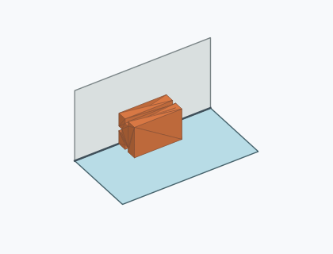](catalogue/grouped_10000/moving/poses/P002.png) | 1,608 | 16.08% | 1,608 | 16.08% |
| P003 <code>Rk2i_0002</code> | G3 |  | 1,520 | 15.20% | 1,520 | 15.20% |
| P004 <code>Rk2i_0005</code> | G4 |  | 637 | 6.37% | 637 | 6.37% |
| P005 <code>Rk2i_0006</code> | G5 |  | 616 | 6.16% | 616 | 6.16% |
| P006 <code>Rk2i_0010</code> | G6 |  | 598 | 5.98% | 598 | 5.98% |
| P007 <code>Rk2i_0009</code> | G7 |  | 596 | 5.96% | 596 | 5.96% |
| P008 <code>Rk2i_0011</code> | G8 |  | 285 | 2.85% | 285 | 2.85% |
| P009 <code>Rk2i_0003</code> | G9 |  | 275 | 2.75% | 275 | 2.75% |
| P010 <code>Rk2i_0012</code> | G10 | [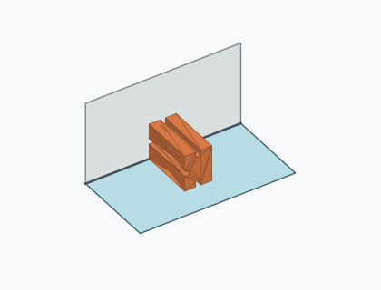](catalogue/grouped_10000/moving/poses/P010.png) | 255 | 2.55% | 255 | 2.55% |
| P011 <code>Rk2i_0001</code> | G11 |  | 249 | 2.49% | 249 | 2.49% |

Outcomes from the archived run: settled 9,997, unsettled 3.

## Stationary belt

9,985 of 10,000 trials settled. The catalogue contains 24 poses in 18 groups. This condition uses seated tipping-barrier grouping with a whole-group diameter limit.

| Pose | Group | Preview | Pose drops | Pose incidence | Group drops | Group incidence |
| --- | --- | --- | ---: | ---: | ---: | ---: |
| P000 <code>Rk2i_0014</code> | G0 | [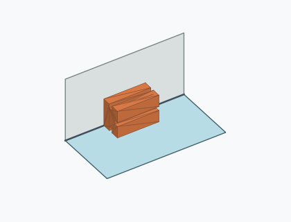](catalogue/grouped_10000/stationary/poses/P000.png) | 1,731 | 17.31% | 1,731 | 17.31% |
| P001 <code>Rk2i_0004</code> | G1 | [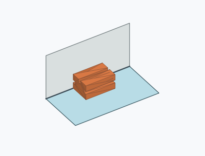](catalogue/grouped_10000/stationary/poses/P001.png) | 1,671 | 16.71% | 1,671 | 16.71% |
| P002 <code>Rk2i_0012</code> | G2 |  | 1,564 | 15.64% | 1,564 | 15.64% |
| P003 <code>Rk2i_0003</code> | G3 | [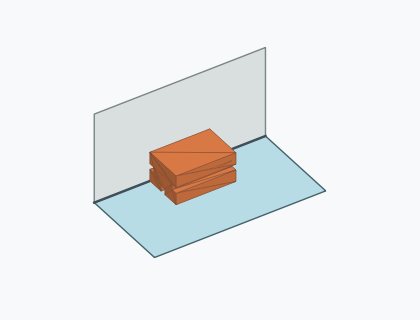](catalogue/grouped_10000/stationary/poses/P003.png) | 1,505 | 15.05% | 1,505 | 15.05% |
| P004 <code>Rk2i_0005</code> | G4 | [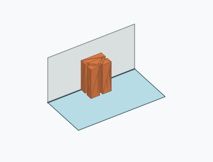](catalogue/grouped_10000/stationary/poses/P004.png) | 628 | 6.28% | 628 | 6.28% |
| P005 <code>Rk2i_0007</code> | G5 |  | 620 | 6.20% | 627 | 6.27% |
| P006 <code>Rk2i_0013</code> | G6 | [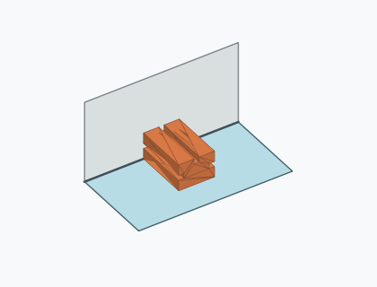](catalogue/grouped_10000/stationary/poses/P006.png) | 599 | 5.99% | 599 | 5.99% |
| P007 <code>Rk2i_0015</code> | G7 | [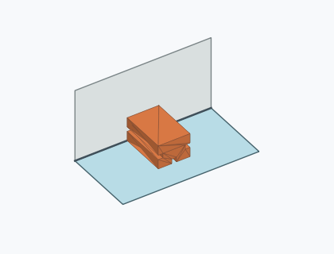](catalogue/grouped_10000/stationary/poses/P007.png) | 560 | 5.60% | 560 | 5.60% |
| P008 <code>Rk2i_0006</code> | G8 |  | 279 | 2.79% | 279 | 2.79% |
| P009 <code>Rk2i_0022</code> | G9 |  | 278 | 2.78% | 278 | 2.78% |
| P010 <code>Rk2i_0023</code> | G10 |  | 267 | 2.67% | 267 | 2.67% |
| P011 <code>Rk2i_0001</code> | G11 | [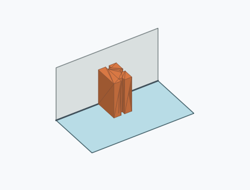](catalogue/grouped_10000/stationary/poses/P011.png) | 263 | 2.63% | 265 | 2.65% |
| P012 <code>Rk2i_0021</code> | G5 | [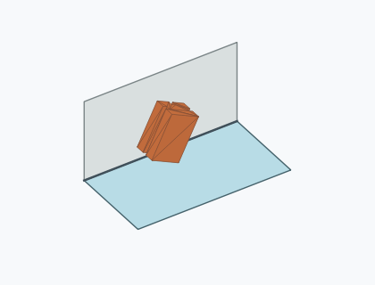](catalogue/grouped_10000/stationary/poses/P012.png) | 4 | 0.04% | 627 | 6.27% |
| P013 <code>Rk2i_0019</code> | G5 | [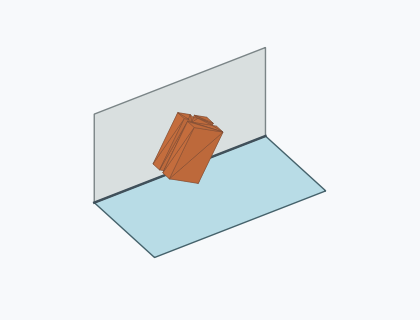](catalogue/grouped_10000/stationary/poses/P013.png) | 3 | 0.03% | 627 | 6.27% |
| P014 <code>Rk2i_0008</code> | G12 |  | 2 | 0.02% | 5 | 0.05% |
| P015 <code>Rk2i_0009</code> | G12 |  | 2 | 0.02% | 5 | 0.05% |
| P016 <code>Rk2i_0018</code> | G13 | [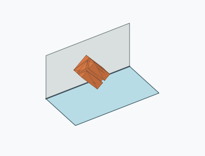](catalogue/grouped_10000/stationary/poses/P016.png) | 2 | 0.02% | 2 | 0.02% |
| P017 <code>Rk2i_0002</code> | G11 | [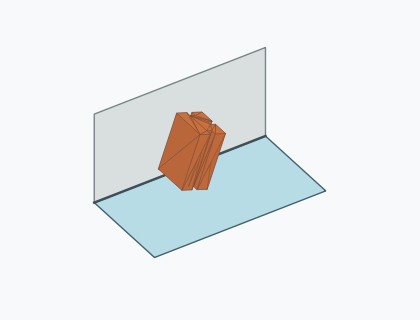](catalogue/grouped_10000/stationary/poses/P017.png) | 1 | 0.01% | 265 | 2.65% |
| P018 <code>Rk2i_0010</code> | G12 |  | 1 | 0.01% | 5 | 0.05% |
| P019 <code>Rk2i_0011</code> | G14 | [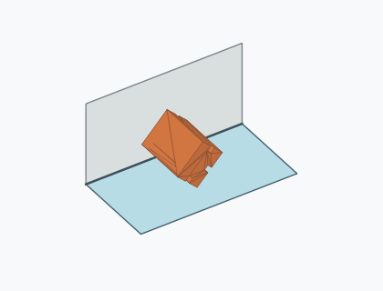](catalogue/grouped_10000/stationary/poses/P019.png) | 1 | 0.01% | 1 | 0.01% |
| P020 <code>Rk2i_0016</code> | G15 | [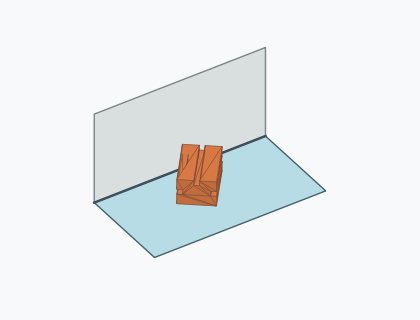](catalogue/grouped_10000/stationary/poses/P020.png) | 1 | 0.01% | 1 | 0.01% |
| P021 <code>Rk2i_0017</code> | G16 | [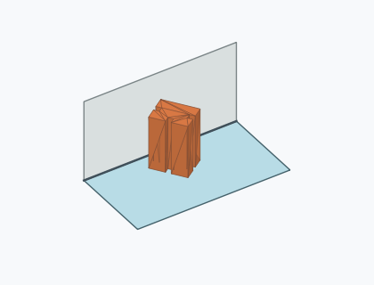](catalogue/grouped_10000/stationary/poses/P021.png) | 1 | 0.01% | 1 | 0.01% |
| P022 <code>Rk2i_0020</code> | G17 | [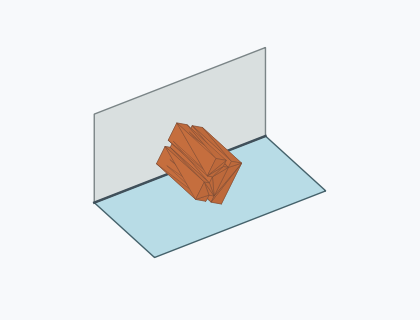](catalogue/grouped_10000/stationary/poses/P022.png) | 1 | 0.01% | 1 | 0.01% |
| P023 <code>Rk2i_0024</code> | G11 | [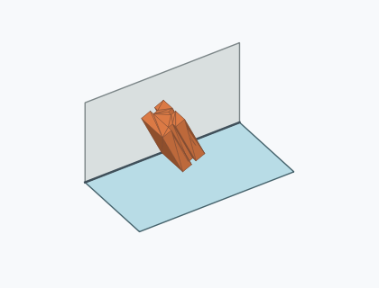](catalogue/grouped_10000/stationary/poses/P023.png) | 1 | 0.01% | 265 | 2.65% |

Outcomes from the archived run: settled stationary 9,985, unsettled stationary 15.

## Data and source runs

- **Moving belt** · [Catalogue JSON](catalogue/grouped_10000/moving/catalogue.json) · [Grouping evidence](catalogue/grouped_10000/moving/grouping-evidence.json) · [Checksums](catalogue/grouped_10000/moving/files.sha256.json) · [Source run and validation](simulations/20261110_10000/100mm_s/README.md) · [Raw run archive](simulations/20261110_10000/100mm_s/simulation_results.tar.xz)
- **Stationary belt** · [Catalogue JSON](catalogue/grouped_10000/stationary/catalogue.json) · [Grouping evidence](catalogue/grouped_10000/stationary/grouping-evidence.json) · [Checksums](catalogue/grouped_10000/stationary/files.sha256.json) · [Source run and validation](simulations/20261110_10000/static/README.md) · [Raw run archive](simulations/20261110_10000/static/simulation_results.tar.xz)
